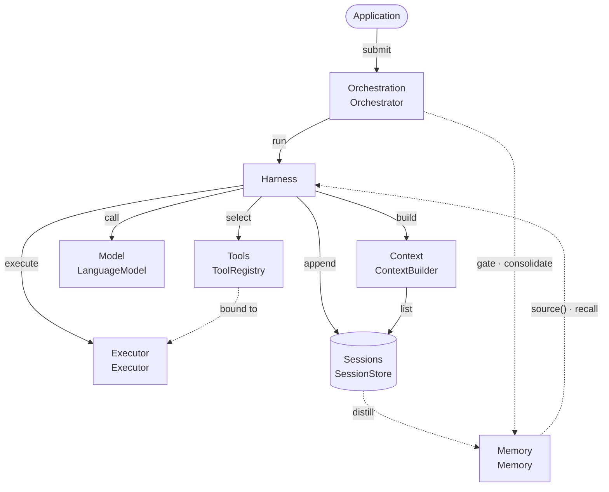
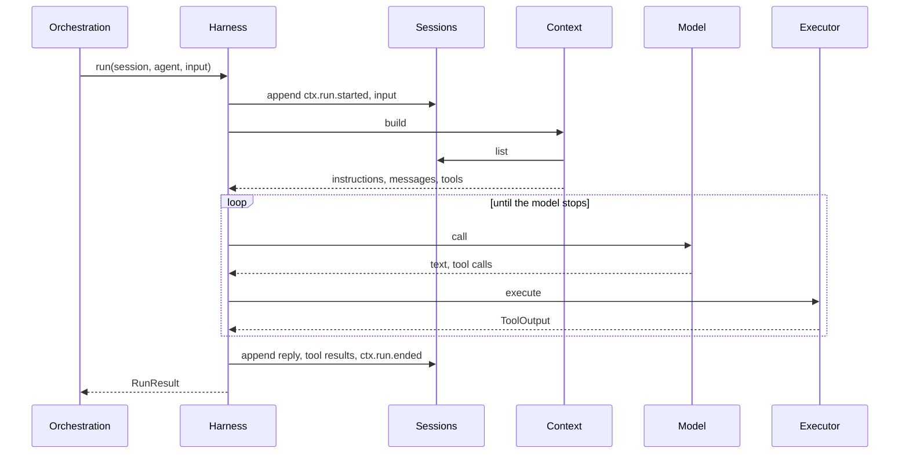

# ctx

A context and runtime framework for agent-native programs, for programs as yet unthought of.

[中文](README.md) is the authoritative version; this translation was last synced on 2026-11-19. The specification is translated too: [Protocol layer](docs/en/protocol.md). The architecture, ADRs and package READMEs are in Chinese only.

An agent is split into seven components: sessions, context, tools, executors, harness, orchestration and models. Each component has one protocol, components interact only through protocols, and any one of them can be replaced on its own. Sessions, executors, the harness, orchestration and the memory store also have a wire form (HTTP, with a JSON Schema, an OpenAPI document and conformance tests you run against an address), so they can live in another process or be hosted elsewhere, and can be implemented in other languages; context, the tool catalog and models stay in the same process as the harness. Sessions can be in memory, SQLite or third-party storage, executors can be local processes or containers, and the harness and orchestration can be remote services; models reach any provider through Vercel AI SDK v7. The eighth component, memory, distills facts, lessons and a profile that last across sessions from the session logs.

## Architecture



Solid lines are protocol calls within a run; dashed lines are bindings and how memory plugs in. Protocols carry only JSON, so [`ctx-remote`](packages/remote) can put any component on the other side of HTTP. The session log is append-only and the single source of truth; the harness and executors can crash or be swapped at any time, and resuming reads from the log. Memory only reads the log and plugs in through existing extension points (`ContextSource`, `Executor`).

The order of a run:



Components, terms and design constraints are in [概念](docs/concepts.md) (concepts), signatures and JSON shapes in the [protocol layer](docs/en/protocol.md), and the reference implementation in [架构](docs/architecture.md) (architecture).

## Packages

| Layer           | Package                                                      | Purpose                                                                                                                       |
| --------------- | ------------------------------------------------------------ | ----------------------------------------------------------------------------------------------------------------------------- |
| Protocol        | [`@modelctx-ai/ctx-protocol`](packages/protocol)             | Interfaces, JSON shapes, pure functions and contract tests of the nine protocols                                              |
| Implementations | [`@modelctx-ai/ctx`](packages/core)                          | The in-process reference implementation, with the facade `createContext()`                                                    |
|                 | [`@modelctx-ai/ctx-sqlite`](packages/sqlite)                 | Session and memory stores on `node:sqlite`                                                                                    |
|                 | [`@modelctx-ai/ctx-models`](packages/models)                 | Builds a `LanguageModel` and decision and extraction models from configuration                                                |
|                 | [`@modelctx-ai/ctx-memory`](packages/memory)                 | Memory: gating, recall, consolidation, forgetting                                                                             |
|                 | [`@modelctx-ai/ctx-mcp`](packages/mcp)                       | MCP servers as executors                                                                                                      |
|                 | [`@modelctx-ai/ctx-exec`](packages/exec)                     | Local subprocess executor                                                                                                     |
|                 | [`@modelctx-ai/ctx-remote`](packages/remote)                 | HTTP servers and clients for sessions, executors, harness, orchestration, memory                                              |
|                 | [`@modelctx-ai/ctx-gateway`](packages/gateway)               | A local OpenAI-compatible gateway that swaps a client's own history for ctx's context                                         |
|                 | [`@modelctx-ai/ctx-otel`](packages/otel)                     | OpenTelemetry spans derived from session logs                                                                                 |
|                 | [`@modelctx-ai/ctx-claude-code`](packages/claude-code)       | Claude Code as a harness: its trajectory goes into the log as it runs, tools come back to ctx over MCP                        |
|                 | [`@modelctx-ai/ctx-pi`](packages/pi)                         | pi as a harness: its trajectory goes into the log as it runs, tools come back to ctx over MCP                                 |
|                 | [`@modelctx-ai/ctx-managed-agents`](packages/managed-agents) | Claude Managed Agents as a harness: its event stream goes into the log as it runs, ctx tools come back to ctx as custom tools |
|                 | [`ctx-pydantic-ai`](python/pydantic-ai) (Python)             | pydantic-ai's `Agent` as a harness, served over the wire protocol                                                             |
| Practice        | [modelctx-ai/yoyo](https://github.com/modelctx-ai/yoyo)      | A resident desktop-pet director built from these packages; see [实践：yoyo](docs/repos.md)                                    |

## Quick start

Not on npm yet. For now, clone ctx next to your project, run `pnpm install && pnpm build` in ctx, and link it from your project with `overrides` in `pnpm-workspace.yaml` (see [ADR 0002](docs/adr/0002-packages.md#使用方式)); once published, drop the `overrides` and install as usual:

<details>
<summary><code>pnpm-workspace.yaml</code></summary>

```yaml
overrides:
  '@modelctx-ai/ctx': link:../ctx/packages/core
  '@modelctx-ai/ctx-claude-code': link:../ctx/packages/claude-code
  '@modelctx-ai/ctx-exec': link:../ctx/packages/exec
  '@modelctx-ai/ctx-gateway': link:../ctx/packages/gateway
  '@modelctx-ai/ctx-managed-agents': link:../ctx/packages/managed-agents
  '@modelctx-ai/ctx-mcp': link:../ctx/packages/mcp
  '@modelctx-ai/ctx-memory': link:../ctx/packages/memory
  '@modelctx-ai/ctx-models': link:../ctx/packages/models
  '@modelctx-ai/ctx-otel': link:../ctx/packages/otel
  '@modelctx-ai/ctx-pi': link:../ctx/packages/pi
  '@modelctx-ai/ctx-protocol': link:../ctx/packages/protocol
  '@modelctx-ai/ctx-remote': link:../ctx/packages/remote
  '@modelctx-ai/ctx-sqlite': link:../ctx/packages/sqlite
```

</details>

```sh
pnpm add @modelctx-ai/ctx @modelctx-ai/ctx-protocol @modelctx-ai/ctx-models zod
```

```ts
import { createContext, createMemoryStore } from '@modelctx-ai/ctx';
import { createModel } from '@modelctx-ai/ctx-models';

const context = createContext({
  store: createMemoryStore(),
  session: 'demo',
  model: createModel({
    provider: 'openai-compatible',
    baseUrl: 'https://api.deepseek.com/v1',
    apiKey: process.env.DEEPSEEK_API_KEY,
    model: 'deepseek-chat',
  }),
});

const first = await context.generate({
  instructions: 'Answer in one sentence.',
  input: 'Is a tomato a fruit or a vegetable?',
});
console.log(first.text);

// The previous question and answer are already in the log, so this run includes them
const second = await context.generate({ instructions: 'Answer in one sentence.', input: 'And when cooking?' });
console.log(second.text);
```

Persistence, events and projections, tools, the harness, the orchestrator and the gateway are covered in each package's README.

Complete examples you can run are in [`examples/`](examples/README.md): a single process, storage and executor deployed apart, two processes sharing one database, memory plugged into context, and moving a session to another store; without keys they use scripted models.

## Development

```sh
pnpm install
pnpm check
```

Node ≥22.18, pnpm 10. Commands, the toolchain and conventions for changing code are in [AGENTS.md](AGENTS.md); the documentation starts at [docs/index.md](docs/index.md).

## License

[Apache-2.0](LICENSE)
