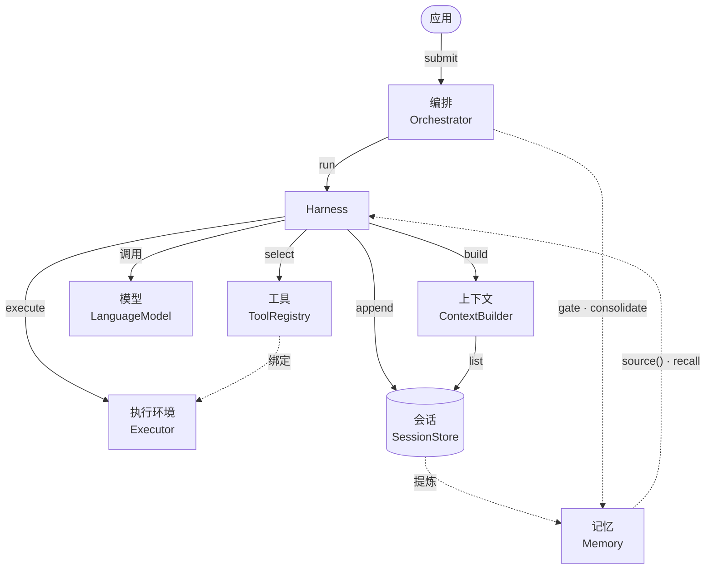
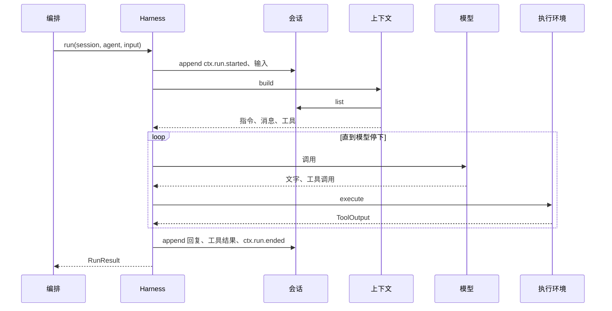

# ctx

面向 agent 原生程序的上下文与运行框架，for programs as yet unthought of。

一个 agent 被拆成七个组件：会话、上下文、工具、执行环境、harness、编排、模型。每个组件一个协议，组件之间只通过协议交互：任何一个都能单独替换，也能放在任何地方托管。会话可以在内存、SQLite 或第三方存储，执行环境可以是本机进程或容器，harness 和编排可以是远端服务；模型经 Vercel AI SDK v7 接任何服务商。第八个组件记忆从会话日志里提炼跨会话的事实、经验和画像。

## 架构



实线是一轮里的协议调用，虚线是绑定和记忆的接入。协议只收发 JSON，[`ctx-remote`](packages/remote) 能把任何一个组件放到 HTTP 另一侧。会话日志只追加，是唯一的真相；harness 和执行环境随时可以崩、可以换，续跑从日志读。记忆只读日志，经已有的扩展点（`ContextSource`、`Executor`）接进来。

一轮的顺序：



组件、术语和设计约束见[概念](docs/concepts.md)，签名和 JSON 形状见[协议层](docs/protocol.md)，参考实现见[架构](docs/architecture.md)。

## 包

| 层   | 包                                                      | 作用                                                          |
| ---- | ------------------------------------------------------- | ------------------------------------------------------------- |
| 协议 | [`@modelctx-ai/ctx-protocol`](packages/protocol)        | 九个协议的接口、JSON 形状、纯函数、契约测试                   |
| 实现 | [`@modelctx-ai/ctx`](packages/core)                     | 进程内参考实现，门面 `createContext()`                        |
|      | [`@modelctx-ai/ctx-sqlite`](packages/sqlite)            | `node:sqlite` 的会话存储和记忆存储                            |
|      | [`@modelctx-ai/ctx-models`](packages/models)            | 按配置造 `LanguageModel` 和决策、提取模型                     |
|      | [`@modelctx-ai/ctx-memory`](packages/memory)            | 记忆：门控、召回、巩固、遗忘                                  |
|      | [`@modelctx-ai/ctx-mcp`](packages/mcp)                  | MCP 服务器作为执行环境                                        |
|      | [`@modelctx-ai/ctx-exec`](packages/exec)                | 本机子进程执行环境                                            |
|      | [`@modelctx-ai/ctx-remote`](packages/remote)            | 会话、执行环境、harness、编排、记忆的 HTTP 服务端和客户端     |
|      | [`@modelctx-ai/ctx-gateway`](packages/gateway)          | 本机 OpenAI 兼容网关，把客户端带来的历史换成 ctx 的上下文     |
| 实践 | [modelctx-ai/yoyo](https://github.com/modelctx-ai/yoyo) | 用这些包组合出来的常驻桌宠导演，见[实践：yoyo](docs/repos.md) |

## 快速开始

还没有发布到 npm。现在把 ctx 克隆在使用方旁边，先在 ctx 里 `pnpm install && pnpm build`，使用方在 `pnpm-workspace.yaml` 里用 `overrides` 链接过来（见 [ADR 0002](docs/adr/0002-packages.md#使用方式)）；发布以后删掉 `overrides`，照常安装：

<details>
<summary><code>pnpm-workspace.yaml</code></summary>

```yaml
overrides:
  '@modelctx-ai/ctx': link:../ctx/packages/core
  '@modelctx-ai/ctx-exec': link:../ctx/packages/exec
  '@modelctx-ai/ctx-gateway': link:../ctx/packages/gateway
  '@modelctx-ai/ctx-mcp': link:../ctx/packages/mcp
  '@modelctx-ai/ctx-memory': link:../ctx/packages/memory
  '@modelctx-ai/ctx-models': link:../ctx/packages/models
  '@modelctx-ai/ctx-protocol': link:../ctx/packages/protocol
  '@modelctx-ai/ctx-remote': link:../ctx/packages/remote
  '@modelctx-ai/ctx-sqlite': link:../ctx/packages/sqlite
```

</details>

```sh
pnpm add @modelctx-ai/ctx @modelctx-ai/ctx-protocol @modelctx-ai/ctx-models zod
```

```ts
import { createContext, createMemoryStore } from '@modelctx-ai/ctx';
import { createModel } from '@modelctx-ai/ctx-models';

const context = createContext({
  store: createMemoryStore(),
  session: 'demo',
  model: createModel({
    provider: 'openai-compatible',
    baseUrl: 'https://api.deepseek.com/v1',
    apiKey: process.env.DEEPSEEK_API_KEY,
    model: 'deepseek-chat',
  }),
});

const first = await context.generate({ instructions: '回答控制在一句话。', input: '番茄是水果还是蔬菜？' });
console.log(first.text);

// 上一轮的问和答已经写进日志，这一轮自动带上
const second = await context.generate({ instructions: '回答控制在一句话。', input: '那做菜的时候呢？' });
console.log(second.text);
```

持久化、事件和投影、工具、harness、编排器、网关的用法见各包的 README。

## 开发

```sh
pnpm install
pnpm check
```

Node ≥22.18，pnpm 10。命令、工具链和改代码的约定见 [AGENTS.md](AGENTS.md)，文档入口是 [docs/index.md](docs/index.md)。

## 许可

[Apache-2.0](LICENSE)
