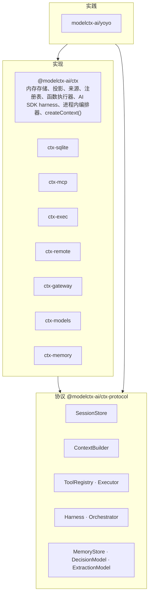
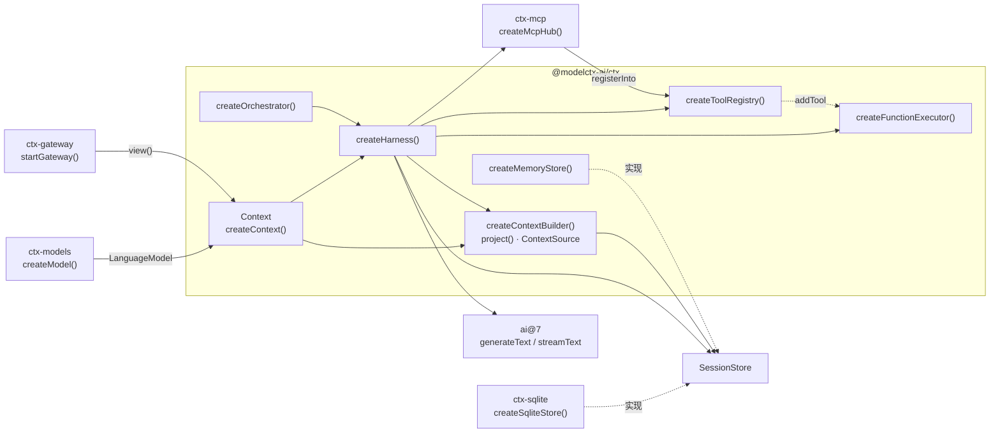
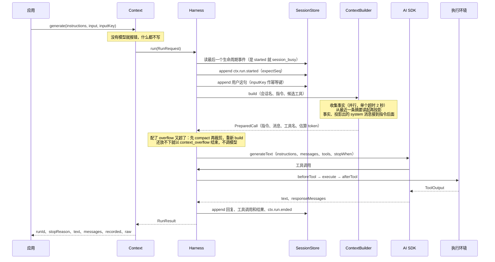
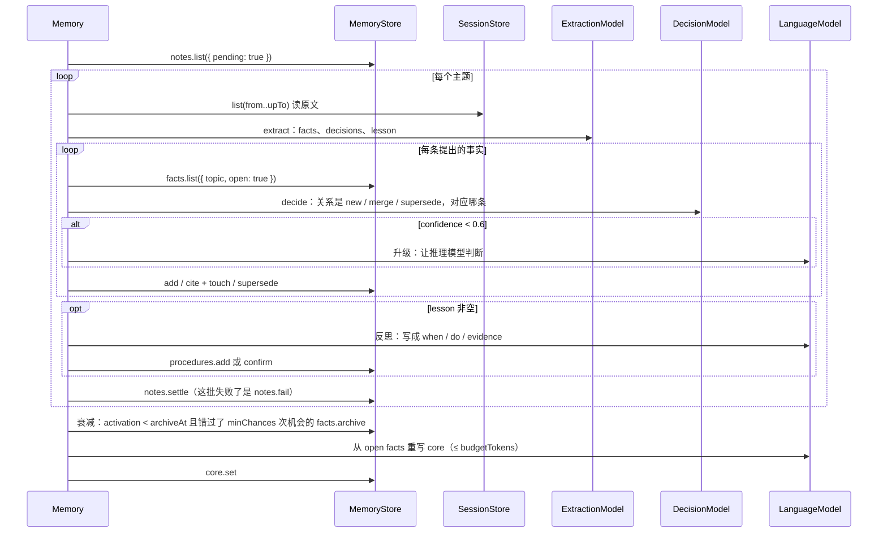
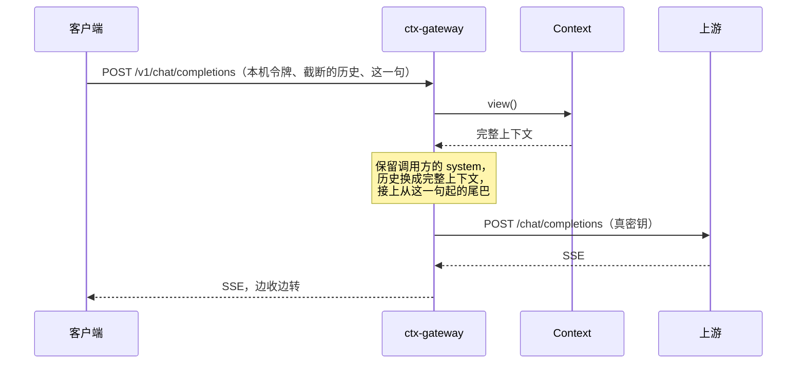

# 架构：进程内参考实现

ctx 分三层：协议（`@modelctx-ai/ctx-protocol`，只有接口）、实现（`@modelctx-ai/ctx` 和 `ctx-*`）、实践（yoyo）。组件和协议的说明见[概念](concepts.md)和[协议层](protocol.md)。本文写的是实现层里进程内的那一份：`@modelctx-ai/ctx` 的会话存储、上下文（投影、来源、压缩）、工具注册表、函数执行环境、harness、编排器和组合门面 `createContext()`，以及 sqlite、models、mcp、gateway 四个适配包。记忆的参考实现（`ctx-memory`，及 sqlite、models、remote 里的记忆部分）在[记忆](#记忆)一节；它的设计见[记忆](memory.md)。



## 概念

| 概念                    | 说明                                                                                                                         |
| ----------------------- | ---------------------------------------------------------------------------------------------------------------------------- |
| 会话 `session`          | 一个 agent 实例的日志的名字，例如 `pet:main`、`user:42`。条目按会话存放                                                      |
| 条目 `Entry`            | 会话里的一条记录，分 `message`、`event`、`summary` 三种，写入后不再修改（应用明确擦除的除外）                                |
| 位置 `seq`              | 存储按写入顺序分配的序号，会话内严格递增、从 1 起。`at` 是逻辑时间（毫秒），只用于投影排序和展示                             |
| 会话存储 `SessionStore` | 只追加的持久化边界：`append`、`list`、`sessions`、`watch`，加上删除 `clear`、`truncate`、`remove` 和涂改 `redact`            |
| 投影 `project()`        | 把条目渲染成这一次交给模型的 `Message[]`（ctx 自己的 JSON 消息，harness 调模型时转成 AI SDK 的），每次调用重新计算，不改日志 |
| 来源 `ContextSource`    | 调用那一刻才去取的上下文，取到的文字叫事实 `Fact`，不写日志                                                                  |
| 上下文 `ContextBuilder` | `createContextBuilder()`：投影 + 来源 + 压缩，把会话组装成一次调用的指令、消息和工具名单                                     |
| 工具目录 `ToolRegistry` | `createToolRegistry()`：工具定义（名字、说明、JSON Schema）放在一处，每个绑一个执行环境                                      |
| 执行环境 `Executor`     | 工具调用真正发生的地方。核心包有进程内的 `createFunctionExecutor()`，MCP hub 也是一个                                        |
| Harness                 | `createHarness()`：跑一轮，组装 → 调模型 → 分发工具 → 写回，前后写 `ctx.run.started` / `ctx.run.ended`                       |
| 编排器 `Orchestrator`   | `createOrchestrator()`：进程内队列，同一会话串行，不同会话并行，崩溃后补 `ctx.run.ended`                                     |
| 门面 `Context`          | `createContext()` 的返回值：在一个会话上把上面几样组合起来，带投影规则、来源、工具和缺省模型                                 |

## 组件



实线是调用或提供，虚线是实现接口。

## 一次 generate

`context.generate()` 把参数换成一个 `RunRequest`（`AgentSpec` 里是模型、指令、工具名单、步数和调用参数），交给 harness：



`Context` 的方法：

| 方法 / 字段                      | 作用                                                                                |
| -------------------------------- | ----------------------------------------------------------------------------------- |
| `append(...entries)`             | 追加条目，返回真正写入的那些                                                        |
| `entries(options?)`              | 读原始条目，参数同 `SessionStore.list`                                              |
| `view({ window? })`              | 当前交给模型的历史：最近一条摘要和它之后的条目，按投影规则渲染                      |
| `facts(signal?)`                 | 收集一次事实                                                                        |
| `prepare(options)`               | 组装指令、消息和工具（包成 AI SDK `ToolSet`），不调用模型                           |
| `generate(options)`              | 经 harness 跑一轮（`generateText`）；模型出错或被取消时抛出原来的错误               |
| `stream(options)`                | 经 harness 跑一轮（`streamText`），流结束后记录；返回 `{ runId, result, recorded }` |
| `compact(options)`               | 把较早的历史压成摘要（太长时分段滚动）；这次没写下摘要时返回 `null`                 |
| `compactDetailed(options)`       | 同上，返回怎么收场的：`status`、写下的摘要、调了几次模型、压了几条、截短了几条      |
| `builder`、`executor`、`harness` | 内部的 `ContextBuilder`、函数执行环境和 harness，直接用就是协议的接口               |
| `session`                        | 会话名                                                                              |

## 条目

| 类型      | 字段                                | 怎么进模型上下文                                                     |
| --------- | ----------------------------------- | -------------------------------------------------------------------- |
| `message` | `message: Message`                  | ctx 的 JSON 消息（文字、文件、推理、工具调用和结果），投影时原样带上 |
| `event`   | `kind`、`text?`、`data?: JsonValue` | 应用自己的事件。缺省不可见，`projection.events[kind]` 有规则才渲染   |
| `summary` | `text`、`covers: number`            | 压缩点：代替 `seq` ≤ `covers` 的全部条目，固定在第一条               |

公共字段：

| 字段             | 说明                                                                               |
| ---------------- | ---------------------------------------------------------------------------------- |
| `id`             | 全局唯一；不给就由存储生成                                                         |
| `session`、`seq` | 由存储填                                                                           |
| `v`              | 写入这一行时的格式版本，由存储填；读出来的形状永远是当前版本，旧行读时升级、不回写 |
| `at`             | 逻辑时间，缺省是写入时刻。导入的旧记录写原来的时间，会排回原来的位置               |
| `key`            | 幂等键：同一会话里键相同的第二条被跳过                                             |
| `source`         | 谁写的，例如 `user`、`model`、`harness`、`dsh-pet`                                 |
| `meta`           | 任意 JSON 对象                                                                     |

用 `userEntry(content)`、`assistantEntry(text)`、`messageEntry(message)`、`eventEntry(kind, { text, data })` 构造条目，都接受 `{ id, at, key, source, meta }`。摘要条目一般由 `compact()` 写。事件 `kind` 用 `{domain}.{action}`，`ctx.` 前缀留给框架：harness 写 `ctx.run.started`、`ctx.run.ended`、`ctx.error`，压缩写 `ctx.compacted`，缺省都对模型不可见。

## 存储

| 方法                                                           | 行为                                                                                                                                                                                                                                                                                                                                                                  |
| -------------------------------------------------------------- | --------------------------------------------------------------------------------------------------------------------------------------------------------------------------------------------------------------------------------------------------------------------------------------------------------------------------------------------------------------------- |
| `append(session, entries, { expectSeq? })`                     | 追加，一批是原子的。`id` 重复或同会话 `key` 重复的条目静默跳过，其余照写；返回真正写入的条目（已带 `id`、`seq`、`at`）。给了 `expectSeq` 而会话末尾 `seq` 不等于它（空会话是 0）时整批不写，抛 `conflict`（`retryable`），检查先于去重                                                                                                                                |
| `list(session, { after, last, limit, types, kinds, atAfter })` | 按 `seq` 升序（写入顺序）。`after` 是 `seq`，不含；`last` 取 `seq` 最大的 N 条，仍升序，小数向下取整，不是有限正数时返回空；`limit` 取过滤之后最早的 N 条，和 `after` 配合翻页（和 `last` 同时给时先取 `last`）；`kinds` 只要 `kind` 在其中的事件（消息和摘要不返回），与 `types` 取交集；`atAfter` 只要 `at` 大于它的，`NaN` 不过滤；都可以组合，`last` 在过滤之后取 |
| `clear(session)`                                               | 删掉整个会话，返回条数。不留记录，末尾回到 0                                                                                                                                                                                                                                                                                                                          |
| `truncate(session, upTo)`                                      | 删掉 `seq ≤ upTo` 的条目，返回条数。`upTo` 小数向下取整，不是有限数时不删                                                                                                                                                                                                                                                                                             |
| `remove(session, ids)`                                         | 按 `id` 真删，返回条数；认不得的、别的会话的 `id` 跳过。读不了的行也删得掉                                                                                                                                                                                                                                                                                            |
| `redact(session, ids)`                                         | 按 `id` 涂改：条目变成 `ctx.redacted` 事件，`id`、`seq`、`at`、`key`、`source` 留着，内容和 `meta` 去掉；已经涂改过的跳过                                                                                                                                                                                                                                             |
| `sessions({ prefix, after, limit })`                           | 有内容的会话，按名字升序（码点序）。`prefix` 按字面匹配，`after` 是上一页最后一个名字（不含），`limit` 限条数，小数向下取整，不是正数时返回空；都不给就是全部                                                                                                                                                                                                         |
| `watch(session, { after, signal })`                            | 先给出 `after` 之后已有的条目，再持续给出新写入的，直到 `signal` 中止                                                                                                                                                                                                                                                                                                 |

实现有 `createMemoryStore()`（核心包，进程内；`watch` 靠内存里的订阅，写入立刻唤醒；写入和读出各拷一份，和落盘的存储一样不把存着的对象交出去）和 `createSqliteStore()`（ctx-sqlite；`watch` 轮询 `list(after)`，一次读一页，缺省每 250ms，别的进程写进同一个库的也能读到；`unreadable: 'placeholder'` 时解不了的行读成 `ctx.unreadable` 事件，见[协议层](protocol.md#会话-sessionstore)）。条目只追加；框架自己不删不改，删除和涂改只在应用调下面这几个方法时发生。

### 删除和保留期

`truncate`、`remove`、`redact` 的规则在[协议层](protocol.md#擦除)，为什么这样定在 [ADR 0007](adr/0007-deletion-and-retention.md)。参考实现怎么做：

- **内存存储**：三个方法都走协议包的纯函数 `eraseEntries`，改条目和追加 `ctx.erased` 在同一个同步段里；`seq` 是全局计数器，擦除不重置它。`remove`、`truncate` 让出 `id` 和 `key`，`redact` 留着。
- **`ctx-sqlite`**：在写锁里（`BEGIN IMMEDIATE`，应用已有事务时用 SAVEPOINT）删行或改行，同一个事务里插入 `ctx.erased`，所以应用的事务回滚时擦除一起回滚。`remove`、`redact` 只按列操作，不解码正文；`id` 多的时候分批，每条语句 500 个。`redact` 把行改成 `type = 'event'`、正文是占位、`meta` 清空、`v` 写当前版本。连接上开着 `secure_delete`，被删、被改掉的内容当场用零覆写；文件不会变小，`vacuum()` 才还空间，细节见[包说明](../packages/sqlite/README.md#删除和文件大小)。
- **`ctx-remote`**：三条 `POST` 路径原样转给服务端挂的存储；客户端不重试它们。
- **`pruneSession(store, session, { keep?, maxAgeMs?, now?, pageSize? })`**（核心包）是保留期：应用自己调，没有定时器。它读生效的摘要（`latestSummary`），把 `seq ≤ covers` 的条目交给 `truncate`，返回删掉的条数；摘要自己和它之后的条目不动，所以模型看到的上下文不变。

  | 选项       | 作用                                                                                                                     |
  | ---------- | ------------------------------------------------------------------------------------------------------------------------ |
  | （都不给） | 被盖住的全删                                                                                                             |
  | `keep`     | 被盖住的条目里最后写入的 N 条留着                                                                                        |
  | `maxAgeMs` | 从最早的条目起往后删，删到第一条 `at` 还在保留期内的为止；补写的旧记录 `at` 早、`seq` 大，排在它前面的没过期就不会删到它 |
  | 两个都给   | 两个条件都放行的才删                                                                                                     |

  选项不是有限的非负数时一条都不删。没有摘要的会话不删。会话里有未结束的运行（最后一个生命周期事件是 `ctx.run.started`）时最多删到它前一条，删到了那一轮会被围栏。给了 `keep` 或 `maxAgeMs` 时要一页一页读被盖住的条目（只为了它们的 `seq` 和 `at`），都不给时只读摘要。

  ```ts
  import { pruneSession } from '@modelctx-ai/ctx';

  await context.compact();
  // 被摘要盖住的历史只留最近 30 天的。
  await pruneSession(store, 'pet:main', { maxAgeMs: 30 * 24 * 60 * 60 * 1000 });
  ```

- 擦除和记忆：记忆的笔记和事实用 `seq` 区间指回日志当证据，`truncate`、`remove` 之后证据区间里可能读不到条目，`redact` 之后读到的是占位；还没过门控（`gate`）的条目被删掉就进不了记忆，所以先 `gate` 再清。从这些条目提取出来的事实、画像不会跟着删，那是记忆自己的删除。

## 投影

`project(entries, options)` 按顺序做六步，要截短时是七步：

1. 按 `(at, seq)` 排序（`compareEntries`）：补写的旧记录排回逻辑上的位置。
2. 选摘要：`covers` 最大的那条生效，相同时后写（`seq` 大）的生效。`seq` ≤ `covers` 的条目不再出现，摘要之后补写的旧记录（`seq` > `covers`）仍然可见；摘要用 `options.summary` 渲染（缺省是一条用户消息 `Summary of the earlier conversation:\n…`），固定在第一条，不参与裁剪。
3. 消息条目原样带上。`options.message(entry)` 可以改写，返回空就丢掉。
4. 事件条目：没有规则的 `kind` 跳过，也不打断前后同类事件的合并。`fold: true` 的规则把连续的同类事件合成一组交给 `render(events)`；`render` 返回一条消息、多条消息，或者空（丢掉）。
5. 配对：工具结果找不到对应的调用（按调用 `id`）就去掉；工具调用没有结果（运行断在中间）就在它后面补一条错误结果 `No result was recorded for this tool call.`，服务商自己执行的调用（`providerExecuted`）不补。
6. 窗口：开头孤立的工具结果（它的调用已经被摘要盖住或被裁掉）总是丢掉。设了 `maxMessages` 或 `maxTokens` 时，从最旧的消息开始整组丢弃直到不超；带工具调用的助手消息和紧跟的工具结果是一组。裁过之后如果没有摘要、开头又不是用户消息，接着裁到下一条用户消息（后面没有用户消息了就不再裁）。至少留下最后一组，宁可超预算也不交出空上下文。
7. 截短（只在 `window.truncate` 为 `true`、又给了 `maxTokens` 时）：第 6 步之前先给单条消息封顶——从最新的一组往回看，超过历史预算（`maxTokens` 减去摘要）一半的消息截到一半，累计超过预算就停，更早的反正要丢，不白截；第 6 步之后只剩最后一组还超，从最大的消息接着截，每条最少留 32 个 token，摘要最后才动。截法是 `truncateMessage`（见[协议层](protocol.md#上下文-contextbuilder)）。

这样不管日志里是什么样、窗口裁在哪，交给模型的都是服务商接口收得下的序列。

例子：`whisper` 有 `fold` 规则，`clipboard` 没有规则。

| 日志（按 `seq`）               | 投影                                                        |
| ------------------------------ | ----------------------------------------------------------- |
| `user` 早先的问题              | 被摘要代替                                                  |
| `assistant` 早先的回答         | 被摘要代替                                                  |
| `summary`，`covers` 指向上一条 | `user` Summary of the earlier conversation: …（固定第一条） |
| `event whisper` 在呢           | `assistant` 碎碎念：在呢 / 喝水（合成一条）                 |
| `event clipboard`              | 不可见，也不打断合并                                        |
| `event whisper` 喝水           | 并进上面那条                                                |
| `user` 今天呢？                | `user` 今天呢？                                             |

| 选项                 | 说明                                                                  |
| -------------------- | --------------------------------------------------------------------- |
| `events`             | `Record<kind, EventRule>`，`EventRule` 是 `{ fold?, render(events) }` |
| `summary`            | 摘要渲染成哪条消息                                                    |
| `message`            | 改写或过滤消息条目                                                    |
| `window.maxMessages` | 最多保留几条消息，摘要不算                                            |
| `window.maxTokens`   | 估算 token 的预算，摘要计入                                           |
| `window.truncate`    | 放不下时截短消息，不只是整组丢；缺省不截                              |
| `window.estimate`    | 换掉缺省的 `estimateTokens`                                           |

不设 `window` 就不裁剪：最近一条摘要之后的历史全部带上。

builder 的 `view`、`build` 经 `projectSession` 读会话：有窗口时不把摘要之后的历史整段读出来再裁，只读够用的尾部。先读最后 256 条（再加 `maxMessages` 的四倍），用 `atAfter` 补上 `at` 排在这段之后的更早的条目，投影一次；窗口挤掉的组比开头可能不完整的那几组多，结果就和读整段一样，否则读 4 倍那么多再来。30 万条、没压缩过的会话，`maxMessages: 20` 的 `view` 读几百条。只读了尾部时 `dropped` 只数读到的那部分。压缩（`compact`）要看全部，照旧读整段；`ContextSpec.inherit` 的父会话也读整段。

投影照常输出 `system` 消息（例如摘要渲染成 `system`）；组装调用时 builder 把它们从消息里拿出来，接到指令后面（见[调用](#调用)）。

结果 `Projection`：`messages`；`items`，每条带 `from`、`upTo`（它来自的条目里最小和最大的 `seq`）、`at`（来自的条目里最晚的 `at`）、`pinned`、`tokens`；`tokens` 合计；`dropped` 被丢掉的消息条数（`projectSession` 只读了尾部时只数读到的部分）；`truncated` 被截短的消息条数；`summary` 生效的摘要条目。

缺省的 token 估算不依赖分词器：中日韩文字一个字约 1 token，ASCII 约 4 个字符 1 token，其余文字（西里尔、阿拉伯、表情……）约 2 个字符 1 token，每条消息另加 4。附件按 `estimateFileTokens`：内联文字按字数，base64 按解码后的大小（图片 64 KiB 以内 256、更大 1600；文本类按字节数除以 4；其余每 20 字节 1 个、至少 256），只有地址或服务商引用、不知道大小的按 256；工具结果里的文件一样算。只用于预算和裁剪，不用于计费。

## 调用

`createContextBuilder({ store, projection, projections, sources, sourceTimeoutMs, logger, factsPlacement, model, models, now, calibrate })` 的 `build(request)` 组装一次调用，`context.prepare(options)` 是它加上工具的 `ToolSet`：

1. 收集事实（`facts: false` 跳过；`FactsSpec.sources` 只用指定的来源）。投影名先认：不认识就以 `not_found` 失败，不回退，也不先去收事实。
2. 读视图：只读最近一条摘要和它之后的条目，再投影。请求带了 `window` 就整个换掉投影里配的上限（`{}` 是不裁剪），`estimate` 始终用投影里配的。`build` 时 `maxTokens` 先扣掉历史之外已经占掉的部分——指令、事实、工具定义、`input`、`prompt` 的估算——剩下的才是历史的预算，所以它管的是整次调用；`view` 没有这些，不扣。
3. 指令：`instructions` 是字符串时，事实追加在后面，用空行隔开；（`createContext` 里）是函数时把事实传进去，由函数决定怎么写。
4. 投影里的 `system` 消息（摘要、事件规则或 `message` 钩子渲染成的，以及存成消息条目的）不放进 `messages`，文字按顺序接在指令最后，同样用空行隔开。
5. 消息：视图 + `input`（这一轮用户说的话）+ `prompt`（最后一条临时用户消息；可以是函数，拿到事实）。
6. 工具：`build` 收候选的 `ToolDefinition[]`，给出工具名单；`context.prepare` 的 `tools` 缺省是注册表里全部，`false` 不给，名字列表、`{ names, tags, sources }` 或 `(definition) => boolean` 筛选。
7. `PreparedCall.tokens`：第 2 步扣掉的那部分加上历史的估算，也就是整次调用的估算。harness 的超窗检查用它（见 [Harness](#harness)），也把它记进第一步的 `StepMeta.estimatedInputTokens`。

估算不分词，偏差随文字和服务商而变。builder 拿上一轮的实际用量校准（`calibrate`，缺省开着）：往回最多看 64 条消息，找上一轮第一步的 `meta.step`，`usage.inputTokens` 比 `estimatedInputTokens` 多几倍（样本里已经乘过的 `calibration` 换算回去再比，所以不会来回摆），这一轮 `maxTokens` 就按估算的单位收紧几倍，`PreparedCall.tokens` 乘上它，`PreparedCall.calibration` 记下倍数。只往小里收（估算偏高时不放宽），最多 `MAX_CALIBRATION`（4）倍；投影接了自己的 `window.estimate`（分词器）时不校准。`view` 带 `maxTokens` 时一样校准。样本只有一个、按会话取，同一个会话换了模型时头一轮还是按上一个模型的偏差算。

`instructions` 和 `prompt` 只要有一个是函数，事实就不再自动放进去；投影出的 `system` 消息照样接上。

`BuildRequest.facts` 可以是 `FactsSpec`（`sources`、`placement`、`heading`），`BuildRequest.projection` 选 `projections` 里的哪一套（缺省 `default`，取 `projections.default`，没有就取 `projection` 选项；每套是完整的，不合并）；harness 把 `AgentSpec.context` 放进去，所以同一个 builder 上不同的 agent 可以收不同的事实、放不同的位置、用不同的投影。`factsPlacement` 是缺省值，`FactsSpec.placement` 按一轮覆盖。

`factsPlacement: 'prompt'` 把事实放进最后一条临时用户消息（接在 `prompt` 前面，没有 `prompt` 时单独一条），指令里不再有事实：system 前缀每次都一样，服务商的提示缓存能命中。缺省 `'instructions'`。

```ts
import { readFile } from 'node:fs/promises';

import { createContext, createMemoryStore, defineSource, renderFacts, type LanguageModel } from '@modelctx-ai/ctx';

declare const model: LanguageModel;

const context = createContext({
  store: createMemoryStore(),
  session: 'pet:main',
  model,
  sources: [
    defineSource('task', () => '当前任务：写周报'),
    // 读不到就抛错：这一次跳过它，记一条告警
    defineSource('todo', async ({ signal }) => `待办：${await readFile('todo.txt', { encoding: 'utf8', signal })}`),
  ],
});

// 指令后面跟着事实：「你是桌宠。\n\n当前任务：写周报\n待办：…」
await context.generate({ instructions: '你是桌宠。', input: '在吗？' });

// 事实放进最后一条临时用户消息；指令里没有事实，prompt 不写日志
const { text } = await context.generate({
  instructions: '只说一句碎碎念。',
  prompt: (facts) => `${renderFacts(facts)}\n请再说一句碎碎念。`,
  record: false,
});
console.log(text);
```

`generate` 和 `stream` 用 AI SDK v7 的 `instructions` 传系统指令、`messages` 传历史，其余设置对应如下：

| `GenerateOptions`                                                                                             | AI SDK                                                                                          |
| ------------------------------------------------------------------------------------------------------------- | ----------------------------------------------------------------------------------------------- |
| `model`                                                                                                       | `model`。缺省用 `createContext` 的 `model`，都没有就报错；字符串原样交给 AI SDK（网关的模型名） |
| `maxSteps`                                                                                                    | `stopWhen: stepCountIs(n)`。缺省有工具 5 步，没有工具 1 步                                      |
| `timeoutMs`                                                                                                   | `timeout`（整次调用，含工具步骤）                                                               |
| `signal`                                                                                                      | `abortSignal`                                                                                   |
| `temperature`、`maxOutputTokens`、`topP`、`seed`、`stopSequences`、`maxRetries`、`headers`、`providerOptions` | 同名                                                                                            |

### 记录

| 情况       | `record: true`（缺省）                                                                                                                                                                             | `record: false`                                            |
| ---------- | -------------------------------------------------------------------------------------------------------------------------------------------------------------------------------------------------- | ---------------------------------------------------------- |
| 开始、结束 | 先写 `ctx.run.started`（`runId`、`agent`），最后写 `ctx.run.ended`（`runId`、`stopReason`、`usage`）                                                                                               | 不写                                                       |
| `input`    | 调用模型之前写入日志，组装时已经在视图里；`inputKey` 是它的幂等键                                                                                                                                  | 只放进这一次的消息                                         |
| 模型产出   | `responseMessages` 全部写入：助手消息、工具调用和工具结果，`source: 'model'`                                                                                                                       | 不写。从 `result.messages` 拿，由应用决定什么时候 `append` |
| 模型报错   | `input` 已经在日志里，没有回复；记 `ctx.error` 和 `ctx.run.ended`（`error`）；带同样的 `input` 重试，这句不会再记一遍（给了 `inputKey` 按键去重，没给的由 harness 认出来，见 [Harness](#harness)） | 日志不变                                                   |
| 没有模型   | `createContext` 直接报错，什么都不写                                                                                                                                                               | 直接报错                                                   |

- `generate` 返回 `{ runId, stopReason, text, messages, recorded, raw }`：`recorded` 是这次真正写进日志的条目（含 `ctx.run.*`），`raw` 是 `generateText` 的原始结果。
- `generate` 和 `harness.run` 的差别：模型出错或被取消时，`generate` 为了和 0.1 兼容抛出原来的错误；`harness.run` 不抛，返回 `stopReason: 'error' | 'aborted'` 和 `error`，日志里照样有 `ctx.run.ended`。两者都只在写日志失败时 reject。
- `await context.stream()` 得到 `{ runId, result, recorded }`。`result` 是 AI SDK 的 `StreamTextResult`；`recorded` 在回复写进日志以后给出这次写入的全部条目（含先写的 `ctx.run.started` 和用户这句）：流出错或中止时没有回复，`record: false` 时是 `[]`，只在写日志失败时 reject（同时告警）。读 `recorded` 和读 `result.text` 一样会让流跑完。
- 流出错时调 `onError`；没给 `onError`、上下文也没配 `logger` 时沿用 AI SDK 的缺省处理（`console.error`），配了 `logger` 就记一条告警。
- `prompt` 和事实从不写日志。
- `createContext({ source })`：经这个上下文追加、又没写 `source` 的条目（包括自动记录的 `input`）记成它。

副作用必须先成功的场景用 `record: false`，成功以后再自己追加：

```ts
import { createContext, createMemoryStore, eventEntry, type LanguageModel } from '@modelctx-ai/ctx';

declare const model: LanguageModel;
declare function speak(text: string): Promise<void>; // 应用自己的副作用：合成语音、投喂给桌宠

const context = createContext({ store: createMemoryStore(), session: 'pet:main', model });

const { text } = await context.generate({ instructions: '只说一句。', prompt: '请说一句碎碎念。', record: false });
await speak(text); // 失败就抛出，日志里不会多出一句没说出口的话
await context.append(eventEntry('whisper', { text }));
```

## 压缩

`compact(options)` 把较早的历史压成摘要条目，原条目保留；`compactDetailed(options)` 做同一件事，返回 `CompactResult`：

1. 取完整视图（不裁剪）：当前摘要 + 之后的消息。
2. 最近 `keep`（缺省 12）条原样保留。切点往前挪，保留的部分不以工具结果开头。`at` 还在未来的消息（把到期时间当 `at` 的提醒；「现在」是 `createContextBuilder({ now })`，缺省 `Date.now`）一直排在视图的最后，数「最近 `keep` 条」时不算它们：它们的 `seq` 很小，算进去会把切点钉在自己前面，之后写的消息永远压不了。
3. 切点之前没有消息，或者不到 `minimum`（缺省 8）条，就不压缩、不调模型：`status` 是 `not_needed`。
4. 定 `covers`：被保留的消息里最小的 `from` 减 1，即日志顺序上的切点。进摘要的是投影里 `upTo` ≤ `covers` 的消息：补写的旧记录 `seq` 在切点之后，不进这次摘要，压缩后仍然可见；写在切点之前的未来条目进摘要，写在切点之后的照常留在视图里。`fold` 合并的事件组里混进补写的旧记录时，组的 `from` ≤ `covers` < `upTo`，整组进摘要会重复，所以 `covers` 退到这一组的 `from` 减 1，整组留在视图里；退到不再有横跨的组为止，退到没有可压的就是 `not_needed`。
5. 把消息转成纯文本记录，一条消息几行：`角色: 文字`、`角色 called 工具(输入)`、`工具 returned 结果`。图片、文件只写占位（例如 `[image image/png]`），不带数据；工具调用的输入和工具结果各自最多留约 1000 个估算 token（预算小时是一段预算的四分之一），留头尾、中间写明省略了多少字符。
6. 分段滚动：一次交给摘要模型的输入——压缩指令（`instructions`，缺省是内置的）、到目前为止的摘要、这一段记录——估算不超过 `maxInputTokens`（缺省 `DEFAULT_COMPACT_INPUT_TOKENS`，24000）。放不下就分段，每段用 `temperature: 0`、`maxOutputTokens`（缺省 1024）调一次模型，得到的摘要带进下一段。单条消息的记录就超过一段的预算时截短它（`truncateText`），不然永远过不去。短历史只有一段，输入和不分段时一样。`model` 缺省用上下文的模型。
7. 检查点：每段压完，在同一批里追加一条 `summary`（`covers` 是下一段第一条消息之前）和一条 `ctx.compacted`（`covers`、`summaryId`）。这个位置落不了检查点时（下一段以工具结果开头，或者补写的旧记录让投影顺序和 `seq` 顺序在这里对不上），摘要先带在内存里，到下一个能落的位置再写；最后一段总是写。
8. 中途停下的三种情况都不写那一段，已经落的检查点留着：摘要被 `maxOutputTokens` 截断（`finishReason` 是 `length`，记一条告警，`status` 是 `truncated`）；模型没给出文字（`empty`）；已有的摘要加指令就占满了 `maxInputTokens`、留给记录的不到 200 个估算 token（`input_too_long`，这时不调模型）。摘要模型自己报上下文过长（`isContextOverflowError`，上限配得比它的窗口大，或者估算偏小）时，这一段的预算减半再试，减到放不下也是 `input_too_long`。
9. `timeoutMs` 管整次压缩：每次调模型只给剩下的时间，用完了抛 `timeout`（`CtxError`，`retryable: true`）。模型出错、超时照常抛出；这两种情况已经落的检查点同样留着，再调一次从那里接着压。

`CompactResult` 是 `{ status, summary?, calls, compacted, remaining, shortened }`：`summary` 是这次写下的最后一条摘要，`calls` 是调模型的次数，`compacted`、`remaining` 是进了摘要和没进去的消息条数，`shortened` 是进摘要之前被截短的消息条数。`compact()` 返回 `summary ?? null`：没写下摘要的几种情况它分不开，要分开用 `compactDetailed()`。

新摘要已经包含旧摘要，所以只有 `covers` 最大的那一条生效；之后 `view()` 从它读起。什么时候压缩缺省由应用决定（例如定时、超过阈值）；给 agent 配了 `context.overflow` 时，harness 在上下文超过上限的那一轮先压缩一次（见 [Harness](#harness)）。

窗口和压缩的区别：窗口只影响这一次交给模型的内容，什么都不写；压缩写下一个检查点，以后每次投影都从它开始，被压缩的原条目仍在日志里，要删由应用调 [`pruneSession`](#删除和保留期)。

`recompactLossy`（旧摘要的补救，见[协议层](protocol.md#消息格式和版本)）走同一套分段，但中途不落检查点：它的新摘要和旧摘要 `covers` 相同，写一半的会取代旧的，所以全部并完才写。

## 上下文来源

- 每次 `prepare`、`generate`、`stream`（以及 `facts()`）都重新收集，来源之间并行，结果按来源列表的顺序排。
- 返回 `null`、空串或只有空白的来源跳过；文字去掉前后空白。
- 单个来源出错或超时（缺省 2 秒，`createContext({ sourceTimeoutMs })` 可改）只影响它自己，记一条告警。
- `collect` 拿到 `{ session, signal }`，`signal` 来自这次调用的 `signal`。
- 事实不写日志。它们描述的是“现在”：当前任务、粘贴板、天气，写进历史下一轮就过期了。

## 工具与 MCP

工具目录里只有定义（名字、说明、JSON Schema 输入、来源、标签、`executor`），执行函数在执行环境里。`addTool(name, tool(...), meta)` 把 AI SDK 的 zod 工具拆开：输入结构经 `asSchema(...).jsonSchema` 变成 JSON Schema 定义，`execute` 放进注册表自带的函数执行环境（`registry.executor`，名字 `local`）。执行时先按原来的 zod 校验输入（默认值、转换照常），返回值是字符串时成 `{ type: 'text' }`，否则成 `{ type: 'json' }`；有 `toModelOutput` 的按它转。

```ts
import { createContext, createMemoryStore, createToolRegistry, tool, type LanguageModel } from '@modelctx-ai/ctx';
import { createMcpHub } from '@modelctx-ai/ctx-mcp';
import { z } from 'zod';

declare const model: LanguageModel;

const registry = createToolRegistry().addTool(
  'remember',
  tool({
    description: '记一条备忘',
    inputSchema: z.object({ text: z.string() }),
    execute: async ({ text }) => ({ saved: text }),
  }),
  { tags: ['memo'] },
);

const hub = createMcpHub({
  notes: { command: 'node', args: ['./mcp/notes-server.js'], include: ['search_notes'] },
  docs: { url: 'https://mcp.example.com/mcp', headers: { authorization: `Bearer ${process.env.DOCS_TOKEN}` } },
});
await hub.connect(); // 单个服务器失败只记在 hub.status() 里
hub.registerInto(registry); // notes__search_notes、docs__…，来源 mcp:notes、mcp:docs，执行环境 mcp

// hub 本身是一个执行环境，交给 executors；注册表自带的函数执行环境自动带上
const context = createContext({
  store: createMemoryStore(),
  session: 'user:42',
  model,
  tools: registry,
  executors: [hub],
});
await context.generate({ input: '我之前记过周报的事吗？', tools: { sources: ['mcp:notes', 'mcp:docs'] } });
await context.generate({ input: '记一下：周五交周报', tools: ['remember'] });
await hub.close();
```

| 调用时的 `tools`              | 交给模型的工具                                                                   |
| ----------------------------- | -------------------------------------------------------------------------------- |
| 不给或 `true`                 | 注册表里全部                                                                     |
| `false`                       | 不给                                                                             |
| 名字列表                      | 按名字挑，不存在的名字忽略                                                       |
| `{ names?, tags?, sources? }` | 每一项里任一个命中即可，给了的几项都要命中（能序列化，`AgentSpec.tools` 也用它） |
| `(definition) => boolean`     | 按 `ToolDefinition` 筛，只在进程内                                               |

- 工具名只能是 `[a-zA-Z0-9_-]`，最长 64（各家接口的共同限制）。重名报错，`{ replace: true }` 覆盖。`addTool` 的 `source` 缺省 `local`，`removeSource(source)` 整批移除（函数执行环境里的函数一起拿掉）。
- `registry.select(filter)` 按协议返回 `ToolDefinition[]`；要 AI SDK 的 `ToolSet` 用 `registry.toolSet(filter, { executors })`，或 `toToolSet(definitions, executors)`：每个工具的 `execute` 转给绑定的执行环境，结果经 `toolOutputToAiSdk` 交回模型。0.1 的 `add(name, tool, meta)`、`addAll` 还能用。
- `createMcpHub(servers)` 收常见的 `mcpServers` 写法：有 `command` 走 stdio（`env` 只写额外的变量，`PATH`、`HOME` 等自动带上），有 `url` 走 Streamable HTTP，`type: 'sse'` 走 SSE。
- `connect()` 并行连接，从不因为单个服务器抛错：失败记为 `failed` 和错误信息，`enabled: false` 记为 `disabled`；`status()` 按配置顺序。再调一次 `connect()` 会重试没连上的和后来断开的，已连上的不动。
- 每台服务器连接加列工具最多等 `timeoutMs`：服务器配置里的优先，其次 hub 的，缺省 15 秒；`0` 或 `Infinity` 不限时。超时记为失败。连上以后任何一步失败都关掉连接，stdio 服务器的进程跟着结束。
- 工具名缺省加服务器前缀 `<server>__<tool>`，非法字符换成 `_`，截到 64；`namespace: false` 保留原名。`include`、`exclude` 用服务器上的原名。改名后重名的按配置顺序留第一个，后面的原名记进那台服务器状态的 `skipped`。
- hub 本身是一个执行环境，名字缺省 `mcp`（`createMcpHub(servers, { name })` 可改，一个应用开几个 hub 时各起一个）。`tools()` 报全部工具的 `ToolDefinition`，`executor` 指向 hub；`execute(call)` 调对应服务器的工具，MCP 结果转成 `ToolOutput`：全是文字时合成一段 `text`，图片、音频是 `file`，`isError` 是 `{ type: 'error' }`。`provision()` / `dispose()` 就是 `connect()` / `close()`。
- `registerInto(registry)` 写进注册表，来源 `mcp:<server>`，执行环境是 hub；重复调用先删掉这个 hub 之前写的工具再写。注册表里已有别的来源的同名工具时不替换，跳过并告警；返回实际写入的条数。
- 第三方的内容进上下文之前有上限：工具说明超过 `maxDescriptionChars`（缺省 2000）截断；一次结果的文字超过 `maxOutputChars`（缺省 10 万字符）截断并注明省略多少，图片、音频合计超过 `maxFileBytes`（缺省 5 MiB）时放不下的换成一句说明。一次调用最多等 `callTimeoutMs`（缺省 60 秒，服务器配置里的优先），到点返回错误并中止底层请求。
- 服务器断开（stdio 进程退出、Streamable HTTP 会话过期、SSE 流断开）时，那台的状态变成 `failed`（`disconnected: …`），工具从 `tools()` 和写过的注册表里去掉，调它的工具返回说明断开的错误；`execute` 里不自动重连，下一次 `connect()` 重连。服务器发 `notifications/tools/list_changed` 时重新列工具，`refresh(name?)` 手动做同一件事；列不出来时保留原来的工具，原因记在状态的 `refreshError`。远程服务器的这两条靠 `@ai-sdk/mcp` 的内部结构，只对测试里的本地服务器验证过，没有对真实服务验证。
- `close()` 断开全部连接、清空状态，并从写过的每个注册表里删掉这些工具。
- MCP 工具和本地工具一样经 harness 的工具循环，调用和结果作为消息写进日志。

反方向，`createMcpServer` 把 ctx 的执行环境包成 MCP 服务器，给只认 MCP 的进程级 harness 用（[#23](https://github.com/modelctx-ai/ctx/issues/23)）：

- 一个服务器对应一组执行环境和一个 `ExecutionContext`（会话、`runId`）：适配器每起一轮就建一个，调用记到那一轮的会话上。`context` 是函数时每次调用取一次。
- JSON-RPC 自己写，不依赖 MCP 的 SDK：只有工具这一块（`initialize`、`ping`、`tools/list`、`tools/call`、`notifications/cancelled`），每个请求各自跑，取消按请求 id 中止那次调用的 `signal`。
- 调用前按 `inputSchema` 查输入（`checkJsonSchema`），结果超过 `maxOutputChars`（缺省 `DEFAULT_MAX_TOOL_OUTPUT_CHARS`）时截断并注明（`limitToolOutput`），再经 `toolOutputToMcp` 转；执行环境的错误结果和抛错都是 `isError` 的结果。`onResult` 在每次调用之后调（收到截过的结果），抛错只记告警。Claude Code 的适配器不用它：MCP 请求里没有模型给的调用 id，轨迹从 stream-json 拿（见[外部 harness：Claude Code](#外部-harnessclaude-code)）。
- 传输：`createMcpHttpHandler` 只认 `POST`，回 JSON 不开 SSE 流，`Origin` 和令牌的检查照 `ctx-remote`；`serveMcpStdio` 一行一条。

## 函数执行环境

`createFunctionExecutor(name = 'local')` 是进程内的 `Executor`：一张 `名字 → (input, context) => ToolOutput` 的表。

```ts
import { createFunctionExecutor, createToolRegistry } from '@modelctx-ai/ctx';

const local = createFunctionExecutor('local').register(
  {
    name: 'clock_now',
    description: '当前时间，ISO 8601',
    inputSchema: { type: 'object', properties: {} },
  },
  () => ({ type: 'text', text: new Date().toISOString() }),
);

const registry = createToolRegistry({ executor: local }).add(local.definition('clock_now')!);
console.log(await local.tools()); // 注册过的 ToolDefinition，executor: 'local'
```

- `execute` 从不抛：不认识的工具（错误里列出可用的）、`signal` 已中止、函数抛错、`dispose()` 之后都返回 `{ type: 'error', message }`，模型看得到原因。
- `context` 是协议的 `ExecutionContext`（`session`、`runId`、`signal`）加上这次调用的 `callId`。
- 注册表的 `addTool` 就是往它的函数执行环境里 `register`。
- `open(session)`、`close(session)` 只记下开着的会话（`openSessions()`），不做别的：函数在 harness 的进程里，没有要准备的环境。

### 每会话的执行环境

[ADR 0009](adr/0009-hosted-prerequisites.md) 的参考实现：

- harness 每一轮建一张「这一轮已经 `open` 过的执行环境」的表。第一次把调用交给某个执行环境之前调它的 `open(session, { environment: agent.environment, signal })`，同一轮的后续调用复用那次的结果。`open` 抛错时，这一轮交给它的调用都回 `Executor "x" could not prepare session "s" for tool …: 原因`，模型看得到，这一轮照常往下走；没有 `open` 的执行环境不管。外部执行的工具（`external`）不经这一步。
- `closeExecutorSessions(executors, session)` 依次调各个执行环境的 `close`，没有的跳过，一个失败不挡别的，返回 `{ closed, failed }`。harness 和编排器都不调它：会话什么时候算结束是应用的事。
- `ctx-exec` 的 `sessionCwd: true`：`cwd` 下 `session-<会话名 sha256 的前 16 位>` 是这个会话的工作目录，`run_command`、固定命令工具和文件工具都以它为根（越界检查也按它），第一次调用或 `open` 时建，`close` 时连同内容删掉。`open` 收到镜像、包、出站白名单，或者 `env` 里要的变量它的 `env` 选项里没有，抛 `invalid_request`。
- `ctx-remote`：`POST /executors/:name/sessions/:session/open`、`DELETE /executors/:name/sessions/:session` 转给服务端挂的执行环境，客户端的 `open`、`close` 连不上时按 `retry` 重试（两个都可以重复调）。

## Harness

`createHarness({ store, context, tools?, executors?, models?, hooks?, logger?, source? })` 实现协议的 `run` 和 `stream`，基于 `generateText` / `streamText`：

1. 写 `ctx.run.started`（`runId`、`agentSpecToJson(agent)`）。
2. 记输入（`inputKey` 作幂等键；`source` 给了就记成它）。没给 `inputKey` 时先认重试：开始这一轮时读到的最后一个生命周期事件是停在 `error` 或 `aborted` 的 `ctx.run.ended`，就读日志末尾的 64 条，从后往前跳过 `ctx.*` 事件和摘要，碰到的第一条如果是内容相同的用户消息（而且没被跳过的摘要盖住），这句就不再记。上一轮成功时不多读。
3. `agent.model` 是字符串时经 `models(name)` 造模型，没给 `models` 就以 `error` 结束。
4. `tools.select(agent.tools)` 得到候选工具，`context.build(...)` 得到 `PreparedCall`。`agent.context.overflow` 配了、`PreparedCall.tokens` 又超过它的 `maxTokens` 时，按协议的三步走（见[协议层](protocol.md#harness)）：压缩（builder 抛 `no_model` 时带上这一轮的模型再调一次；失败只告警）→ 带 `truncate` 的窗口重新 `build` → 还超就抛 `context_overflow`。然后才交给 `beforeModel`（之后的每个工具步骤也会再调一次）；钩子换掉的调用不再检查。
5. 调模型。每个工具调用：按定义的 `inputSchema` 查输入（`checkJsonSchema`；不合就不往下走，模型看到 `Invalid input for tool …` 和具体哪里不对，这一轮继续；`addTool` 加的工具不在这里查，函数执行环境按它原来的 zod 校验，注册表的 `validatesInput(name)` 告诉 harness 是哪些）→ `beforeTool`（可以拒绝或改写输入；拒绝时模型看到 `not allowed: <原因>`，这一轮继续）→ 按定义的 `executor` 找执行环境 `execute` → `afterTool`（可以改写结果）→ 结果超过 `maxToolOutputChars`（缺省 20 万字符）时截断并注明（`limitToolOutput`）。找不到执行环境、执行环境本身抛错也变成给模型看的错误。`validateToolInput: false` 关掉输入检查，`true` 连 `addTool` 的也查，`maxToolOutputChars: 0` 关掉截断。
6. 每一步即时记产出（`source: 'model'`），用 AI SDK 的两个回调：`onLanguageModelCallEnd`（模型调用的结果解析完、工具执行之前）在这一步有要本地执行的工具调用时，照 AI SDK 生成响应消息的规则把这次的内容转成助手消息先写下；`onStepEnd` 写这一步剩下的（工具结果，或者没有工具调用时的助手消息）。AI SDK 等这两个回调写完才执行工具、才走下一步，`generateText` 和 `streamText` 都一样。它吞掉回调里的异常，所以写日志失败或被围栏时 harness 记下错误、中止这一轮，再按那个错误收尾。同一轮的写入排成一队，不交错。有服务商执行的工具结果、审批请求这些照抄不了的部件时，这一步退回在结束时一起写。
   每一步的助手消息带 `meta.step`（`StepMeta`）：工具执行前写下的那条取模型调用结束时的 `provider`、`modelId`（服务商响应里的）、`finishReason`、用量，步骤结束时写的取 `StepResult` 的同几项。用量的缓存和推理取 AI SDK 的 `inputTokenDetails.cacheReadTokens`、`cacheWriteTokens` 和 `outputTokenDetails.reasoningTokens`。
7. `ctx.run.ended`（`stopReason`、`usage`）。中途出错或被取消时，写下了调用、没等到结果的工具调用先补一条错误结果（`The run ended before this tool call returned; its result is unknown.`），再写 `ctx.error` 和 `ctx.run.ended`；已经写下的步骤留着。

`AgentSpec` 的几项交给 AI SDK：`output` 是 `Output.object({ schema: jsonSchema(...) })`，`toolChoice` 原样（`{ tool }` 换成 `{ type: 'tool', toolName }`），`budget` 是 `stopWhen` 里和 `stepCountIs` 并列的一个停止条件（记下是它让循环停的）。回答的解析不靠 AI SDK：`generateText` 自己解析失败时抛 `NoObjectGeneratedError`，`errorInfo` 把它映射成 `invalid_output`；流式时 harness 在结束时自己 `JSON.parse` 最后的文字、按 `checkJsonSchema` 校验，两条路的结果一样。`permissions` 在 `setup` 里用：`ask` 的工具和 `external` 的一样包成不带 `execute` 的，`deny` 的分发直接回一条错误，不进 `beforeTool`。

`stopReason`：模型自己停下是 `end_turn`；最后一步留下了外部执行（或等确认）的工具调用是 `requires_action`；`budget` 让循环停下是 `max_budget`；步数用完还想调工具是 `max_steps`；被 `maxOutputTokens` 截断是 `max_tokens`；`signal` 中止是 `aborted`；其他错误是 `error`，另记一条 `ctx.error`。出错和取消都照常返回 `RunResult` 并写 `ctx.run.ended`，只有写日志失败才 reject。`record: false` 一条都不写。

`error.type`（`errorInfo(error)` 给出，重试错误取最后一次）：接口错误是 `api_call`，带 `statusCode`、`responseBody` 和 AI SDK 判断的 `retryable`；`CtxError` 是它自己的 `type`（`session_busy`、`not_found`、`unsupported_part`……）；上下文过长是 `context_overflow`、`retryable: false`，来源有两个——超窗检查自己抛的，和 `isContextOverflowError(error)` 认出来的服务商错误。后者 AI SDK 没有专门的类型，只能看状态码和文字：已经标成 `context_overflow` 的、HTTP 413、消息或响应正文里有常见写法的（`context_length_exceeded`、`maximum context length`、`prompt is too long`、`exceeds the context window`、`input is too long`、`input token count … exceeds`、`maximum prompt length`、`too many tokens`、`reduce the length of the messages`、`request_too_large` 等）算，401、403、404、429 一律不算（「too many tokens per minute」是限流）。这张表是按各家文档和常见报错整理的，**没有对真实服务验证**；认不出来的照旧是 `api_call`，应用可以自己再判断 `responseBody`。Anthropic 在输出途中撞到窗口上限时回的是 `stop_reason: model_context_window_exceeded`，AI SDK 把它归成 `length`，这里就是 `max_tokens`，不是错误。

`external` 列出在别处执行的执行环境的名字（[ADR 0008](adr/0008-tool-calls-through-the-log.md)）：绑定到它们的工具经 `toToolSet` 的 `external` 选项包成不带 `execute` 的 AI SDK 工具，模型调用时 AI SDK 停下这一轮；harness 看最后一步里有调用、没有结果的（服务商执行的不算），有就以 `requires_action` 结束，`pending` 是这些调用；本地的工具在同一步里照常执行。列了的名字不给 `executors` 也不告警。执行方用 `runPendingTools(store, session, { executor, tools?, source?, maxOutputChars?, signal? })`：读最后一个生命周期事件，是以 `requires_action` 结束的 `ctx.run.ended` 才往下；从那一轮的 `ctx.run.started` 起读条目，`pendingToolCalls` 找出等待中的，归这个执行环境的（`tools` 或 `executor.tools()` 报的名字）逐个 `execute`，每个结果截断后追加一条 `toolResultEntry`（`source` 缺省是执行环境的名字）。执行时抛错的不记，留在 `remaining` 里。

`executors` 可以是数组（按各自的 `name`）或 `{ 名字: 执行环境 }`；`tools` 是 `createToolRegistry()` 建的注册表时，它自带的函数执行环境自动加进来。

```ts
import { createContextBuilder, createHarness, createMemoryStore, createToolRegistry, tool } from '@modelctx-ai/ctx';
import { createModel } from '@modelctx-ai/ctx-models';
import { z } from 'zod';

const store = createMemoryStore();
const tools = createToolRegistry().addTool(
  'weather_get',
  tool({
    description: '查城市天气',
    inputSchema: z.object({ city: z.string() }),
    execute: async ({ city }) => `${city}晴`,
  }),
);
const harness = createHarness({
  store,
  context: createContextBuilder({ store, factsPlacement: 'prompt' }),
  tools,
  models: (name) => createModel({ provider: 'openai-compatible', baseUrl: 'https://api.deepseek.com/v1', model: name }),
  hooks: {
    beforeTool: (call) => (call.name === 'weather_get' ? undefined : { allow: false, reason: '只能查天气' }),
  },
});

const result = await harness.run({
  session: 'user:42',
  agent: { model: 'deepseek-chat', instructions: '你是生活助手。', tools: { names: ['weather_get'] } },
  input: '台北下午要带伞吗？',
});
console.log(result.stopReason, result.text);

for await (const event of harness.stream({
  session: 'user:42',
  agent: { model: 'deepseek-chat' },
  input: '那明天呢？',
})) {
  if (event.type === 'text.delta') process.stdout.write(event.text);
}
```

`stream` 的事件：`run.started` → 每一步 `model.started`、`reasoning.delta`、`text.delta`、`tool.called`、`tool.returned`、`model.ended` → 出错时 `error` → `run.ended`（带去掉 `messages`、`recorded` 的结果）。调用方提前不读时取消模型调用，照样写 `ctx.run.ended`（`aborted`）。`model.ended` 等这一步写进日志再发，带上写到的 `seq`；`run.started`、`run.ended` 带 `ctx.run.started`、`ctx.run.ended` 的 `seq`。

### 子 agent

`createSubagentTool({ name, runner, agent, session?, input?, context?, store?, inputSchema?, description? })` 是派子 agent 的工具，返回 `{ definition, execute }`，注册进函数执行环境：

```ts
import { createSubagentTool } from '@modelctx-ai/ctx';

const research = createSubagentTool({
  name: 'research',
  description: '把一个需要查资料的问题交给研究员',
  runner: harness, // 或者编排器：子运行排进它的队列
  agent: { model: 'deepseek-chat', instructions: '你是研究员。', tools: { names: ['web_search'] } },
  context: 'inherit', // 带上父会话到这次调用之前的投影；缺省 'fresh'
  store,
});
tools.executor.register(research.definition, research.execute);
tools.add(tools.executor.definition('research')!);
```

- 模型调用它：子会话缺省是 `<父会话>/<工具名>/<调用 id>`，输入缺省取 `task`。先生成子运行的 `runId`，`parent` 是父会话、父 `runId` 和调用 id。`runner` 是 harness 就直接 `run`，带上工具调用的 `signal`，父运行取消时子运行跟着中止；是编排器就 `submit`，`signal` 中止时 `cancel(子 runId)`。
- 结果是 `childRunOutput({ session, runId }, result)`。子运行以 `error` 或 `aborted` 结束时，模型看到一条错误；父会话的日志里，结果照样指向子会话。
- `context: 'inherit'` 在 `store` 里找到带着这次调用的那条助手消息，取它前一个 `seq` 作 `inherit.upTo`：子 agent 看得到父会话到这里的投影，看不到那个还没有结果的调用。builder 先投影本会话（`reserve` 是指令、事实、工具、输入），再用剩下的窗口投影父会话，两段拼起来：父会话在前，本会话的摘要生效。
- 子会话和父会话同名会排在自己后面，永远等不到，这时直接回错误。`agent.tools` 不限制时子 agent 也拿得到这个工具，要不要允许递归由应用的工具选择决定。

### 外部 harness：Claude Code

`createClaudeCodeHarness({ store, executors?, tools?, builtinTools?, command?, args?, cwd?, env?, bare?, maxToolOutputChars?, interruptTimeoutMs?, source?, logger? })`（`@modelctx-ai/ctx-claude-code`）把 Claude Code 的无界面模式接成协议的 `Harness`（[ADR 0010](adr/0010-external-harness-adapters.md)）。一轮：

1. 读最后 64 个生命周期事件：最后一个是 `ctx.run.started` 就以 `session_busy` 结束，什么都不写。找到上一轮由它跑的运行（`data.harness.name` 是 `claude-code`），定这一轮接着 Claude Code 的哪个会话、从哪接：上一轮失败、这一轮是重试（认法同参考实现；给了 `inputKey` 的看最近的条目里有没有这个键）就退回到失败那一轮开始的位置；否则接着上一轮结束的位置；都不知道就开新会话。带 `expectSeq` 写 `ctx.run.started`（`harness: { name, version, session }`，`meta.claudeCode.resumeAt`），冲突就重来。版本是第一次用时 `claude --version` 读的，每个实例读一次。
2. 记输入（同参考实现）。查 `AgentSpec`：映射不了的字段、没有输入也没有 `prompt`、`signal` 已经中止，都在这里结束，不起进程。
3. 有 ctx 的工具时起这一轮的 MCP 服务器：`createMcpServer` 加 `createMcpHttpHandler`，只听 `127.0.0.1` 的随机端口，令牌每轮新生成，配置写进 `0600` 的临时文件交给 `--mcp-config`。执行环境包一层：第一次交给某个执行环境之前 `open` 这个会话，打不开时这个执行环境的调用都回错误。
4. 起 `claude -p --output-format stream-json --input-format stream-json --verbose --include-partial-messages`，新会话 `--session-id`，续接 `--resume`（重试再加 `--resume-session-at`），`record: false` 加 `--no-session-persistence`；`--tools` 是 `builtinTools`，`--strict-mcp-config`，`--allowedTools` 是交出去的全部工具，`--model`、`--append-system-prompt`、`--max-turns`、`--json-schema` 按 `AgentSpec`。用户消息写进 stdin，stdin 留着发中断。
5. 一行一行读 stdout：`message_start` 是一步开始（`model.started`），增量变成 `text.delta`、`reasoning.delta`；同一个 `message.id` 的助手消息行合成一条，`message_stop` 时写下（带 `meta.step`，用量取 `message_start` 和 `message_delta`），交出 `tool.called`。工具结果行变成 `tool.returned`，一步的结果到齐时按执行方分组写成 `tool` 消息（`source` 是执行环境的名字或 `claude-code`），这一步结束（`model.ended`），再看预算。接口错误的合成助手消息、子代理的消息（带 `parent_tool_use_id`）不写；Claude Code 补的用户消息写成 `claude-code.synthetic`，`compact_boundary` 写成 `claude-code.compacted`。每条带 `meta.claudeCode.uuid`。
6. 读到 `result` 就关 stdin 等进程退出（过了 `interruptTimeoutMs` 就结束它），按结果映射 `stopReason` 和 `error`；给了 `output` 时按 schema 再查一遍 `structured_output`。没等到结果的工具调用补错误结果，出错写 `ctx.error`，最后写 `ctx.run.ended`（`meta.claudeCode.last` 是读到的最后一条的位置），关掉 MCP 服务器。

取消、预算、`settings.timeoutMs` 都走中断：写 `interrupt` 控制消息，过了时限 SIGTERM、再过一样久 SIGKILL。写日志冲突时读末尾之后的条目，自己的 `runId` 已经有 `ctx.run.ended` 就是被围栏，中断进程、不再写；写日志失败时中断进程，`run` reject。同一个实例里同一会话的记录型运行排队。

### 外部 harness：pydantic-ai（Python）

`PydanticAIHarness(store=, executors=, tools=, models=, max_tool_output_chars=, source=)`（[`python/pydantic-ai`](../python/pydantic-ai/README.md)，Python 包 `ctx-pydantic-ai`）把 pydantic-ai 的 `Agent` 接成协议的 `Harness`，`create_app` 把它挂成线上入口（`GET /protocol`、`POST /runs`、`DELETE /runs/:runId`），TypeScript 一侧用 `createRemoteHarness` 连（[ADR 0010](adr/0010-external-harness-adapters.md)）。日志和工具一般在 `ctx-remote` 里，`RemoteSessionStore`、`RemoteExecutor` 是线上协议的 Python 客户端。一轮：

1. 查忙、认重试、带 `expectSeq` 写 `ctx.run.started`（`harness: { name: 'pydantic-ai', version }`，不写 `session`）、记输入：和参考实现同一套规则，照着移植。
2. 查 `AgentSpec`：映射不了的字段以 `invalid_request` 结束（`spec_problem`），按 `AgentSpec.tools` 从目录里挑工具，按名字找模型（`models`，没给就是 pydantic-ai 的 `infer_model`）。
3. 读会话的消息和摘要，按协议包 `project` 的缺省规则投影，转成 `message_history`。输入已经在日志里时只把 `prompt` 交给 `Agent.iter`，否则交输入加 `prompt`。
4. 每轮建一个 `Agent`：ctx 的工具各包成一个 `Tool.from_schema`，`args_validator` 先看权限、按 `inputSchema` 查，不过就 `ToolFailed`；函数体交给执行环境（第一次交给某个执行环境之前 `open`），结果按上限截断。结构化输出是名为 `final_result` 的 `ToolOutput(StructuredDict(schema))`；`settings` 映射成 `ModelSettings`，`timeoutMs` 给 `Agent.iter(timeout=)`，`signal` 接到 `CancellationToken`；`UsageLimits(request_limit=None)`，步数由适配器数。
5. 一个节点一个节点地走。模型请求的节点：先把 pydantic-ai 补的话（`RetryFeedbackPart`）写成 `pydantic-ai.retry`，查步数和预算，再流式读出增量。工具节点：写这一步的助手消息（带 `meta.step`），流式跑工具，结果到齐按调用的顺序、按执行方分组写成 `tool` 消息。
6. 收尾同参考实现：没等到结果的工具调用补错误结果，出错写 `ctx.error`，最后写 `ctx.run.ended`；给了 `output` 时按 schema 再查一遍最后交上的对象。写日志冲突时读末尾之后的条目，自己的 `runId` 已经有 `ctx.run.ended` 就是被围栏，不再写。

服务端（Starlette）照 `ctx-remote` 的约定：结果出来之前先发响应头、隔一段时间写一个换行，`?stream=1` 是 NDJSON，取消先于运行到达时记下，断开即中止；`Host` 只认监听地址，带 `Origin` 的请求一律 403。一致性模式（`create_conformance_app`）只给 harness 契约用。

## 编排器

`createOrchestrator({ harness, store?, owner?, resume?, retainEnded?, logger? })` 是进程内队列：每个会话一条队列，同一会话的运行串行，不同会话并行。

```ts
import { createOrchestrator } from '@modelctx-ai/ctx';

// harness、store 接上一段
const orchestrator = createOrchestrator({ harness, store, owner: 'pet' }); // owner：这个实例的稳定名字
await orchestrator.recover?.(); // 启动时：先收上次崩溃时断掉的运行（给了 resume 的接着跑），再接新的 submit

// 状态变化：run.queued → run.running → run.completed
void (async () => {
  for await (const event of orchestrator.events()) console.log(event.type, event.runId);
})();

const agent = { model: 'deepseek-chat', instructions: '你是桌宠，回答一句话。' };
const first = await orchestrator.submit({ session: 'pet:main', agent, input: '在吗' });
const second = await orchestrator.submit({ session: 'pet:main', agent, input: '今天忙吗？' }); // 等 first 跑完
await orchestrator.cancel(second.runId); // 还在排队：不跑了
console.log((await first.done).text, await orchestrator.status(second.runId)); // … cancelled
await orchestrator.close(); // 不再收新运行，等运行中的结束
```

- 状态：`completed` 跑完；`failed` 是 `stopReason: 'error'` 或 harness 抛错（`done` 跟着 reject）；`cancelled` 是被 `cancel` 或请求的 `signal` 取消。
- `cancel(runId)`：排队中的直接取消，`done` 给出 `stopReason: 'aborted'` 的空结果，不调 harness；运行中的中止传给 harness 的 `signal`。跑完的或不认识的返回 `false`。先把这个编排器里 `request.parent.runId` 是它的运行（排队的、运行中的）一个个 `cancel`，子运行再往下传。
- `recover()`：只在给了 `store` 时有。用 `sessions({ limit, after })` 一页一页读会话名，每个会话一次 `list({ kinds: [ctx.run.started, ctx.run.ended], last: 1 })`，不读消息正文；最后一个生命周期事件是 `ctx.run.started` 的就是断掉的运行（这个编排器自己正在跑的除外）。找到断点的会话再读一次末尾、一次这一轮 `ctx.run.started` 之后的消息（`types: ['message']`），写下了调用、没有结果的工具调用（服务商执行的不算）补一条错误结果，和 `ctx.run.ended`（`stopReason: 'error'`）一批写，`source: 'orchestrator'`。
- `resume(run)`：给了才续跑。`run` 带 `session`、`runId`、`ctx.run.started` 里记下的 `agent`（`agentSpecToJson` 的结果：模型只剩名字，请求头打了码，不能原样拿来跑）、补了结果的调用个数 `interrupted`，是子运行时还有 `ctx.run.started` 里的 `parent`；返回 `AgentSpec` 就在这个会话上 `submit` 一轮不带输入的运行，`RecoveredRun.resumed` 是它的 `runId`；返回 `undefined` 只结束不续跑。续跑的那一轮从日志接着走：做完的工具不再执行，结果未知的那次由模型看到错误结果后自己决定。
- 结束的运行只留状态给 `status` 查，最多 `retainEnded` 个（缺省 1000），再多就从最早结束的开始忘，忘掉之后 `status` 返回 `undefined`；请求和结果在运行结束时就放手，常驻进程的内存不随运行数增长。留着状态的 `runId` 不能再 `submit`。
- `owner`：写进每个运行的 `ctx.run.started`；`recover()` 只收 `owner` 相同的断点（都没配置也算相同），两个进程共用一个库时各配一个名字。写 `ctx.run.ended` 时带 `expectSeq`，读和写之间会话有新条目就跳过那个运行。
- 用缺省 `record`（写日志）的应用，进程崩溃留下的未结束运行会让该会话一直 `session_busy`，所以启动时要先 `recover()` 再 `submit`；`record: false` 的运行不留生命周期事件，没有这个要求。harness 里同一会话最多一个未结束的运行（跨进程也成立；同一个 harness 实例内部先按会话排队，一个接一个，`session_busy` 只出现在跨进程或别的 harness 实例上，`record: false` 不排），每次写入带 `expectSeq`，被 `recover` 结束的运行在下一次写入时发现自己被围栏，以 `aborted` 停下、不再写 `ctx.run.ended`；运行中途会话被 `clear` 也一样（冲突后发现自己的 `ctx.run.started` 不在了），删掉的会话不会被这一轮的收尾写回来。`truncate`、`remove`、`redact` 追加的 `ctx.erased` 让这一轮的下一次写入必然冲突一次，harness 在冲突后把它和生命周期事件一起读（一次 `list`，`kinds` 多一项）：记录动了这一轮自己写的条目（`recorded` 里的 `seq`）就同样停下，动的是更早的历史或别人写的条目就换个末尾接着写。

## 记忆

协议只定存储、模型和门面 `Memory` 的形状（见[协议层](protocol.md#记忆-memorystoredecisionmodelextractionmodelmemory)）。五个操作的参考实现是 `@modelctx-ai/ctx-memory` 的 `createMemory(options)`：

```ts
// @modelctx-ai/ctx-memory
interface MemoryOptions {
  store: MemoryStore;
  sessions: Pick<SessionStore, 'list'>; // 只读，只用 list
  decision?: DecisionModel; // 门控和并入判断；没有就用 createHeuristicDecisionModel
  extraction?: ExtractionModel; // 夜里提取；没有、但有 model 时用 extractionFromLanguageModel(model)
  model?: ModelRef; // 反思、重写 core、升级低置信度判断；没有就跳过反思，core 用 renderCore
  models?: (name: string) => LanguageModel; // model 是名字时怎么造，和 harness 一样
  topics?: Record<string, string>; // 主题名 → 说明，给门控的 topic 选择题用（另加 other）
  kinds?: Record<string, string>; // kind → 说明；缺省 DEFAULT_KINDS：pref / obs / fail / ok
  subject?: string; // 新事实的 subject，缺省 user
  gate?: {
    theta?: number; // 缺省 0.6
    auto?: boolean; // 自动调阈值，缺省开
    entries?: Omit<ListOptions, 'after'>; // 看哪些条目，缺省 { types: ['message'] }
    maxTokens?: number; // 一段的估算 token 上限，超过就拆开各打一次分，缺省 4000
  };
  recall?: {
    k?: number; // 缺省 5
    budgetTokens?: number; // 作为来源时事实文字的预算，缺省不限
    minScore?: number; // 相似度下限，缺省 0.1
    minConfidence?: number; // confidence 低于它的事实不召回，缺省 0.5
    archivedWeight?: number; // 归档的事实参与召回时相似度乘多少，缺省 0.5；0 就不找归档的
    spacingMs?: number; // 来源自动带出的事实多久记一次 touch，缺省一天
    confirmations?: number; // 程序要几次确认才带上，缺省 2
  };
  // d、epsilon、archiveAt 缺省 ACTIVATION_DEFAULTS：0.5、0.02、0.55；minChances 是归档前要错过几次机会，缺省 7
  decay?: { d?: number; epsilon?: number; archiveAt?: number; minChances?: number };
  consolidate?: {
    escalateBelow?: number; // 并入判断的 confidence 低于它、又有 model 时升级，缺省 0.6
    maxPNull?: number; // 提取字段的 pNull 高于它当作没说，缺省 0.3
    maxTokens?: number; // 一次提取的原文上限，超过就分批，缺省 6000
    maxAttempts?: number; // 一批失败几次进死信，缺省 3
    minEvidenceOverlap?: number; // 事实的字词在原文里至少出现多少，缺省 0.5，0 不查
    ungroundedConfidence?: number; // 原文里找不到支撑的事实，置信度最多多高，缺省 0.4
  };
  core?: { budgetTokens?: number }; // 缺省 2000
  embed?: (text: string) => Promise<readonly number[]>; // 召回时再加一路余弦，和存储 search 的分取大的
  name?: string; // 执行环境的名字，缺省 memory
  now?: () => number; // 缺省 Date.now
  logger?: Logger;
  onDeadLetter?: (notes: readonly Note[], error: unknown) => void; // 笔记进了死信时调
}
function createMemory(options: MemoryOptions): Memory;
```

参考实现在同一会话上的 `gate` 排队执行，`consolidate` 和 `forget` 排同一个队，不并发。排队只在进程里；几个进程共用一份存储时靠存储的幂等（同一段只有一条笔记、同一个 `key` 只有一条事实）不写出重复的。

`ctx-memory` 的 `createMemoryStore` 造的是内存 `MemoryStore`，和核心包 `@modelctx-ai/ctx` 的会话存储 `createMemoryStore`（造 `SessionStore`）同名；两个一起用时改名导入，例如 `import { createMemoryStore as createSessionStore } from '@modelctx-ai/ctx'`。

### 门控 `gate`

```ts
const answers = await decision.decide({
  state: renderEntries(entries), // 这一段日志渲染成文字
  questions: {
    keep: { type: 'noul', instructions: '这段里有没有值得长期记住的信息：偏好、事实变化、决定、教训？' },
    kind: { type: 'choice', instructions: '主要属于哪一类？', criteria: kinds },
    topic: { type: 'choice', instructions: '属于哪个主题？', criteria: { ...topics, other: '以上都不是' } },
    salience: {
      type: 'score',
      instructions: '对未来的任务有多重要？',
      criteria: ['无关', '顺带提到', '有用', '必须记住'],
    },
  },
});
const salience = 0.6 * answers.keep.noul + 0.4 * answers.salience.score;
if (salience >= theta) await store.notes.add([{ session, from, upTo, at: now, salience, kind, topic }]);
```

- 一次调用四个问题，一次前向。只打分、只写笔记，不提取。新条目超过 `gate.maxTokens`（缺省 4000 估算 token）时拆成几段，各问一次、各写一条笔记。渲染成文字时 `tool` 角色的消息不进来；只剩没有文字的条目时写一条 0 分的已处理笔记。
- 看哪些条目由应用定（`gate.entries`）：缺省只看消息，事件按 `kinds` 挑。
- 决策模型失败（服务不可用、回答取不出 JSON）时这一段改用启发式打分，告警一次：不给一个假的 0.5 分让它悄悄过不了阈值，也不让一段日志一直卡住这个会话的门控。
- 阈值：`gate.auto` 开着（缺省）时取最近 7 天笔记的 `salience`，按 `theta` 算待处理的占比；落在 10–25% 就用 `theta`，否则取分位让占比落到最近的边界。最近 7 天的笔记少于 20 条时用 `theta`（缺省 0.6）。`auto: false` 固定用 `theta`。
- 启发式退路 `createHeuristicDecisionModel`：惊讶（1 − 与已有事实的最大相似度，乘信息量）、强调（「记住」「以后」「别再」、改变、偏好）、重复（这段里用户反复说的、最近几段里说过的）、情绪（报错、失败、纠正）四项加权，权重 `HEURISTIC_WEIGHTS` 是 0.3、0.4、0.1、0.2。只认这四个问题，别的问题返回均匀分布。`createMemory` 没给 `decision` 时用它：「惊讶」接 `store.facts.search`，「重复」看这个进程最近 7 天门控过的段落（存在进程里，重启后从空开始）。够用就不上模型。

### 召回 `recall`

```
score(fact) = 0.6 × similarity(query, fact.text) + 0.4 × retrievability(fact, now)
```

两项都在 0..1（见协议的[激活度](protocol.md#激活度-activationretrievability)）：激活度最多贡献 0.4，召回次数再多也盖不过相似度高出一截的事实。

1. 候选：`open` 的事实做 `search`（给了 `embed` 再和余弦取大的）；归档的事实另搜一次（`archived: true`），相似度乘 `recall.archivedWeight`（缺省 0.5），所以它们排在同样相关的 open 事实后面，也占不了 open 事实的名额。关闭的不要。
2. 筛：相似度低于 `recall.minScore`（缺省 0.1）的不要；`confidence` 低于 `recall.minConfidence`（缺省 0.5）的不要。0.5 的依据：低于它就是提取模型自己都觉得多半不对；模型没报置信度时适配器填的是 0.5（`extractionFromLanguageModel`）或 `1 − pNull`（`pNull` 不超过 `consolidate.maxPNull` = 0.3，所以不低于 0.7），都不会被筛掉。单次调用用 `RecallOptions.minConfidence` 改。
3. 排：`rankFacts`，按 `k` 和 `budgetTokens` 截断。
4. 恢复：返回的事实里原先归档的 `restore`。归档是「暂时用不上」，相关的问题来了就回到 open 里。
5. `touch`：主动的召回（直接调 `recall`、模型调 `recall` 工具）每次都记。来源（`source()`）自动带出的，同一条事实离它上一次记下的召回不到 `recall.spacingMs`（缺省一天）就不再记。来源每一轮都跑，带出谁又是按激活度排的：以前每轮都记，被带出过的事实激活度越滚越高，别的再也排不上。

程序带上没退役、确认不少于 `recall.confirmations`（缺省 2）次、并且主题匹配的（`topic` 选项，或者召回的事实的主题；没有主题时看 `when` / `do` 和 `query` 的相似度）。作为来源时结果渲染成事实文字；作为工具时（`evidence: true`）还带回证据原文。被召回就是一次 `t_i`，衰减从头算：这是「回忆即再巩固」。

### 巩固 `consolidate`



- 提取：待处理的笔记按主题分组，每组按 `consolidate.maxTokens`（缺省 6000 估算 token）分批，每批一次 `extract`，字段是 `facts`、`decisions`、`lesson`。`facts` 和 `decisions` 都写成事实。`pNull > consolidate.maxPNull`（缺省 0.3）的字段当作没说。起始日期按条给：对话里说了某一条从哪天起成立的，那一条开头写 `[YYYY-MM-DD]`，就是它的 `validFrom`；没写的取这批第一条的 `at`。以前一个 `since` 字段套给整批，一条的日期会被安到别的事实上。
- 证据：以前证据就是这批笔记的区间，只保证「有区间」，不保证区间里真有这句话。现在每条事实先在原文里找支撑：事实的字词（`evidenceTerms`：中文一个字一个，转述常换掉相邻的字，按两个字切太严；去掉虚字、代词，和「主人」「用户」、`subject` 这些主语，原文里主人说的是「我」），某一条原文覆盖了至少 `consolidate.minEvidenceOverlap`（缺省 0.5），或者几条合起来覆盖到。有支撑的，每条笔记的证据收窄到和事实有共同字词的条目（`sourceRef`），一条都没有的笔记不当证据。没有支撑的，证据仍是整批，置信度降到不超过 `consolidate.ungroundedConfidence`（缺省 0.4，低于召回的缺省门槛 0.5），报告的 `facts.ungrounded` 记一笔：模型编的、从别处推出来的、被注入的话进不了召回，但留在存储里给人看。这是启发式，防的是凭空写进记忆的话，不是证明；「我不吃肉」推出「主人吃素」这种推断也会被降下来，要收的话调低 `minEvidenceOverlap`。
- 并入：候选是同主题的 open 事实（没有主题时用 `search`），按相似度取前 5。措辞相同（空白和句读归一、不分大小写后相等）的直接并入，不调 `decide`；否则有对照的事实放进 `state`，这就是分类问题。置信度低于 `consolidate.escalateBelow`（缺省 0.6）、又有 `model` 时升级给 `LanguageModel`，回答不能用时沿用决策模型的。`merge` 是 `cite`（追加 `sources`）加 `touch`；`supersede` 是存储的 `supersede`：新的写进去、旧的关掉（`supersededBy` 指向新的），一步完成，不会留下两条都成立的。旧的按新事实自己写的日期关（早于旧事实生效时按今天），没写日期按今天。新事实的日期在将来（「下个月起改用……」）时不取代，两条都留着，各带各的起始日期：协议的有效期只有「关了」和「没关」，关在将来的日期上等于现在就关了。
- 幂等键：新事实的 `key` 是 `m1:` 加来源区间和归一化文字的 53 位哈希。同一批笔记再处理一次（另一个进程同时在跑、上次半途失败）算出的是同一个键，存储返回已有的那条。
- 反思是唯一的开放生成，只在 `lesson` 非空且有 `model` 时做：和同主题已有的程序是同一条就 `confirm`，否则 `add`。`add` 时 `confirmations` 是 1，相同的证据 `confirm` 不计数；召回只带 `confirmations ≥ recall.confirmations`（缺省 2）的。
- 按批隔离：每一批（和每一组读原文）单独 `try`，一批失败不挡后面的。可以重试的错（`retryable: true`：超时、429、5xx）当场再试一次，还不行就留着下次，不记次数，报告的 `failed` 数它。别的错（包括模型的回答取不出 JSON、`invalid_response`）`notes.fail` 记一次，次数到 `consolidate.maxAttempts`（缺省 3）进死信，告警并调 `onDeadLetter`；死信不再处理，修好原因后 `store.notes.retry(ids)` 放回去。以前一批持续失败（某段内容总让模型输出坏 JSON）时整个 `consolidate` 都过不去，解析失败的那批又被当成「什么都没说」标掉，记忆悄悄丢了。
- 读不到原文的笔记（会话清掉了）直接 `settle`，什么都不写。既没有 `extraction` 也没有 `model` 时不处理笔记，笔记保持待处理，只做衰减和 `core` 的缺省渲染，第一次告警一次。
- 衰减：open 的事实同时满足两条才归档。一是[激活度](protocol.md#激活度-activationretrievability)低于 `decay.archiveAt`。二是错过了至少 `decay.minChances`（缺省 7）次机会：这条事实最后一次活动（`validFrom` 或最后一次被召回，取晚的）之后，记忆有这么多个不同的日子（UTC）召回过别的事实，它一次都没轮上。日子从 open 事实的 `recalls` 里数。只看时间的话，一条 `s = 0.6` 的新事实 1.09 天后就归档，头两天没碰上相关的问题就没了；没人用记忆的日子现在不算，主人离开一个月回来也不会全归档。缺省取 7 是一周的节律：只在周末或每周例会上用得到的事实，七个有召回的日子里轮得到一次。`minChances: 0` 回到只看激活度。`validFrom` 在未来的事实按它离现在多远算（和激活度一样折回过去），所以远期的也会归档，临近的不会。这一轮刚写入或刚并入的事实不在同一轮归档（提取出的 `validFrom` 可能早于今天）。归档不是删除：召回还找得到它（降权），被召回就恢复。没有写入时间这个字段，所以提取出的 `since` 很早的事实，从写入的第二夜起仍然按 `validFrom` 算。
- `core`：有 `model` 时从 open 事实重写；open 事实的集合和上次重写时一样就不再调模型（这个记录在进程里，重启后第一夜会重写一次）；输出为空或超预算时回到 `renderCore`。没有 `model` 时用 `renderCore`。文字和当前版本相同就不写新版本。
- 幂等：笔记 `settle` 之后不再处理；中途失败时已经 `settle` 的批次不受影响，没 `settle` 的下一夜重做，重做时同一个键的事实不再写，措辞相同的直接并入，同一段证据不会记两次。白天不受影响。
- 报告里 `facts.added` 只数 `new`，取代的那条新事实算在 `superseded` 里；`escalated` 数调了几次 `LanguageModel` 做并入判断。
- 报告的 `failed`、`dead` 数这次失败留着的和进了死信的笔记。
- 什么时候跑由编排器定：每天固定时刻、空闲时、待处理笔记够多时。框架不替应用决定。

### 删除 `forget`

- `facts`、`procedures` 按 `id` 删；`session` 删这个会话的笔记（`notes.forget(session)`）、证据里有它的事实和程序；`all` 删这个作用域里的全部。几项可以一起给。
- 删了事实（或 `all`）时画像整个重来：`core.clear()` 删掉全部版本，再从剩下的 open 事实按 `renderCore` 写一版。不经模型重写：重写要把上一版画像喂回去，删掉的内容又会回来。下一次 `consolidate` 照常用模型重写（记着的「上次重写时的事实集合」清掉了）。
- 召回用的向量缓存（`embed`）删掉对应的；启发式门控记着的最近几段原文清空。
- 会话日志不归它删：`forget({ session })` 之后应用自己 `sessions.clear(session)`（或 `truncate`、`remove`）。

### SQLite 和内存存储

SQLite 存储可以和 `createSqliteStore` 共用一个库：表是 `<prefix>notes`、`facts`、`procedures`、`core`、`meta`，加检索用的 `fact_docs`、`fact_terms`，前缀缺省 `memory_`；结构版本 4 存在 `<prefix>meta` 的 `memory_schema` 键里，和会话存储的 `schema` 键不同，两边用同一个前缀也不冲突。

两个存储的 `search` 是同一套：协议包的 `searchTerms` 切词（字母数字连成的词、中日韩文字相邻两字），`termOverlap` 打分（共同的词数除以较小的那一边），分数相同时共同的词多的在前、再相同按 `id`。同一组事实、同一个查询，两边的命中和分数一样。

- SQLite 是倒排索引。`fact_terms(scope, term, doc)` 一个词一行，主键以 `scope` 开头；`fact_docs(doc, scope, fact_id, terms)` 给每条事实一个短的整数编号（事实的 `id` 是 UUID，每个词都带着它太占地方）并记下它有几个词。`facts.add` 在同一个事务里写索引，`forget` 把它的词删干净；事实的文字不改，别的方法不动索引。查询的词（最多 `MAX_SEARCH_TERMS` 个）当一个 JSON 参数传进去，`json_each` 展开后每个词按主键查一次，按事实数命中了几个，只有命中的事实才读事实表。语句的形状不随词数变，所以上千个词也不会撑破表达式树；CROSS JOIN 固定了连接顺序，库里没有统计信息时规划器自己排会先扫整个作用域。3 万条事实的库里，一个常见词的查询约 7 毫秒，罕见词不到 1 毫秒（以前是全表 `instr`，19–41 毫秒；900 个词的查询约 4 秒）。
- 没有用 FTS5：它不是每个 Node 自带的 SQLite 都编进去了（这个包的 `engines` 从 22.13 起），自带的 `unicode61` 分词器不切中文，`trigram` 匹配不到两个字的词。自己切词、用普通表，哪个版本都一样。
- 版本 2 的库打开时升到 3：建两张表，已有的事实（各个作用域的，含关闭、归档的）补进索引，`recalls` 超过 `MAX_FACT_RECALLS` 个的截到最近的那些。
- 版本 4：`notes` 加 `attempts`、`error`、`failed_at`，`(scope, session, from_seq, up_to)` 上有唯一索引（建之前已有的重复只留最早的一条），`notes.add` 用 `ON CONFLICT DO NOTHING`；`facts` 加 `fact_key`，`(scope, fact_key)` 上有部分唯一索引（没有键的不限）。待处理的部分索引换成也排除死信的 `notes_scope_waiting`。`supersede` 在一个 `BEGIN IMMEDIATE` 里写新的、关旧的。
- 内存存储每次扫一遍这个作用域的事实，每条事实的词只切一次、按 `id` 记着；给了 `embed` 再和余弦取大的。

### 模型

`ctx-models` 按配置造 System One 模型：`createDecisionModel(spec, options?)`、`createExtractionModel(spec, options?)`。`SystemOneSpec` 的写法和 `createModel` 的 `ModelSpec` 一致，可以直接写进配置文件；差别是 `provider` 必填、没有缺省，`cloudflare` 另要 `accountId`。第二个参数 `options` 不进配置文件，只有 `fetch`（测试里注入）。一次请求最多等 `timeoutMs`（缺省 `SYSTEM_ONE_TIMEOUT_MS`，30 秒，连读完正文），超时抛 `CtxError('timeout')`，`retryable: true`。决策模型内置 `cloudflare`、`typesafe`；提取模型只内置 `cloudflare`，因为 TypeSafe 的公开 API（OpenAPI 只有 `/v1/systemone`）没有提取接口。别的服务商用 `createDecisionModelRegistry`、`createExtractionModelRegistry` 注册。非 2xx 抛 `SystemOneError`（继承 `CtxError`，带 `statusCode`、`responseBody`，408、429、5xx 可重试）。

请求、响应的映射依据两家的公开文档写成，**没有对真实服务验证过**；测试用的是假 `fetch`。

```ts
import { createDecisionModel, createExtractionModel } from '@modelctx-ai/ctx-models';

// Cloudflare Workers AI：POST <baseUrl>/accounts/{accountId}/ai/run/@cf/cloudflare/<model>，baseUrl 缺省 https://api.cloudflare.com/client/v4
const gate = createDecisionModel({
  provider: 'cloudflare',
  model: 'clef-flash', // 9B，在线门控；夜间并入判断用 'clef'（27B）
  accountId: process.env.CF_ACCOUNT_ID,
  apiKey: process.env.CF_API_TOKEN,
});
const extractor = createExtractionModel({
  provider: 'cloudflare',
  model: 'clairic',
  accountId: process.env.CF_ACCOUNT_ID,
  apiKey: process.env.CF_API_TOKEN,
});

// TypeSafe Jev：只有决策模型。POST <baseUrl>/v1/systemone，baseUrl 缺省 https://api.typesafe.ai
const jev = createDecisionModel({ provider: 'typesafe', model: 'jev-latest', apiKey: process.env.TYPESAFE_API_KEY });
```

没有 System One 服务时：

```ts
import {
  createHeuristicDecisionModel,
  decisionFromLanguageModel,
  extractionFromLanguageModel,
} from '@modelctx-ai/ctx-memory';
import { createModel } from '@modelctx-ai/ctx-models';

// 启发式：不联网，惊讶 / 强调 / 重复 / 情绪加权；只认 gate 用的那四个问题，别的问题返回均匀分布。
// 选项都可选：similarity（缺省 textSimilarity）、known（已有事实，算惊讶）、recent（最近的段落，算重复）、weights、name
const offline = createHeuristicDecisionModel();

// 用推理模型装成决策、提取模型：接口一样，慢、贵，但任何服务商都能用
const llm = createModel({ provider: 'anthropic', apiKey: process.env.ANTHROPIC_API_KEY, model: 'claude-sonnet-4-5' });
const slowGate = decisionFromLanguageModel(llm);
const slowExtractor = extractionFromLanguageModel(llm);
```

两个适配器要结构化输出：按问题、字段生成 JSON Schema，经 `Output.object` 交给服务商约束解码。服务商不支持（回答不合 JSON 或不合 schema）时退回从文字里宽松地取第一个 JSON 对象。整个回答都取不出 JSON 对象（例如被截断）时 reject，`invalid_response`；以前返回全部「不确定」，门控因此得 0.5 分悄悄过不了阈值，提取被当成「什么都没说」把笔记标掉。

### 组装

```ts
import { createContextBuilder, createHarness, createToolRegistry } from '@modelctx-ai/ctx';
import { createMemory } from '@modelctx-ai/ctx-memory';
import { createSqliteMemoryStore, createSqliteStore } from '@modelctx-ai/ctx-sqlite';

const sessions = createSqliteStore({ database, prefix: 'ctx_' });
const memory = createMemory({
  store: createSqliteMemoryStore({ database, prefix: 'memory_' }),
  sessions,
  decision: gate,
  extraction: extractor,
  model: llm,
  topics: { user: '主人的偏好和习惯', work: '手头的项目和工具链', people: '提到的人' },
});

// 接进上下文和工具
const builder = createContextBuilder({ store: sessions, sources: [memory.source({ k: 5 })] });
const registry = createToolRegistry();
for (const tool of await memory.tools()) registry.add(tool);
const harness = createHarness({ store: sessions, context: builder, tools: registry, executors: [memory] });

// 编排器里
await memory.gate(session); // 一轮结束后
await memory.consolidate(); // 夜里
```

配置文件里的写法（应用自定字段名，这是 yoyo 用的）：

```json
{
  "memory": {
    "decision": { "provider": "cloudflare", "model": "clef-flash", "accountId": "…", "apiKey": "…" },
    "extraction": { "provider": "cloudflare", "model": "clairic", "accountId": "…", "apiKey": "…" },
    "gate": { "theta": 0.6 },
    "decay": { "d": 0.5, "archiveAt": 0.55 }
  }
}
```

`decision` 不配就是启发式，`extraction` 不配就让 `model` 提取。`extraction` 和 `model` 都没有时，`gate` 照常写笔记，`consolidate` 不处理笔记（笔记保持待处理）、只做衰减和 `core` 的缺省渲染；记忆退化成一张手写的事实表加全文检索，`recall` 和 `source` 照常工作。

## 网关

ctx-gateway 给只会说 OpenAI Chat Completions、又自己截断历史的客户端用（例如 dsh-pet 的右键对话）：



按顺序检查：

| 请求                                                                                        | 处理                                                                          |
| ------------------------------------------------------------------------------------------- | ----------------------------------------------------------------------------- |
| `Host` 不在 `allowedHosts` 里                                                               | 403                                                                           |
| 带 `Origin` 头，又不在 `allowedOrigins` 里（缺省一个都不放）                                | 403                                                                           |
| 路径不在 `basePath`（缺省 `/v1`；`''` 或 `/` 挂在根上）下                                   | 404                                                                           |
| 设了 `accessToken`，`Authorization: Bearer` 没带或不对（`Bearer` 不分大小写，常量时间比较） | 401                                                                           |
| 方法和路径不在 `routes` 里（缺省 `POST /chat/completions`、`GET /models`；`'*'` 是全部）    | 404，不转发                                                                   |
| 请求体超过 `maxBodyBytes`（缺省 4 MiB）                                                     | 413                                                                           |
| `POST <basePath>/chat/completions`，设了 `rewrite`                                          | 请求体不是 JSON，或不是带 `messages` 数组的对象：400；否则 `rewrite` 以后转发 |
| `routes` 里的其他请求                                                                       | 原样转发：方法、路径、查询串、请求体                                          |
| 上游连不上                                                                                  | 502                                                                           |

- `startGateway` 缺省只认监听地址的 `Host`（`host:port`，不分大小写），挡 DNS rebinding；监听本机时 `localhost`、`127.0.0.1`、`[::1]` 加端口都认。`createGatewayHandler` 不知道端口，没给 `allowedHosts` 就不查 `Host`，`Origin` 照查。浏览器网页发来的请求带 `Origin`，缺省一律拒绝。
- 只转发调用方的 `content-type`、`accept`，加上 `upstream.headers`；有 `upstream.apiKey` 时设 `Authorization: Bearer <apiKey>`。调用方的令牌不会到上游，上游的密钥不会到调用方。
- 响应的状态码和头原样转回（去掉逐跳头和 `content-encoding`、`content-length`），正文边收边转，SSE 不缓冲。调用方中途断开时取消上游请求，不算出错。
- 错误正文是 OpenAI 的形状：`{ "error": { "message", "type" } }`，`type` 是 `authentication_error`（401）、`permission_error`（403）或 `gateway_error`。
- `accessToken` 是空串时抛错；`startGateway` 听在非本机地址上又没有 `accessToken` 时拒绝启动，除非写 `allowUnauthenticated: true`。`ctx-remote` 的 `startRemote` 是同样的规则（给了 `authenticate` 也算有鉴权）。
- 缺省只听 `127.0.0.1`、随机端口。`createGatewayHandler(options)` 返回 `(req, res) => Promise<void>`，可以挂到已有的 HTTP 服务上。

`replaceHistory(history, { keepSystem })` 生成改写函数：保留调用方的 `system` / `developer` 消息（`keepSystem: false` 时去掉），中间换成 `toChatMessages(await history())`（去掉其中的 `system`），再接上调用方从最后一句用户话起的尾巴：这句话，以及它之后的工具调用、工具结果和预填的助手话（调用方没有用户话时只留最后一条预填的助手话）。完整历史的最后一条和这句用户话内容相同时这句不重复带：比的是归一后的内容，字符串和分段写法算一样，图片比地址。完整历史里没配对的工具调用和工具结果先去掉。请求的 `messages` 逐条校验，不合的回 400；改写函数抛错回 500、连不上上游回 502，两种的原因都只进 `onError`，不回给调用方。`withContext(context)` 就是 `replaceHistory(async () => (await context.view()).messages)`；`withContext(builder, session)` 直接用一个 `ContextBuilder` 和会话名。

网关只读上下文，不写日志。调用方自己保存的问答要另外并进上下文，例如 yoyo 每拍把 dsh-pet 的对话记忆按幂等键导入（见 [ADR 0003](adr/0003-context-model.md)）。

`toChatMessages()` 的转换：

| AI SDK                                | OpenAI Chat Completions                                                                                                                                                                            |
| ------------------------------------- | -------------------------------------------------------------------------------------------------------------------------------------------------------------------------------------------------- |
| `system`                              | `system`                                                                                                                                                                                           |
| `user` 文字                           | `text` 段（纯字符串保持字符串）                                                                                                                                                                    |
| `user` 图片、`image` / `image/*` 文件 | `image_url`：URL 原样；base64 和二进制转 data URL（类型只写到 `image` 或带 `*` 时用 `image/png`）。AI SDK v7 带标签的 `{ type: 'data' }`、`{ type: 'url' }` 也认；服务商侧的文件引用和其他分段丢掉 |
| `assistant` 文字、工具调用            | `content` + `tool_calls`（`arguments` 是 JSON 字符串）；只有工具调用时 `content: null`。推理和服务商执行的工具调用丢掉，什么都不剩的消息整条丢掉                                                   |
| `tool` 工具结果                       | 每个结果一条 `{ role: 'tool', tool_call_id, content }`：文字原样，JSON 序列化，拒绝执行写明原因                                                                                                    |

## 追踪

`@modelctx-ai/ctx-otel` 把结束了的运行换成 OpenTelemetry 的 span，全部从会话日志的条目派生，不在 harness、编排器里插桩，核心包不依赖它。`deriveSpans(entries)` 是纯函数：从 `ctx.run.started` 到同一个 `runId` 的 `ctx.run.ended` 是一棵 `invoke_agent`；中间每条带 `meta.step` 的助手消息是一个 `chat`，从它前一条条目的 `at` 到它自己的 `at`；这条消息里本地执行的每个工具调用是一个 `execute_tool`，结束在带它结果的那条 `tool` 消息，到下一步都没有结果就记成 `ERROR`。没结束的运行不发，`upTo` 停在最后一个结束了的运行的 `ctx.run.ended`。`emitSpans` 用 `startSpan({ startTime })`、`end(at)` 把时间设成条目的 `at`，父子关系经 `trace.setSpan` 传。`traceSession(store, session, { tracer, after })` 是 `list({ after })` 加上这两步。属性见包的 README；消息正文、工具输入输出不进属性。

## 错误和日志

- `describeError(error, { secrets, max })` 给日志和界面用：重试错误取最后一次；接口错误带 `status` 和截短的响应正文 `detail`；`secrets` 里的密钥换成 `***`，空白合并，截到 `max`（缺省 180）字。
- `isContextOverflowError(error)` 判断一个错误是不是「上下文超过了模型的窗口」，harness 和 `compact` 都用它；认法和「没有对真实服务验证」的说明见 [Harness](#harness)。
- `redact(text, secrets)` 单独做去密钥。
- 框架只通过 `Logger { warn, debug? }` 出声，缺省静默（`silentLogger`）。`createContext`、`createMcpHub` 都接受 `logger`。

## 扩展点

| 扩展点                 | 接口                             | 做法                                                                                                     |
| ---------------------- | -------------------------------- | -------------------------------------------------------------------------------------------------------- |
| 会话存储               | `SessionStore`                   | 实现七个方法（`watch` 可选），跑 `describeSessionStoreContract`                                          |
| 执行环境               | `Executor`                       | `execute` 出错返回 `{ type: 'error' }`，跑 `describeExecutorContract`                                    |
| Harness、编排器        | `Harness`、`Orchestrator`        | 跑 `describeHarnessContract`、`describeOrchestratorContract`；模型用 `createScriptedModel(script)`       |
| 上下文                 | `ContextBuilder`                 | 实现 `build`、`view`（`compact`、`compactDetailed` 可选），跑 `describeContextBuilderContract`           |
| 钩子                   | `Hooks`                          | `createHarness({ hooks: { beforeModel, beforeTool, afterTool } })`                                       |
| 模型服务商             | `ModelFactory`                   | `createModelRegistry().register(name, factory)`；或者直接给 `createContext` 任何 AI SDK `LanguageModel`  |
| 事件渲染               | `EventRule`                      | `projection.events[kind]`                                                                                |
| 摘要、消息、token 估算 | `ProjectionOptions`              | `summary`、`message`、`window.estimate`                                                                  |
| 上下文来源             | `ContextSource`                  | `defineSource(name, collect)`                                                                            |
| 工具                   | AI SDK `Tool` / `ToolDefinition` | `registry.addTool(name, tool(...), { source, tags })`；或 `registry.add(definition)` 绑到别的执行环境    |
| MCP 连接               | `McpConnector`                   | `createMcpHub(servers, { connector })`；连接器收到 `{ signal }`，超时或 `close()` 时中止。测试时换成假的 |
| 网关改写               | `Rewrite`                        | `(request) => request`，转发前任意改写                                                                   |
| 日志                   | `Logger`                         | `{ warn, debug? }`                                                                                       |

### 自定义存储

实现 `SessionStore`，再用契约测试验证行为和内置存储一致（`@modelctx-ai/ctx/testing` 原样转出 `@modelctx-ai/ctx-protocol/testing`）。工厂要用传进来的 `now` 作为缺省的 `at`。

```ts
// pg-store.test.ts。describe、test 从你用的测试框架取：vitest、node:test、Jest、Bun 都行
import { describe, test } from 'vitest';

import { describeSessionStoreContract } from '@modelctx-ai/ctx-protocol/testing';

import { createPgStore } from './pg-store.ts';

describeSessionStoreContract('pg', ({ now }) => createPgStore({ url: 'postgres://localhost/ctx_test', now }), {
  describe,
  test,
});
```

| 用例            | 要求                                                                                                                                                          |
| --------------- | ------------------------------------------------------------------------------------------------------------------------------------------------------------- |
| 位置            | `list` 按 `seq` 升序；补写的旧记录排在写入的位置，`list(after)`、`watch(after)` 仍然给出它；`seq` 会话内递增、从 1 起，`clear` 后不回退                       |
| 同一时刻        | 按写入先后                                                                                                                                                    |
| 去重            | 同会话重复的 `key`、全局重复的 `id` 跳过，只返回真正写入的；键按会话隔离；一批里有重复的，其余照写                                                            |
| 原子            | 并发追加的两批不交错                                                                                                                                          |
| 查询            | `after`、`last`、`types`、`kinds` 可以组合；`last` 向下取整，`0`、负数、`NaN`、`Infinity` 返回空；`kinds` 只返回事件，与 `types` 取交集，`last` 在过滤之后取  |
| 往返            | 消息分段（含工具调用的对象入参、图片 `URL`）、事件 `data`、摘要 `covers`、`source`、`meta` 原样读回；`seq` 递增                                               |
| 二进制和 URL    | `Buffer`、`ArrayBuffer`、带标签的 `{ type: 'data' }` 读回来字节不变（容器可以换成 `Uint8Array`）；`URL`（包括 `{ type: 'url' }` 里的）读回来还是 `URL`        |
| 像标记的数据    | 事件 `data` 里 `{ $url }`、`{ $bytes }` 这类普通对象原样读回                                                                                                  |
| 会话            | `clear` 返回删掉的条数；`sessions()` 只列有内容的会话，名字升序（码点序）；`prefix` 按字面匹配（`%`、`_`、`\` 不特殊），`after`、`limit` 翻页不重不漏         |
| 擦除            | `truncate`、`remove`、`redact` 返回真正动了的条数，剩下的条目原样；动了才追加一条 `ctx.erased`，末尾前进，旧的 `expectSeq` 冲突一次；和并发的 `append` 不交错 |
| `watch`（有时） | 先给出 `after` 之后已有的，再给出新写入的，只看这个会话；`signal` 中止后迭代正常结束                                                                          |

### 模型服务商

```ts
import { createOpenAI } from '@ai-sdk/openai';
import { createModelRegistry } from '@modelctx-ai/ctx-models';

const models = createModelRegistry().register('openai', (spec) =>
  createOpenAI({ apiKey: spec.apiKey, baseURL: spec.baseUrl })(spec.model),
);

const model = models.create({ provider: 'openai', model: 'gpt-5-mini', apiKey: process.env.OPENAI_API_KEY });
console.log(models.providers()); // ['openai-compatible', 'anthropic', 'openai']
```

### 事件规则和渲染

```ts
import type { ProjectionOptions } from '@modelctx-ai/ctx';

export const projection: ProjectionOptions = {
  events: {
    // 连续的碎碎念合成一条助手消息
    whisper: {
      fold: true,
      render: (events) => ({ role: 'assistant', content: `碎碎念：\n${events.map((event) => event.text).join('\n')}` }),
    },
    // 每条提醒单独一条用户消息；返回 null 的不进上下文
    reminder: {
      render: ([event]) => (event?.text ? { role: 'user', content: `[提醒] ${event.text}` } : null),
    },
  },
  // 渲染成 system 时，调用会把它从消息里拿出来，接到指令后面
  summary: (entry) => ({ role: 'system', content: `前情提要：\n${entry.text}` }),
  window: { maxTokens: 16_000 },
};
```

## 实现约束

| 约束                        | 落在哪                                                                                                                                                                                                                                                                                                                                                                                                                                                                                                                                                      |
| --------------------------- | ----------------------------------------------------------------------------------------------------------------------------------------------------------------------------------------------------------------------------------------------------------------------------------------------------------------------------------------------------------------------------------------------------------------------------------------------------------------------------------------------------------------------------------------------------------- |
| 核心包只依赖 `ai`           | `@modelctx-ai/ctx` 的 dependencies 只有 `ai`（`zod` 是 `ai` 要的 peer）。主入口不用 `node:` 模块，只用 `crypto.randomUUID`、`setTimeout`、`AbortSignal` 这类标准全局对象                                                                                                                                                                                                                                                                                                                                                                                    |
| Node 专属的东西放在适配包   | `node:sqlite` 在 ctx-sqlite；`node:http`、`node:crypto`、`node:stream` 在 ctx-gateway；stdio 子进程在 ctx-mcp；`claude` 子进程和每轮的本机 MCP 服务器在 ctx-claude-code；`node:assert` 在 `@modelctx-ai/ctx/testing` 子路径（测试框架由调用方传入）                                                                                                                                                                                                                                                                                                         |
| 实现包只依赖协议包          | ctx-sqlite、ctx-mcp、ctx-gateway、ctx-exec、ctx-remote 的 `peerDependencies` 是 `@modelctx-ai/ctx-protocol`（ctx-claude-code 另把 ctx-mcp 当 peer，复用 `createMcpServer`，见 [ADR 0010](adr/0010-external-harness-adapters.md)），测试要用内存存储时才把 `@modelctx-ai/ctx` 放进 devDependencies；核心包把协议包当 peer，并原样转出它的全部导出。ctx-models、ctx-memory 把协议包和 `ai` 都当 peer（ctx-models 返回协议的 `DecisionModel`、`ExtractionModel`）。应用里只有一份协议包、一份 `ai`，`SessionStore`、`Executor`、`LanguageModel` 都是同一个类型 |
| AI SDK 的工具函数从核心包拿 | `tool`、`dynamicTool`、`jsonSchema`、`zodSchema`、`stepCountIs` 和 `ModelMessage`、`LanguageModel`、`ToolSet` 等类型从 `@modelctx-ai/ctx` 转出，应用不用单独依赖 `ai`                                                                                                                                                                                                                                                                                                                                                                                       |
| 只追加                      | 条目写入后不改；压缩是追加摘要；框架自己不删，只有应用调 `clear`、`truncate`、`remove`、`redact` 才删或涂改                                                                                                                                                                                                                                                                                                                                                                                                                                                 |
| 存储和渲染分开              | 存储只存原始条目，怎么交给模型由投影决定；改规则不用迁移数据，对旧条目同样生效                                                                                                                                                                                                                                                                                                                                                                                                                                                                              |
| 局部失败不打断调用          | 来源出错或超时跳过；MCP 服务器连不上或超时只记状态；工具出错变成给模型看的错误；模型出错 harness 照常返回；流式回复写日志失败只告警（`recorded` reject）                                                                                                                                                                                                                                                                                                                                                                                                    |
| 函数加接口                  | 公开 API 是函数（`createX()` / `startX()` 工厂和 `project()` 这类纯函数）和接口，没有要继承或 `new` 的类                                                                                                                                                                                                                                                                                                                                                                                                                                                    |
