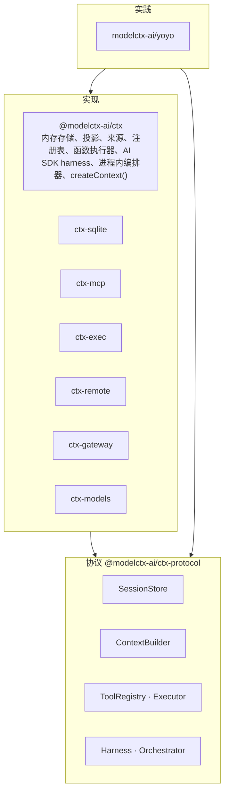
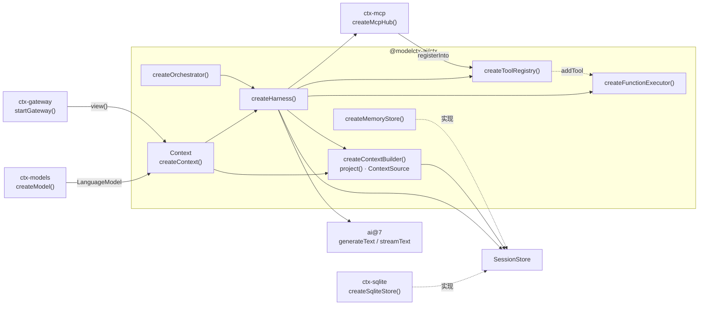
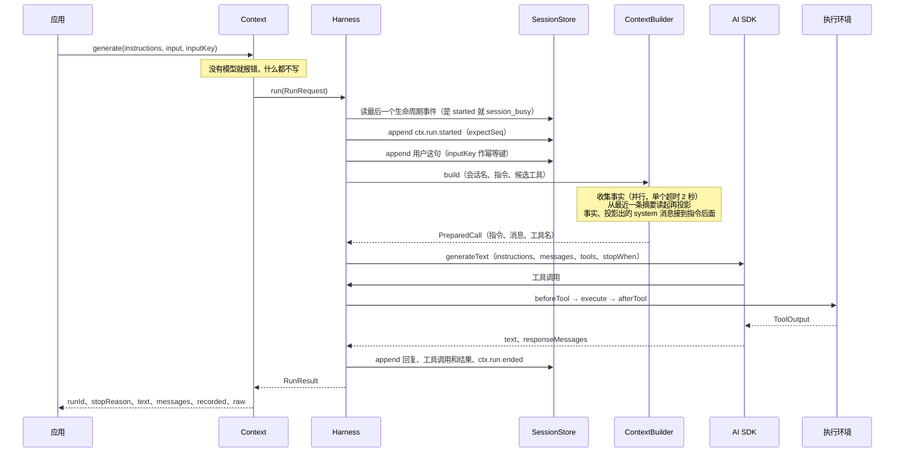
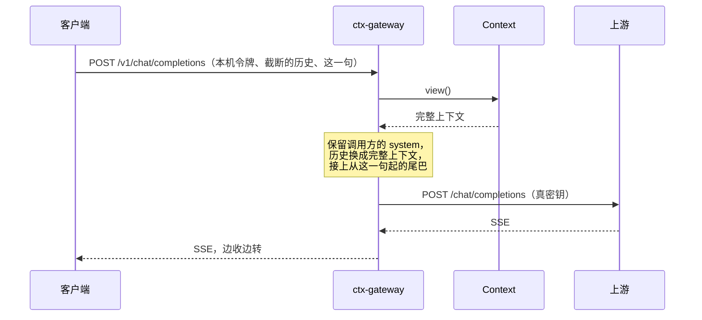

# 架构：进程内参考实现

ctx 分三层：协议（`@modelctx-ai/ctx-protocol`，只有接口）、实现（`@modelctx-ai/ctx` 和 `ctx-*`）、实践（yoyo）。组件和协议的说明见[概念](concepts.md)和[协议层](protocol.md)。本文写的是实现层里进程内的那一份：`@modelctx-ai/ctx` 的会话存储、上下文（投影、来源、压缩）、工具注册表、函数执行环境、harness、编排器和组合门面 `createContext()`，以及 sqlite、models、mcp、gateway 四个适配包。



## 概念

| 概念                    | 说明                                                                                                                         |
| ----------------------- | ---------------------------------------------------------------------------------------------------------------------------- |
| 会话 `session`          | 一个 agent 实例的日志的名字，例如 `pet:main`、`user:42`。条目按会话存放                                                      |
| 条目 `Entry`            | 会话里的一条记录，分 `message`、`event`、`summary` 三种，写入后不再修改                                                      |
| 位置 `seq`              | 存储按写入顺序分配的序号，会话内严格递增、从 1 起。`at` 是逻辑时间（毫秒），只用于投影排序和展示                             |
| 会话存储 `SessionStore` | 只追加的持久化边界：`append`、`list`、`clear`、`sessions`、`watch`                                                           |
| 投影 `project()`        | 把条目渲染成这一次交给模型的 `Message[]`（ctx 自己的 JSON 消息，harness 调模型时转成 AI SDK 的），每次调用重新计算，不改日志 |
| 来源 `ContextSource`    | 调用那一刻才去取的上下文，取到的文字叫事实 `Fact`，不写日志                                                                  |
| 上下文 `ContextBuilder` | `createContextBuilder()`：投影 + 来源 + 压缩，把会话组装成一次调用的指令、消息和工具名单                                     |
| 工具目录 `ToolRegistry` | `createToolRegistry()`：工具定义（名字、说明、JSON Schema）放在一处，每个绑一个执行环境                                      |
| 执行环境 `Executor`     | 工具调用真正发生的地方。核心包有进程内的 `createFunctionExecutor()`，MCP hub 也是一个                                        |
| Harness                 | `createHarness()`：跑一轮，组装 → 调模型 → 分发工具 → 写回，前后写 `ctx.run.started` / `ctx.run.ended`                       |
| 编排器 `Orchestrator`   | `createOrchestrator()`：进程内队列，同一会话串行，不同会话并行，崩溃后补 `ctx.run.ended`                                     |
| 门面 `Context`          | `createContext()` 的返回值：在一个会话上把上面几样组合起来，带投影规则、来源、工具和缺省模型                                 |

## 组件



实线是调用或提供，虚线是实现接口。

## 一次 generate

`context.generate()` 把参数换成一个 `RunRequest`（`AgentSpec` 里是模型、指令、工具名单、步数和调用参数），交给 harness：



`Context` 的方法：

| 方法 / 字段                        | 作用                                                                                |
| ---------------------------------- | ----------------------------------------------------------------------------------- |
| `append(...entries)`               | 追加条目，返回真正写入的那些                                                        |
| `entries(options?)`                | 读原始条目，参数同 `SessionStore.list`                                              |
| `view({ window? })`                | 当前交给模型的历史：最近一条摘要和它之后的条目，按投影规则渲染                      |
| `facts(signal?)`                   | 收集一次事实                                                                        |
| `prepare(options)`                 | 组装指令、消息和工具（包成 AI SDK `ToolSet`），不调用模型                           |
| `generate(options)`                | 经 harness 跑一轮（`generateText`）；模型出错或被取消时抛出原来的错误               |
| `stream(options)`                  | 经 harness 跑一轮（`streamText`），流结束后记录；返回 `{ runId, result, recorded }` |
| `compact(options)`                 | 把较早的历史压成一条摘要                                                            |
| `builder`、`executor`、`harness`   | 内部的 `ContextBuilder`、函数执行环境和 harness，直接用就是协议的接口               |
| `session`（`thread` 是弃用的别名） | 会话名                                                                              |

## 条目

| 类型      | 字段                                | 怎么进模型上下文                                                     |
| --------- | ----------------------------------- | -------------------------------------------------------------------- |
| `message` | `message: Message`                  | ctx 的 JSON 消息（文字、文件、推理、工具调用和结果），投影时原样带上 |
| `event`   | `kind`、`text?`、`data?: JsonValue` | 应用自己的事件。缺省不可见，`projection.events[kind]` 有规则才渲染   |
| `summary` | `text`、`covers: number`            | 压缩点：代替 `seq` ≤ `covers` 的全部条目，固定在第一条               |

公共字段：

| 字段             | 说明                                                                               |
| ---------------- | ---------------------------------------------------------------------------------- |
| `id`             | 全局唯一；不给就由存储生成                                                         |
| `session`、`seq` | 由存储填                                                                           |
| `v`              | 写入这一行时的格式版本，由存储填；读出来的形状永远是当前版本，旧行读时升级、不回写 |
| `at`             | 逻辑时间，缺省是写入时刻。导入的旧记录写原来的时间，会排回原来的位置               |
| `key`            | 幂等键：同一会话里键相同的第二条被跳过                                             |
| `source`         | 谁写的，例如 `user`、`model`、`harness`、`dsh-pet`                                 |
| `meta`           | 任意 JSON 对象                                                                     |

用 `userEntry(content)`、`assistantEntry(text)`、`messageEntry(message)`、`eventEntry(kind, { text, data })` 构造条目，都接受 `{ id, at, key, source, meta }`。摘要条目一般由 `compact()` 写。事件 `kind` 用 `{domain}.{action}`，`ctx.` 前缀留给框架：harness 写 `ctx.run.started`、`ctx.run.ended`、`ctx.error`，压缩写 `ctx.compacted`，缺省都对模型不可见。

## 存储

| 方法                                           | 行为                                                                                                                                                                                                                                   |
| ---------------------------------------------- | -------------------------------------------------------------------------------------------------------------------------------------------------------------------------------------------------------------------------------------- |
| `append(session, entries, { expectSeq? })`     | 追加，一批是原子的。`id` 重复或同会话 `key` 重复的条目静默跳过，其余照写；返回真正写入的条目（已带 `id`、`seq`、`at`）。给了 `expectSeq` 而会话末尾 `seq` 不等于它（空会话是 0）时整批不写，抛 `conflict`（`retryable`），检查先于去重 |
| `list(session, { after, last, types, kinds })` | 按 `seq` 升序（写入顺序）。`after` 是 `seq`，不含；`last` 取 `seq` 最大的 N 条，仍升序，小数向下取整，不是有限正数时返回空；`kinds` 只要 `kind` 在其中的事件（消息和摘要不返回），与 `types` 取交集；都可以组合，`last` 在过滤之后取   |
| `clear(session)`                               | 删掉整个会话，返回条数                                                                                                                                                                                                                 |
| `sessions({ prefix, after, limit })`           | 有内容的会话，按名字升序（码点序）。`prefix` 按字面匹配，`after` 是上一页最后一个名字（不含），`limit` 限条数，小数向下取整，不是正数时返回空；都不给就是全部                                                                          |
| `watch(session, { after, signal })`            | 先给出 `after` 之后已有的条目，再持续给出新写入的，直到 `signal` 中止                                                                                                                                                                  |

实现有 `createMemoryStore()`（核心包，进程内；`watch` 靠内存里的订阅，写入立刻唤醒）和 `createSqliteStore()`（ctx-sqlite；`watch` 轮询 `list(after)`，缺省每 250ms，别的进程写进同一个库的也能读到）。条目只追加；除了 `clear`，没有删除和修改。

## 投影

`project(entries, options)` 按顺序做五步：

1. 按 `(at, seq)` 排序（`compareEntries`）：补写的旧记录排回逻辑上的位置。
2. 选摘要：`covers` 最大的那条生效，相同时后写（`seq` 大）的生效。`seq` ≤ `covers` 的条目不再出现，摘要之后补写的旧记录（`seq` > `covers`）仍然可见；摘要用 `options.summary` 渲染（缺省是一条用户消息 `Summary of the earlier conversation:\n…`），固定在第一条，不参与裁剪。
3. 消息条目原样带上。`options.message(entry)` 可以改写，返回空就丢掉。
4. 事件条目：没有规则的 `kind` 跳过，也不打断前后同类事件的合并。`fold: true` 的规则把连续的同类事件合成一组交给 `render(events)`；`render` 返回一条消息、多条消息，或者空（丢掉）。
5. 窗口：开头孤立的工具结果（它的调用已经被摘要盖住或被裁掉）总是丢掉。设了 `maxMessages` 或 `maxTokens` 时，从最旧的消息开始整组丢弃直到不超；带工具调用的助手消息和紧跟的工具结果是一组。至少留下最后一组，宁可超预算也不交出空上下文。

例子：`whisper` 有 `fold` 规则，`clipboard` 没有规则。

| 日志（按 `seq`）               | 投影                                                        |
| ------------------------------ | ----------------------------------------------------------- |
| `user` 早先的问题              | 被摘要代替                                                  |
| `assistant` 早先的回答         | 被摘要代替                                                  |
| `summary`，`covers` 指向上一条 | `user` Summary of the earlier conversation: …（固定第一条） |
| `event whisper` 在呢           | `assistant` 碎碎念：在呢 / 喝水（合成一条）                 |
| `event clipboard`              | 不可见，也不打断合并                                        |
| `event whisper` 喝水           | 并进上面那条                                                |
| `user` 今天呢？                | `user` 今天呢？                                             |

| 选项                 | 说明                                                                  |
| -------------------- | --------------------------------------------------------------------- |
| `events`             | `Record<kind, EventRule>`，`EventRule` 是 `{ fold?, render(events) }` |
| `summary`            | 摘要渲染成哪条消息                                                    |
| `message`            | 改写或过滤消息条目                                                    |
| `window.maxMessages` | 最多保留几条消息，摘要不算                                            |
| `window.maxTokens`   | 估算 token 的预算，摘要计入                                           |
| `window.estimate`    | 换掉缺省的 `estimateTokens`                                           |

不设 `window` 就不裁剪：最近一条摘要之后的历史全部带上。

投影照常输出 `system` 消息（例如摘要渲染成 `system`）；组装调用时 builder 把它们从消息里拿出来，接到指令后面（见[调用](#调用)）。

结果 `Projection`：`messages`；`items`，每条带 `from`、`upTo`（它来自的条目里最小和最大的 `seq`）、`pinned`、`tokens`；`tokens` 合计；`dropped` 被丢掉的消息条数；`summary` 生效的摘要条目。

缺省的 token 估算不依赖分词器：中日韩文字一个字约 1 token，其他字符约 4 个 1 token，每条消息另加 4，图片、文件每个按 256（工具结果里的也一样，不去数 base64）。只用于预算和裁剪，不用于计费。

## 调用

`createContextBuilder({ store, projection, projections, sources, sourceTimeoutMs, logger, factsPlacement, model })` 的 `build(request)` 组装一次调用，`context.prepare(options)` 是它加上工具的 `ToolSet`：

1. 收集事实（`facts: false` 跳过；`FactsSpec.sources` 只用指定的来源）。投影名先认：不认识就以 `not_found` 失败，不回退，也不先去收事实。
2. 读视图：只读最近一条摘要和它之后的条目，再投影。`window` 可以覆盖投影里的窗口设置。
3. 指令：`instructions` 是字符串时，事实追加在后面，用空行隔开；（`createContext` 里）是函数时把事实传进去，由函数决定怎么写。
4. 投影里的 `system` 消息（摘要、事件规则或 `message` 钩子渲染成的，以及存成消息条目的）不放进 `messages`，文字按顺序接在指令最后，同样用空行隔开。
5. 消息：视图 + `input`（这一轮用户说的话）+ `prompt`（最后一条临时用户消息；可以是函数，拿到事实）。
6. 工具：`build` 收候选的 `ToolDefinition[]`，给出工具名单；`context.prepare` 的 `tools` 缺省是注册表里全部，`false` 不给，名字列表、`{ names, tags, sources }` 或 `(definition) => boolean` 筛选。

`instructions` 和 `prompt` 只要有一个是函数，事实就不再自动放进去；投影出的 `system` 消息照样接上。

`BuildRequest.facts` 可以是 `FactsSpec`（`sources`、`placement`、`heading`），`BuildRequest.projection` 选 `projections` 里的哪一套（缺省 `default`，取 `projections.default`，没有就取 `projection` 选项；每套是完整的，不合并）；harness 把 `AgentSpec.context` 放进去，所以同一个 builder 上不同的 agent 可以收不同的事实、放不同的位置、用不同的投影。`factsPlacement` 是缺省值，`FactsSpec.placement` 按一轮覆盖。

`factsPlacement: 'prompt'` 把事实放进最后一条临时用户消息（接在 `prompt` 前面，没有 `prompt` 时单独一条），指令里不再有事实：system 前缀每次都一样，服务商的提示缓存能命中。缺省 `'instructions'`。

```ts
import { readFile } from 'node:fs/promises';

import { createContext, createMemoryStore, defineSource, renderFacts, type LanguageModel } from '@modelctx-ai/ctx';

declare const model: LanguageModel;

const context = createContext({
  store: createMemoryStore(),
  session: 'pet:main',
  model,
  sources: [
    defineSource('task', () => '当前任务：写周报'),
    // 读不到就抛错：这一次跳过它，记一条告警
    defineSource('todo', async ({ signal }) => `待办：${await readFile('todo.txt', { encoding: 'utf8', signal })}`),
  ],
});

// 指令后面跟着事实：「你是桌宠。\n\n当前任务：写周报\n待办：…」
await context.generate({ instructions: '你是桌宠。', input: '在吗？' });

// 事实放进最后一条临时用户消息；指令里没有事实，prompt 不写日志
const { text } = await context.generate({
  instructions: '只说一句碎碎念。',
  prompt: (facts) => `${renderFacts(facts)}\n请再说一句碎碎念。`,
  record: false,
});
console.log(text);
```

`generate` 和 `stream` 用 AI SDK v7 的 `instructions` 传系统指令、`messages` 传历史，其余设置对应如下：

| `GenerateOptions`                                                                                             | AI SDK                                                                                          |
| ------------------------------------------------------------------------------------------------------------- | ----------------------------------------------------------------------------------------------- |
| `model`                                                                                                       | `model`。缺省用 `createContext` 的 `model`，都没有就报错；字符串原样交给 AI SDK（网关的模型名） |
| `maxSteps`                                                                                                    | `stopWhen: stepCountIs(n)`。缺省有工具 5 步，没有工具 1 步                                      |
| `timeoutMs`                                                                                                   | `timeout`（整次调用，含工具步骤）                                                               |
| `signal`                                                                                                      | `abortSignal`                                                                                   |
| `temperature`、`maxOutputTokens`、`topP`、`seed`、`stopSequences`、`maxRetries`、`headers`、`providerOptions` | 同名                                                                                            |

### 记录

| 情况       | `record: true`（缺省）                                                                                                   | `record: false`                                            |
| ---------- | ------------------------------------------------------------------------------------------------------------------------ | ---------------------------------------------------------- |
| 开始、结束 | 先写 `ctx.run.started`（`runId`、`agent`），最后写 `ctx.run.ended`（`runId`、`stopReason`、`usage`）                     | 不写                                                       |
| `input`    | 调用模型之前写入日志，组装时已经在视图里；`inputKey` 是它的幂等键                                                        | 只放进这一次的消息                                         |
| 模型产出   | `responseMessages` 全部写入：助手消息、工具调用和工具结果，`source: 'model'`                                             | 不写。从 `result.messages` 拿，由应用决定什么时候 `append` |
| 模型报错   | `input` 已经在日志里，没有回复；记 `ctx.error` 和 `ctx.run.ended`（`error`）；用同一个 `inputKey` 重试，这句不会再记一遍 | 日志不变                                                   |
| 没有模型   | `createContext` 直接报错，什么都不写                                                                                     | 直接报错                                                   |

- `generate` 返回 `{ runId, stopReason, text, messages, recorded, raw }`：`recorded` 是这次真正写进日志的条目（含 `ctx.run.*`），`raw` 是 `generateText` 的原始结果。
- `generate` 和 `harness.run` 的差别：模型出错或被取消时，`generate` 为了和 0.1 兼容抛出原来的错误；`harness.run` 不抛，返回 `stopReason: 'error' | 'aborted'` 和 `error`，日志里照样有 `ctx.run.ended`。两者都只在写日志失败时 reject。
- `await context.stream()` 得到 `{ runId, result, recorded }`。`result` 是 AI SDK 的 `StreamTextResult`；`recorded` 在回复写进日志以后给出这次写入的全部条目（含先写的 `ctx.run.started` 和用户这句）：流出错或中止时没有回复，`record: false` 时是 `[]`，只在写日志失败时 reject（同时告警）。读 `recorded` 和读 `result.text` 一样会让流跑完。
- 流出错时调 `onError`；没给 `onError`、上下文也没配 `logger` 时沿用 AI SDK 的缺省处理（`console.error`），配了 `logger` 就记一条告警。
- `prompt` 和事实从不写日志。
- `createContext({ source })`：经这个上下文追加、又没写 `source` 的条目（包括自动记录的 `input`）记成它。

副作用必须先成功的场景用 `record: false`，成功以后再自己追加：

```ts
import { createContext, createMemoryStore, eventEntry, type LanguageModel } from '@modelctx-ai/ctx';

declare const model: LanguageModel;
declare function speak(text: string): Promise<void>; // 应用自己的副作用：合成语音、投喂给桌宠

const context = createContext({ store: createMemoryStore(), session: 'pet:main', model });

const { text } = await context.generate({ instructions: '只说一句。', prompt: '请说一句碎碎念。', record: false });
await speak(text); // 失败就抛出，日志里不会多出一句没说出口的话
await context.append(eventEntry('whisper', { text }));
```

## 压缩

`compact(options)` 把较早的历史压成一条摘要条目，原条目保留：

1. 取完整视图（不裁剪）：当前摘要 + 之后的消息。
2. 最近 `keep`（缺省 12）条原样保留。切点往前挪，保留的部分不以工具结果开头。
3. 切点之前没有消息，或者不到 `minimum`（缺省 8）条，就不压缩、不调模型，返回 `null`。
4. 把旧摘要和切点之前的消息转成纯文本记录（图片、文件只写占位，例如 `[image image/png]`，不带数据），用 `instructions`（缺省是内置的压缩指令）、`temperature: 0`、`maxOutputTokens`（缺省 1024）调一次模型。`model` 缺省用上下文的模型。
5. 摘要被 `maxOutputTokens` 截断（`finishReason` 是 `length`）时不写，告警并返回 `null`；否则在同一批里追加一条 `summary`（`covers` 是被保留的消息里最小的 `from` 减 1，即日志顺序上的切点；输入是投影里 `upTo` ≤ `covers` 的消息，补写的旧记录 `seq` 在切点之后，不进这次摘要，压缩后仍然可见。`fold` 合并的事件组里混进补写的旧记录时，组的 `from` ≤ `covers` < `upTo`，整组进摘要会重复，所以 `covers` 退到这一组的 `from` 减 1，整组留在视图里；退到不再有横跨的组为止，退到 0 就返回 `null`）和一条 `ctx.compacted`（`covers`、`summaryId`）。

新摘要已经包含旧摘要，所以只有最新的一条生效；之后 `view()` 从它读起。什么时候压缩由应用决定（例如定时、超过阈值），ctx 不自动压缩。

窗口和压缩的区别：窗口只影响这一次交给模型的内容，什么都不写；压缩写下一个检查点，以后每次投影都从它开始，被压缩的原条目仍在日志里。

## 上下文来源

- 每次 `prepare`、`generate`、`stream`（以及 `facts()`）都重新收集，来源之间并行，结果按来源列表的顺序排。
- 返回 `null`、空串或只有空白的来源跳过；文字去掉前后空白。
- 单个来源出错或超时（缺省 2 秒，`createContext({ sourceTimeoutMs })` 可改）只影响它自己，记一条告警。
- `collect` 拿到 `{ session, signal }`，`signal` 来自这次调用的 `signal`。
- 事实不写日志。它们描述的是“现在”：当前任务、粘贴板、天气，写进历史下一轮就过期了。

## 工具与 MCP

工具目录里只有定义（名字、说明、JSON Schema 输入、来源、标签、`executor`），执行函数在执行环境里。`addTool(name, tool(...), meta)` 把 AI SDK 的 zod 工具拆开：输入结构经 `asSchema(...).jsonSchema` 变成 JSON Schema 定义，`execute` 放进注册表自带的函数执行环境（`registry.executor`，名字 `local`）。执行时先按原来的 zod 校验输入（默认值、转换照常），返回值是字符串时成 `{ type: 'text' }`，否则成 `{ type: 'json' }`；有 `toModelOutput` 的按它转。

```ts
import { createContext, createMemoryStore, createToolRegistry, tool, type LanguageModel } from '@modelctx-ai/ctx';
import { createMcpHub } from '@modelctx-ai/ctx-mcp';
import { z } from 'zod';

declare const model: LanguageModel;

const registry = createToolRegistry().addTool(
  'remember',
  tool({
    description: '记一条备忘',
    inputSchema: z.object({ text: z.string() }),
    execute: async ({ text }) => ({ saved: text }),
  }),
  { tags: ['memo'] },
);

const hub = createMcpHub({
  notes: { command: 'node', args: ['./mcp/notes-server.js'], include: ['search_notes'] },
  docs: { url: 'https://mcp.example.com/mcp', headers: { authorization: `Bearer ${process.env.DOCS_TOKEN}` } },
});
await hub.connect(); // 单个服务器失败只记在 hub.status() 里
hub.registerInto(registry); // notes__search_notes、docs__…，来源 mcp:notes、mcp:docs，执行环境 mcp

// hub 本身是一个执行环境，交给 executors；注册表自带的函数执行环境自动带上
const context = createContext({
  store: createMemoryStore(),
  session: 'user:42',
  model,
  tools: registry,
  executors: [hub],
});
await context.generate({ input: '我之前记过周报的事吗？', tools: { sources: ['mcp:notes', 'mcp:docs'] } });
await context.generate({ input: '记一下：周五交周报', tools: ['remember'] });
await hub.close();
```

| 调用时的 `tools`              | 交给模型的工具                                                                   |
| ----------------------------- | -------------------------------------------------------------------------------- |
| 不给或 `true`                 | 注册表里全部                                                                     |
| `false`                       | 不给                                                                             |
| 名字列表                      | 按名字挑，不存在的名字忽略                                                       |
| `{ names?, tags?, sources? }` | 每一项里任一个命中即可，给了的几项都要命中（能序列化，`AgentSpec.tools` 也用它） |
| `(definition) => boolean`     | 按 `ToolDefinition` 筛，只在进程内                                               |

- 工具名只能是 `[a-zA-Z0-9_-]`，最长 64（各家接口的共同限制）。重名报错，`{ replace: true }` 覆盖。`addTool` 的 `source` 缺省 `local`，`removeSource(source)` 整批移除（函数执行环境里的函数一起拿掉）。
- `registry.select(filter)` 按协议返回 `ToolDefinition[]`；要 AI SDK 的 `ToolSet` 用 `registry.toolSet(filter, { executors })`，或 `toToolSet(definitions, executors)`：每个工具的 `execute` 转给绑定的执行环境，结果经 `toolOutputToAiSdk` 交回模型。0.1 的 `add(name, tool, meta)`、`addAll` 还能用。
- `createMcpHub(servers)` 收常见的 `mcpServers` 写法：有 `command` 走 stdio（`env` 只写额外的变量，`PATH`、`HOME` 等自动带上），有 `url` 走 Streamable HTTP，`type: 'sse'` 走 SSE。
- `connect()` 并行连接，从不因为单个服务器抛错：失败记为 `failed` 和错误信息，`enabled: false` 记为 `disabled`；`status()` 按配置顺序。再调一次 `connect()` 会重试没连上的，已连上的不动。
- 每台服务器连接加列工具最多等 `timeoutMs`：服务器配置里的优先，其次 hub 的，缺省 15 秒；`0` 或 `Infinity` 不限时。超时记为失败。连上以后任何一步失败都关掉连接，stdio 服务器的进程跟着结束。
- 工具名缺省加服务器前缀 `<server>__<tool>`，非法字符换成 `_`，截到 64；`namespace: false` 保留原名。`include`、`exclude` 用服务器上的原名。改名后重名的按配置顺序留第一个，后面的原名记进那台服务器状态的 `skipped`。
- hub 本身是一个执行环境，名字缺省 `mcp`（`createMcpHub(servers, { name })` 可改，一个应用开几个 hub 时各起一个）。`tools()` 报全部工具的 `ToolDefinition`，`executor` 指向 hub；`execute(call)` 调对应服务器的工具，MCP 结果转成 `ToolOutput`：全是文字时合成一段 `text`，图片、音频是 `file`，`isError` 是 `{ type: 'error' }`。`provision()` / `dispose()` 就是 `connect()` / `close()`。
- `registerInto(registry)` 写进注册表，来源 `mcp:<server>`，执行环境是 hub；重复调用先删掉这个 hub 之前写的工具再写。注册表里已有别的来源的同名工具时不替换，跳过并告警；返回实际写入的条数。
- `close()` 断开全部连接、清空状态，并从写过的每个注册表里删掉这些工具。
- MCP 工具和本地工具一样经 harness 的工具循环，调用和结果作为消息写进日志。

## 函数执行环境

`createFunctionExecutor(name = 'local')` 是进程内的 `Executor`：一张 `名字 → (input, context) => ToolOutput` 的表。

```ts
import { createFunctionExecutor, createToolRegistry } from '@modelctx-ai/ctx';

const local = createFunctionExecutor('local').register(
  {
    name: 'clock_now',
    description: '当前时间，ISO 8601',
    inputSchema: { type: 'object', properties: {} },
  },
  () => ({ type: 'text', text: new Date().toISOString() }),
);

const registry = createToolRegistry({ executor: local }).add(local.definition('clock_now')!);
console.log(await local.tools()); // 注册过的 ToolDefinition，executor: 'local'
```

- `execute` 从不抛：不认识的工具（错误里列出可用的）、`signal` 已中止、函数抛错、`dispose()` 之后都返回 `{ type: 'error', message }`，模型看得到原因。
- `context` 是协议的 `ExecutionContext`（`session`、`runId`、`signal`）加上这次调用的 `callId`。
- 注册表的 `addTool` 就是往它的函数执行环境里 `register`。

## Harness

`createHarness({ store, context, tools?, executors?, models?, hooks?, logger?, source? })` 实现协议的 `run` 和 `stream`，基于 `generateText` / `streamText`：

1. 写 `ctx.run.started`（`runId`、`agentSpecToJson(agent)`）。
2. 记输入（`inputKey` 作幂等键；`source` 给了就记成它）。
3. `agent.model` 是字符串时经 `models(name)` 造模型，没给 `models` 就以 `error` 结束。
4. `tools.select(agent.tools)` 得到候选工具，`context.build(...)` 得到 `PreparedCall`，再交给 `beforeModel`（之后的每个工具步骤也会再调一次）。
5. 调模型。每个工具调用：`beforeTool`（可以拒绝或改写输入；拒绝时模型看到 `not allowed: <原因>`，这一轮继续）→ 按定义的 `executor` 找执行环境 `execute` → `afterTool`（可以改写结果）。找不到执行环境、执行环境本身抛错也变成给模型看的错误。
6. 记产出（`source: 'model'`）和 `ctx.run.ended`（`stopReason`、`usage`），同一批写。

`stopReason`：模型自己停下是 `end_turn`；步数用完还想调工具是 `max_steps`；被 `maxOutputTokens` 截断是 `max_tokens`；`signal` 中止是 `aborted`；其他错误是 `error`，另记一条 `ctx.error`。出错和取消都照常返回 `RunResult` 并写 `ctx.run.ended`，只有写日志失败才 reject。`record: false` 一条都不写。

`executors` 可以是数组（按各自的 `name`）或 `{ 名字: 执行环境 }`；`tools` 是 `createToolRegistry()` 建的注册表时，它自带的函数执行环境自动加进来。

```ts
import { createContextBuilder, createHarness, createMemoryStore, createToolRegistry, tool } from '@modelctx-ai/ctx';
import { createModel } from '@modelctx-ai/ctx-models';
import { z } from 'zod';

const store = createMemoryStore();
const tools = createToolRegistry().addTool(
  'weather_get',
  tool({
    description: '查城市天气',
    inputSchema: z.object({ city: z.string() }),
    execute: async ({ city }) => `${city}晴`,
  }),
);
const harness = createHarness({
  store,
  context: createContextBuilder({ store, factsPlacement: 'prompt' }),
  tools,
  models: (name) => createModel({ provider: 'openai-compatible', baseUrl: 'https://api.deepseek.com/v1', model: name }),
  hooks: {
    beforeTool: (call) => (call.name === 'weather_get' ? undefined : { allow: false, reason: '只能查天气' }),
  },
});

const result = await harness.run({
  session: 'user:42',
  agent: { model: 'deepseek-chat', instructions: '你是生活助手。', tools: { names: ['weather_get'] } },
  input: '台北下午要带伞吗？',
});
console.log(result.stopReason, result.text);

for await (const event of harness.stream({
  session: 'user:42',
  agent: { model: 'deepseek-chat' },
  input: '那明天呢？',
})) {
  if (event.type === 'text.delta') process.stdout.write(event.text);
}
```

`stream` 的事件：`run.started` → 每一步 `model.started`、`text.delta`、`tool.called`、`tool.returned`、`model.ended` → 出错时 `error` → `run.ended`（带去掉 `messages`、`recorded` 的结果）。调用方提前不读时取消模型调用，照样写 `ctx.run.ended`（`aborted`）。

## 编排器

`createOrchestrator({ harness, store?, logger? })` 是进程内队列：每个会话一条队列，同一会话的运行串行，不同会话并行。

```ts
import { createOrchestrator } from '@modelctx-ai/ctx';

// harness、store 接上一段
const orchestrator = createOrchestrator({ harness, store, owner: 'pet' }); // owner：这个实例的稳定名字
await orchestrator.recover?.(); // 启动时：先给上次崩溃时断掉的运行补 ctx.run.ended（error），再接新的 submit

// 状态变化：run.queued → run.running → run.completed
void (async () => {
  for await (const event of orchestrator.events()) console.log(event.type, event.runId);
})();

const agent = { model: 'deepseek-chat', instructions: '你是桌宠，回答一句话。' };
const first = await orchestrator.submit({ session: 'pet:main', agent, input: '在吗' });
const second = await orchestrator.submit({ session: 'pet:main', agent, input: '今天忙吗？' }); // 等 first 跑完
await orchestrator.cancel(second.runId); // 还在排队：不跑了
console.log((await first.done).text, await orchestrator.status(second.runId)); // … cancelled
await orchestrator.close(); // 不再收新运行，等运行中的结束
```

- 状态：`completed` 跑完；`failed` 是 `stopReason: 'error'` 或 harness 抛错（`done` 跟着 reject）；`cancelled` 是被 `cancel` 或请求的 `signal` 取消。
- `cancel(runId)`：排队中的直接取消，`done` 给出 `stopReason: 'aborted'` 的空结果，不调 harness；运行中的中止传给 harness 的 `signal`。跑完的或不认识的返回 `false`。
- `recover()`：只在给了 `store` 时有。用 `sessions({ limit, after })` 一页一页读会话名，每个会话一次 `list({ kinds: [ctx.run.started, ctx.run.ended], last: 1 })`，不读消息正文；最后一个生命周期事件是 `ctx.run.started` 的就是断掉的运行（这个编排器自己正在跑的除外），补一条 `ctx.run.ended`（`stopReason: 'error'`，`source: 'orchestrator'`），不续跑。
- `owner`：写进每个运行的 `ctx.run.started`；`recover()` 只收 `owner` 相同的断点（都没配置也算相同），两个进程共用一个库时各配一个名字。写 `ctx.run.ended` 时带 `expectSeq`，读和写之间会话有新条目就跳过那个运行。
- 用缺省 `record`（写日志）的应用，进程崩溃留下的未结束运行会让该会话一直 `session_busy`，所以启动时要先 `recover()` 再 `submit`；`record: false` 的运行不留生命周期事件，没有这个要求。harness 里同一会话最多一个未结束的运行（跨进程也成立；同一个 harness 实例内部先按会话排队，一个接一个，`session_busy` 只出现在跨进程或别的 harness 实例上，`record: false` 不排），每次写入带 `expectSeq`，被 `recover` 结束的运行在下一次写入时发现自己被围栏，以 `aborted` 停下、不再写 `ctx.run.ended`。

## 网关

ctx-gateway 给只会说 OpenAI Chat Completions、又自己截断历史的客户端用（例如 dsh-pet 的右键对话）：



按顺序检查：

| 请求                                                                                        | 处理                                                                          |
| ------------------------------------------------------------------------------------------- | ----------------------------------------------------------------------------- |
| `Host` 不在 `allowedHosts` 里                                                               | 403                                                                           |
| 带 `Origin` 头，又不在 `allowedOrigins` 里（缺省一个都不放）                                | 403                                                                           |
| 路径不在 `basePath`（缺省 `/v1`；`''` 或 `/` 挂在根上）下                                   | 404                                                                           |
| 设了 `accessToken`，`Authorization: Bearer` 没带或不对（`Bearer` 不分大小写，常量时间比较） | 401                                                                           |
| 请求体超过 `maxBodyBytes`（缺省 4 MiB）                                                     | 413                                                                           |
| `POST <basePath>/chat/completions`，设了 `rewrite`                                          | 请求体不是 JSON，或不是带 `messages` 数组的对象：400；否则 `rewrite` 以后转发 |
| 其他                                                                                        | 原样转发：方法、路径、查询串、请求体                                          |
| 上游连不上                                                                                  | 502                                                                           |

- `startGateway` 缺省只认监听地址的 `Host`（`host:port`，不分大小写），挡 DNS rebinding；监听本机时 `localhost`、`127.0.0.1`、`[::1]` 加端口都认。`createGatewayHandler` 不知道端口，没给 `allowedHosts` 就不查 `Host`，`Origin` 照查。浏览器网页发来的请求带 `Origin`，缺省一律拒绝。
- 只转发调用方的 `content-type`、`accept`，加上 `upstream.headers`；有 `upstream.apiKey` 时设 `Authorization: Bearer <apiKey>`。调用方的令牌不会到上游，上游的密钥不会到调用方。
- 响应的状态码和头原样转回（去掉逐跳头和 `content-encoding`、`content-length`），正文边收边转，SSE 不缓冲。调用方中途断开时取消上游请求，不算出错。
- 错误正文是 OpenAI 的形状：`{ "error": { "message", "type" } }`，`type` 是 `authentication_error`（401）、`permission_error`（403）或 `gateway_error`。
- 缺省只听 `127.0.0.1`、随机端口。`createGatewayHandler(options)` 返回 `(req, res) => Promise<void>`，可以挂到已有的 HTTP 服务上。

`replaceHistory(history, { keepSystem })` 生成改写函数：保留调用方的 `system` / `developer` 消息（`keepSystem: false` 时去掉），中间换成 `toChatMessages(await history())`（去掉其中的 `system`），再接上调用方从最后一句用户话起的尾巴：这句话，以及它之后的工具调用、工具结果和预填的助手话。完整历史的最后一条和这句用户话内容完全相同（图片也比）时，这句不重复带。`withContext(context)` 就是 `replaceHistory(async () => (await context.view()).messages)`；`withContext(builder, session)` 直接用一个 `ContextBuilder` 和会话名。

网关只读上下文，不写日志。调用方自己保存的问答要另外并进上下文，例如 yoyo 每拍把 dsh-pet 的对话记忆按幂等键导入（见 [ADR 0003](adr/0003-context-model.md)）。

`toChatMessages()` 的转换：

| AI SDK                                | OpenAI Chat Completions                                                                                                                                                                            |
| ------------------------------------- | -------------------------------------------------------------------------------------------------------------------------------------------------------------------------------------------------- |
| `system`                              | `system`                                                                                                                                                                                           |
| `user` 文字                           | `text` 段（纯字符串保持字符串）                                                                                                                                                                    |
| `user` 图片、`image` / `image/*` 文件 | `image_url`：URL 原样；base64 和二进制转 data URL（类型只写到 `image` 或带 `*` 时用 `image/png`）。AI SDK v7 带标签的 `{ type: 'data' }`、`{ type: 'url' }` 也认；服务商侧的文件引用和其他分段丢掉 |
| `assistant` 文字、工具调用            | `content` + `tool_calls`（`arguments` 是 JSON 字符串）；只有工具调用时 `content: null`。推理和服务商执行的工具调用丢掉，什么都不剩的消息整条丢掉                                                   |
| `tool` 工具结果                       | 每个结果一条 `{ role: 'tool', tool_call_id, content }`：文字原样，JSON 序列化，拒绝执行写明原因                                                                                                    |

## 错误和日志

- `describeError(error, { secrets, max })` 给日志和界面用：重试错误取最后一次；接口错误带 `status` 和截短的响应正文 `detail`；`secrets` 里的密钥换成 `***`，空白合并，截到 `max`（缺省 180）字。
- `redact(text, secrets)` 单独做去密钥。
- 框架只通过 `Logger { warn, debug? }` 出声，缺省静默（`silentLogger`）。`createContext`、`createMcpHub` 都接受 `logger`。

## 扩展点

| 扩展点                 | 接口                             | 做法                                                                                                     |
| ---------------------- | -------------------------------- | -------------------------------------------------------------------------------------------------------- |
| 会话存储               | `SessionStore`                   | 实现四个方法（`watch` 可选），跑 `describeSessionStoreContract`                                          |
| 执行环境               | `Executor`                       | `execute` 出错返回 `{ type: 'error' }`，跑 `describeExecutorContract`                                    |
| Harness、编排器        | `Harness`、`Orchestrator`        | 跑 `describeHarnessContract`、`describeOrchestratorContract`；模型用 `createScriptedModel(script)`       |
| 钩子                   | `Hooks`                          | `createHarness({ hooks: { beforeModel, beforeTool, afterTool } })`                                       |
| 模型服务商             | `ModelFactory`                   | `createModelRegistry().register(name, factory)`；或者直接给 `createContext` 任何 AI SDK `LanguageModel`  |
| 事件渲染               | `EventRule`                      | `projection.events[kind]`                                                                                |
| 摘要、消息、token 估算 | `ProjectionOptions`              | `summary`、`message`、`window.estimate`                                                                  |
| 上下文来源             | `ContextSource`                  | `defineSource(name, collect)`                                                                            |
| 工具                   | AI SDK `Tool` / `ToolDefinition` | `registry.addTool(name, tool(...), { source, tags })`；或 `registry.add(definition)` 绑到别的执行环境    |
| MCP 连接               | `McpConnector`                   | `createMcpHub(servers, { connector })`；连接器收到 `{ signal }`，超时或 `close()` 时中止。测试时换成假的 |
| 网关改写               | `Rewrite`                        | `(request) => request`，转发前任意改写                                                                   |
| 日志                   | `Logger`                         | `{ warn, debug? }`                                                                                       |

### 自定义存储

实现 `SessionStore`，再用契约测试验证行为和内置存储一致（`@modelctx-ai/ctx/testing` 原样转出 `@modelctx-ai/ctx-protocol/testing`，`describeStoreContract` 是弃用的别名）。工厂要用传进来的 `now` 作为缺省的 `at`。

```ts
// pg-store.test.ts。describe、test 从你用的测试框架取：vitest、node:test、Jest、Bun 都行
import { describe, test } from 'vitest';

import { describeSessionStoreContract } from '@modelctx-ai/ctx-protocol/testing';

import { createPgStore } from './pg-store.ts';

describeSessionStoreContract('pg', ({ now }) => createPgStore({ url: 'postgres://localhost/ctx_test', now }), {
  describe,
  test,
});
```

| 用例            | 要求                                                                                                                                                         |
| --------------- | ------------------------------------------------------------------------------------------------------------------------------------------------------------ |
| 位置            | `list` 按 `seq` 升序；补写的旧记录排在写入的位置，`list(after)`、`watch(after)` 仍然给出它；`seq` 会话内递增、从 1 起，`clear` 后不回退                      |
| 同一时刻        | 按写入先后                                                                                                                                                   |
| 去重            | 同会话重复的 `key`、全局重复的 `id` 跳过，只返回真正写入的；键按会话隔离；一批里有重复的，其余照写                                                           |
| 原子            | 并发追加的两批不交错                                                                                                                                         |
| 查询            | `after`、`last`、`types`、`kinds` 可以组合；`last` 向下取整，`0`、负数、`NaN`、`Infinity` 返回空；`kinds` 只返回事件，与 `types` 取交集，`last` 在过滤之后取 |
| 往返            | 消息分段（含工具调用的对象入参、图片 `URL`）、事件 `data`、摘要 `covers`、`source`、`meta` 原样读回；`seq` 递增                                              |
| 二进制和 URL    | `Buffer`、`ArrayBuffer`、带标签的 `{ type: 'data' }` 读回来字节不变（容器可以换成 `Uint8Array`）；`URL`（包括 `{ type: 'url' }` 里的）读回来还是 `URL`       |
| 像标记的数据    | 事件 `data` 里 `{ $url }`、`{ $bytes }` 这类普通对象原样读回                                                                                                 |
| 会话            | `clear` 返回删掉的条数；`sessions()` 只列有内容的会话，名字升序（码点序）；`prefix` 按字面匹配（`%`、`_`、`\` 不特殊），`after`、`limit` 翻页不重不漏        |
| `watch`（有时） | 先给出 `after` 之后已有的，再给出新写入的，只看这个会话；`signal` 中止后迭代正常结束                                                                         |

### 模型服务商

```ts
import { createOpenAI } from '@ai-sdk/openai';
import { createModelRegistry } from '@modelctx-ai/ctx-models';

const models = createModelRegistry().register('openai', (spec) =>
  createOpenAI({ apiKey: spec.apiKey, baseURL: spec.baseUrl })(spec.model),
);

const model = models.create({ provider: 'openai', model: 'gpt-5-mini', apiKey: process.env.OPENAI_API_KEY });
console.log(models.providers()); // ['openai-compatible', 'anthropic', 'openai']
```

### 事件规则和渲染

```ts
import type { ProjectionOptions } from '@modelctx-ai/ctx';

export const projection: ProjectionOptions = {
  events: {
    // 连续的碎碎念合成一条助手消息
    whisper: {
      fold: true,
      render: (events) => ({ role: 'assistant', content: `碎碎念：\n${events.map((event) => event.text).join('\n')}` }),
    },
    // 每条提醒单独一条用户消息；返回 null 的不进上下文
    reminder: {
      render: ([event]) => (event?.text ? { role: 'user', content: `[提醒] ${event.text}` } : null),
    },
  },
  // 渲染成 system 时，调用会把它从消息里拿出来，接到指令后面
  summary: (entry) => ({ role: 'system', content: `前情提要：\n${entry.text}` }),
  window: { maxTokens: 16_000 },
};
```

## 设计约束

| 约束                        | 落在哪                                                                                                                                                                                                                                                                                                                                      |
| --------------------------- | ------------------------------------------------------------------------------------------------------------------------------------------------------------------------------------------------------------------------------------------------------------------------------------------------------------------------------------------- |
| 核心包只依赖 `ai`           | `@modelctx-ai/ctx` 的 dependencies 只有 `ai`（`zod` 是 `ai` 要的 peer）。主入口不用 `node:` 模块，只用 `crypto.randomUUID`、`setTimeout`、`AbortSignal` 这类标准全局对象                                                                                                                                                                    |
| Node 专属的东西放在适配包   | `node:sqlite` 在 ctx-sqlite；`node:http`、`node:crypto`、`node:stream` 在 ctx-gateway；stdio 子进程在 ctx-mcp；`node:assert` 在 `@modelctx-ai/ctx/testing` 子路径（测试框架由调用方传入）                                                                                                                                                   |
| 实现包只依赖协议包          | ctx-sqlite、ctx-mcp、ctx-gateway 的 `peerDependencies` 是 `@modelctx-ai/ctx-protocol`，测试要用内存存储时才把 `@modelctx-ai/ctx` 放进 devDependencies；核心包把协议包当 peer，并原样转出它的全部导出。ctx-models 不依赖协议包，把 `ai` 当 peer。应用里只有一份协议包、一份 `ai`，`SessionStore`、`Executor`、`LanguageModel` 都是同一个类型 |
| AI SDK 的工具函数从核心包拿 | `tool`、`dynamicTool`、`jsonSchema`、`zodSchema`、`stepCountIs` 和 `ModelMessage`、`LanguageModel`、`ToolSet` 等类型从 `@modelctx-ai/ctx` 转出，应用不用单独依赖 `ai`                                                                                                                                                                       |
| 只追加                      | 条目写入后不改；压缩是追加摘要；只有 `clear(session)` 删除                                                                                                                                                                                                                                                                                  |
| 存储和渲染分开              | 存储只存原始条目，怎么交给模型由投影决定；改规则不用迁移数据，对旧条目同样生效                                                                                                                                                                                                                                                              |
| 局部失败不打断调用          | 来源出错或超时跳过；MCP 服务器连不上或超时只记状态；工具出错变成给模型看的错误；模型出错 harness 照常返回；流式回复写日志失败只告警（`recorded` reject）                                                                                                                                                                                    |
| 函数加接口                  | 公开 API 是函数（`createX()` / `startX()` 工厂和 `project()` 这类纯函数）和接口，没有要继承或 `new` 的类                                                                                                                                                                                                                                    |
