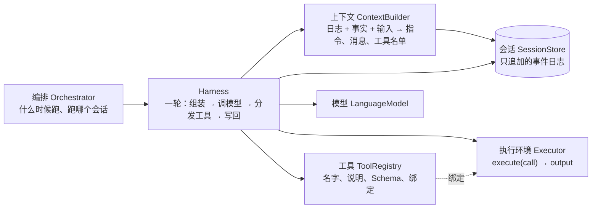

# 概念

ctx 是面向 agent 原生程序的上下文与运行框架。它把一个 agent 拆成七个组件，每个组件一个协议；组件之间只通过协议交互，任何一个都可以单独替换、单独托管。本仓库给每个协议一份参考实现，[yoyo](https://github.com/modelctx-ai/yoyo) 是把它们组合成业务的实践。

## 七个组件

| 组件              | 一句话                                                                                           | 像什么                                                         | 参考实现                     |
| ----------------- | ------------------------------------------------------------------------------------------------ | -------------------------------------------------------------- | ---------------------------- |
| 会话 Session      | 一个 agent 实例的全部经历，只追加的事件日志，放在模型的上下文窗口之外                            | Managed Agents 的 session，Claude Code 的会话记录              | 内存、SQLite、HTTP 远端      |
| 上下文 Context    | 这一次调用模型时交给它的东西：从日志、来源、输入里算出来，每次重算，不改日志                     | 上下文工程本身                                                 | 投影 + 来源 + 窗口 + 压缩    |
| 工具 Tools        | 模型能调用什么：名字、说明、输入结构；每个工具绑一个执行环境                                     | 函数调用、MCP 工具                                             | 注册表                       |
| 执行环境 Executor | 工具调用真正发生的地方：进程内函数、本机子进程、容器、远端服务                                   | Managed Agents 的 sandbox / 自托管 worker，Claude Code 的 Bash | 函数、子进程、MCP、HTTP 远端 |
| Harness           | 跑一轮的循环：组装上下文、调模型、把工具调用交给执行环境、把结果写回会话，直到模型停下或达到上限 | Managed Agents 的 harness，Agent SDK 的 agent loop             | 基于 AI SDK 的循环           |
| 编排 Orchestrator | 跨轮次、跨会话的调度：排队、串行、取消、定时、崩溃后从日志续跑、多 agent 分工                    | Managed Agents 的控制面，yoyo 的常驻循环和导演                 | 进程内队列                   |
| 模型 Model        | 一次模型调用                                                                                     | AI SDK `LanguageModel`                                         | `ctx-models` 按配置造        |

第八个组件是**记忆**（见[记忆](memory.md)和 [ADR 0006](adr/0006-memory.md)）：会话日志回答「发生过什么」，记忆回答「什么仍然成立、上次的教训是什么」。它是一个独立的存储 `MemoryStore`（笔记、事实、程序、画像），只读会话日志、从不改它；白天打分和召回，夜里由提取模型、决策模型和 `LanguageModel` 整理。它通过已有的扩展点接进来：`Memory` 门面是一个 `Executor`（提供 `recall` 工具），`memory.source()` 是一个 `ContextSource`，什么时候 `gate`、什么时候 `consolidate` 是编排器的事。上面的图和表不变。

| 组件        | 一句话                                                                               | 像什么                                              | 参考实现                                                                                                     |
| ----------- | ------------------------------------------------------------------------------------ | --------------------------------------------------- | ------------------------------------------------------------------------------------------------------------ |
| 记忆 Memory | 从日志里提炼出来、跨会话持久、可以重建的知识：事实（带有效期）、程序（带证据）、画像 | Mem0 的事实记忆、Letta 的核心记忆、Hindsight 的反思 | `ctx-memory` 的 `createMemory`；存储在内存、SQLite、HTTP 远端；System One 模型（`ctx-models`）或启发式做判断 |

一个 agent 的**配置**（用哪个模型、什么指令、哪些工具、什么参数）是一个 JSON 值 `AgentSpec`，不是组件。同一个 harness 跑不同的配置就是不同的 agent；Managed Agents 的 Agent 资源、长程 harness 文章里「初始化 agent 和编码 agent 只差第一条提示」说的都是这件事。

## 术语

| 术语                          | 说明                                                                                                                                                                                                                |
| ----------------------------- | ------------------------------------------------------------------------------------------------------------------------------------------------------------------------------------------------------------------- |
| 会话 `session`                | 日志的名字，字符串，例如 `user:42`、`pet:main`。原来叫 `thread`，见 [ADR 0004](adr/0004-protocol-and-implementation.md)                                                                                             |
| 条目 `Entry`                  | 日志里的一条：`message`（ctx 自己的 JSON 消息 `Message`）、`event`（应用或框架的事件）、`summary`（压缩点）。写入后不改                                                                                             |
| 位置 `seq`                    | 条目在会话里的写入序号：会话内严格递增，`list`、`watch`、`covers` 都按它；逻辑时间 `at` 只用于投影排序                                                                                                              |
| 消息 `Message`、版本 `v`      | ctx 自己的 JSON 消息格式，是 AI SDK `ModelMessage` 的子集，和它互转；每个条目带写入时的格式版本 `v`，旧行读时升级（`upgradeEntry`），不改写存量                                                                     |
| 写入前提 `expectSeq`          | `append` 的选项：会话末尾的 `seq` 不等于它就整批不写，抛 `conflict`。没有租约，`seq` 就是围栏令牌                                                                                                                   |
| 围栏                          | 一轮运行写入时发现自己的 `runId` 已被别人写了 `ctx.run.ended`（被 `recover` 收走）：以 `aborted` 停下，不再写。一个会话最多一个未结束的运行，否则新的一轮以 `session_busy` 结束                                     |
| 所有者 `owner`                | 部署者给编排器的稳定实例名，写进 `ctx.run.started`；`recover` 只收同一个 `owner` 的断点                                                                                                                             |
| 上下文配置 `ContextSpec`      | `AgentSpec.context`：按名字选事实的来源、位置和投影，能序列化                                                                                                                                                       |
| 事实 `Fact`                   | 来源在调用那一刻取到的文字，只用于这一次，不写日志                                                                                                                                                                  |
| 投影 `Projection`             | 把条目渲染成这一次交给模型的消息                                                                                                                                                                                    |
| 事件 `kind`                   | 事件的类型名，`{domain}.{action}` 写法。框架保留 `ctx.` 前缀（`ctx.run.started`、`ctx.run.ended`、`ctx.compacted`、`ctx.error`，常量 `CTX_EVENTS`），应用自定其余。事件缺省对模型不可见，投影规则决定怎么渲染       |
| 一轮 `run`                    | harness 的一次运行：一个输入进去，若干次模型调用和工具调用，一个 `stopReason`（`end_turn`、`max_steps`、`max_tokens`、`aborted`、`error`）出来。`runId` 标识它                                                      |
| 工具调用 `ToolCall`           | `{ id, name, input }`；结果 `ToolOutput` 是文字、JSON、内容块或错误，和 AI SDK 的工具结果互转                                                                                                                       |
| 执行上下文 `ExecutionContext` | 一次工具调用附带的环境：会话、`runId`、取消信号                                                                                                                                                                     |
| 钩子 `Hooks`                  | harness 在调模型前后、执行工具前后给应用的切入点；权限确认是「执行工具前」的一个钩子                                                                                                                                |
| 笔记 `Note`                   | 写入门控的结果：日志里值得夜里处理的一段（`session`、`from`、`upTo` 是 `seq` 区间）加显著性、类别、主题。不复制内容。                                                                                               |
| 记忆里的事实 `MemoryFact`     | 一句能独立成立的话，带主语、`validFrom` / `validTo`、来源 `SourceRef`、召回时刻 `recalls`。写入后不改文字：变了就 `close` 旧的、`add` 新的。和来源取到的事实 `Fact`（`{ source, text }`，只用于一次调用）是两回事。 |
| 程序 `Procedure`              | 从经验归纳的规则：`when`、`do`、`evidence`、`confirmations`。确认次数够了才生效。                                                                                                                                   |
| 画像 `core`                   | 仍然成立的事实压成的一段话，每夜重写，常驻上下文，保留历史版本。                                                                                                                                                    |
| 激活度 `activation`           | `ln Σ (Δtᵢ + ε)^−d + s`：召回越近越多越高，显著性 `s` 是偏置。注入排序和夜间归档都用它。                                                                                                                            |
| 决策模型、提取模型            | System One 模型：单次前向，返回概率或带类型的字段，不生成文字。`DecisionModel.decide({ state, questions })`、`ExtractionModel.extract({ state, fields })`。                                                         |

## 和 Anthropic 公开实践的对应

ctx 的拆法参考了 Anthropic 公开的工程和研究材料。对应关系和差别：

| 来源                                                                                              | 它说的                                                                                                                                                                                       | ctx 里的对应                                                                                                                                                                                       |
| ------------------------------------------------------------------------------------------------- | -------------------------------------------------------------------------------------------------------------------------------------------------------------------------------------------- | -------------------------------------------------------------------------------------------------------------------------------------------------------------------------------------------------- |
| [Managed Agents](https://www.anthropic.com/research/managed-agents)                               | session / harness / sandbox 三者虚拟化、互相可换；session 是上下文窗口之外的持久上下文对象；harness 和容器都是可丢弃的，崩了从日志续跑                                                       | 同样的拆法，再加上下文、工具、编排三个协议；不限定托管方和模型                                                                                                                                     |
| Managed Agents API                                                                                | `Agent`（配置）、`Environment`（在哪跑）、`Session`、`Event`（`{domain}.{action}`）；自定义工具由应用侧执行再回传 `user.custom_tool_result`；自托管沙箱是只需出站连接的 worker，从队列领工作 | `AgentSpec`、`Executor`、`SessionStore`、事件命名；应用侧执行就是一个 `Executor`；`ctx-remote` 现在是 harness 推给执行环境（执行环境是一个 HTTP 服务），执行环境拉取的 worker 接法之后加，协议不变 |
| [上下文工程](https://www.anthropic.com/engineering/effective-context-engineering-for-ai-agents)   | 注意力预算有限，找「最少的高价值 token」；预取和即时检索混用；长程靠压缩、结构化笔记、子代理                                                                                                 | `ContextBuilder` 是这件事的落点：来源是预取，工具是即时检索，压缩是 `compact`，笔记放执行环境的文件里，子代理由编排器开新会话                                                                      |
| [长程 harness](https://www.anthropic.com/engineering/effective-harnesses-for-long-running-agents) | 状态放在上下文窗口之外（git、进度文件、功能清单）；每次会话开始先读状态、跑冒烟测试；一次只做一件事                                                                                          | 状态属于会话日志和执行环境；这些是 `AgentSpec` 的指令和编排器的策略，框架不替应用决定                                                                                                              |
| [写给 agent 的工具](https://www.anthropic.com/engineering/writing-tools-for-agents)               | 少而专的工具胜过薄封装；按服务和资源加前缀；说明写给新同事看；输出只给高信号字段，大结果分页截断；错误要能照着做                                                                             | `ToolDefinition` 的约定，MCP 工具的 `<server>__<tool>` 前缀，`ToolOutput.error` 带可读信息                                                                                                         |
| [用代码执行接 MCP](https://www.anthropic.com/engineering/code-execution-with-mcp)                 | 把工具呈现成代码 API，让模型写代码在执行环境里过滤、循环，只把结果给模型；渐进披露工具                                                                                                       | `ctx-exec` 这类执行环境的方向；工具目录支持按需挑选                                                                                                                                                |
| [构建有效的 agent](https://www.anthropic.com/engineering/building-effective-agents)               | 工作流（预定义路径）和 agent（模型自己决定）之分；链式、路由、并行、编排者-工作者、评估-优化几种模式；先简单                                                                                 | 编排器用 `Harness.run` 组合出这些模式；协议不预设哪一种                                                                                                                                            |
| [Agent SDK](https://code.claude.com/docs/en/agent-sdk/overview)                                   | hooks、权限、子代理、会话续跑                                                                                                                                                                | `Hooks`、编排器、`SessionStore`                                                                                                                                                                    |

差别只有一个：以上都是 Anthropic 托管、只跑 Claude；ctx 的每个组件都可以放在任何地方，模型经 AI SDK 接任何服务商。Managed Agents 可以作为一种实现接进来（一个远端 `Harness` 加 `Executor`）。

## 设计约束

1. **只追加。** 会话日志只追加，压缩追加摘要，窗口只影响这一次投影。原条目一直在（[ADR 0003](adr/0003-context-model.md)）。
2. **协议只收发 JSON。** 除 `AbortSignal` 和进程内的 `LanguageModel`，协议方法的参数和返回都能序列化，所以每个组件都能放到进程边界另一侧（[ADR 0004](adr/0004-protocol-and-implementation.md)）。
3. **身份是字符串。** 会话、工具、执行环境、运行都用字符串 id 指代，跨边界时不用传对象。
4. **可丢弃。** harness 和执行环境可以随时崩、随时换；会话日志是唯一的真相，续跑从日志读。
5. **框架不替应用做决定。** 什么时候压缩、什么事件给模型看、工具给不给、什么时候跑一轮，都是应用（编排器、`AgentSpec`、投影规则）的事；框架给机制和缺省值。
6. **先简单。** 进程内的用法（`createContext()`）和三行代码的例子要一直能用；分布式是能力，不是门槛。
