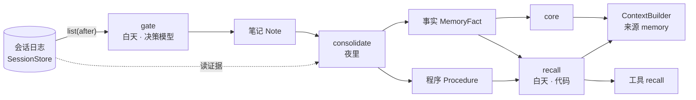
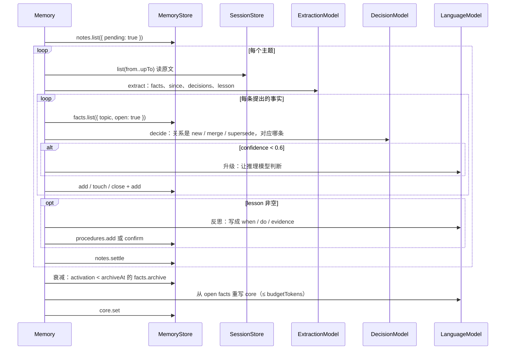

# 记忆

- 状态：提案，未实现。协议签名是草案，实现落地时以包里的 `.d.ts` 为准
- 决策记录：[ADR 0006](adr/0006-memory.md)
- 实践：[yoyo 的记忆](https://github.com/modelctx-ai/yoyo/blob/main/docs/tech/memory.md)

会话日志记下一个 agent 经历过的一切，但它只能回答「发生过什么」。记忆回答另外三件事：主人是谁、什么仍然成立、上次这样做的教训是什么。ctx 把记忆定成第八个组件：一个独立的存储，加一组按固定节律读日志、写存储的操作。记忆**只读**会话日志，从不改它；会话日志仍是唯一的真相，记忆是从真相里提炼出来、可以重建的东西。

## 四层记忆和 ctx 组件

分法来自互补学习系统（CLS）：一个快的索引器记下所有事，一个慢的存储器在空闲时整理成知识。ctx 已经有了前者。

| 层                  | 生物学里     | 保存什么                           | ctx 里是什么                                      | 改不改     |
| ------------------- | ------------ | ---------------------------------- | ------------------------------------------------- | ---------- |
| 工作记忆            | 前额叶       | 这一次交给模型的东西               | 投影 `Projection`，每次重算                       | 不存       |
| 情节记忆 episodic   | 海马体       | 发生过的每件事，按时间             | 会话日志 `SessionStore`，只追加                   | 已有，不动 |
| 语义记忆 semantic   | 新皮层       | 事实：主语、谓语、宾语、何时起成立 | `MemoryStore` 的事实 `MemoryFact`，带有效期和来源 | 新增       |
| 程序记忆 procedural | 基底节、小脑 | 规则：遇到什么、该怎么做、证据     | `MemoryStore` 的程序 `Procedure`                  | 新增       |
| 画像 core           | —            | 仍然成立的事实压成的一段话，常驻   | `MemoryStore` 的 `core`，每夜重写，作为来源注入   | 新增       |

还有一个不是层的东西：**笔记 `Note`**。它是写入门控的结果，标记日志里哪一段值得夜里处理。笔记指向日志里的 `seq` 区间，不复制内容。

## 五个决策

记忆系统的难点不在存储，在五个决策。每个决策对应一个操作，操作分快慢两类：快的在白天、每轮都做、不改写记忆；慢的在夜里、离线、是唯一改写记忆的地方。

| 决策           | 操作              | 什么时候     | 谁来算                                     | 生物学里的对应     |
| -------------- | ----------------- | ------------ | ------------------------------------------ | ------------------ |
| 什么值得记     | `gate`            | 白天，每轮后 | 决策模型（System One），或启发式           | 杏仁核给事件打标签 |
| 什么时候想起   | `recall`          | 白天，组装前 | 代码：相似度 + 激活度                      | 线索触发回忆       |
| 怎么并入旧记忆 | `consolidate`     | 夜里         | 提取模型 → 决策模型 → 推理模型（只做反思） | 睡眠回放、系统巩固 |
| 怎么忘         | `activation`      | 夜里         | 公式，不用模型                             | 遗忘曲线           |
| 怎么纠错       | `close`、`forget` | 主人说了算   | 应用的界面                                 | 再巩固             |



两条路线各自成立：没有夜间任务，记忆就是一张手写的事实表加检索；没有门控，夜间任务就处理全部日志，只是贵。

## 协议 `MemoryStore`

记忆的存储。四个集合，每个集合几个方法；全部只收发 JSON，可以放到进程边界另一侧。身份是字符串。

```ts
/** 指向会话日志里的一段，证据永远指向原文。1 ≤ from ≤ upTo。 */
interface SourceRef {
  session: string;
  from: number; // seq，含
  upTo: number; // seq，含
}

interface Note {
  id: string;
  session: string;
  from: number;
  upTo: number;
  at: number; // 打分时刻（毫秒）
  salience: number; // 0..1
  kind?: string; // 应用定义：pref、obs、fail、ok…
  topic?: string; // 应用定义的主题名
  settledAt?: number; // 夜里处理过的时刻；没有就是待处理
}
/** 门控没过的那段也写一条，settledAt 等于 at：head 照样前进，打过的分留作阈值的分布。 */
type NewNote = Omit<Note, 'id'>;
interface NoteQuery {
  session?: string;
  pending?: boolean; // true 只要待处理的，false 只要处理过的；缺省不限
  limit?: number; // 最早写入的 N 条
}

interface MemoryFact {
  id: string;
  subject: string; // "user"、"project:agent"…应用定义
  predicate?: string;
  text: string; // 一句能独立成立的话
  topic?: string;
  validFrom: number;
  validTo?: number; // 没有就是仍然成立
  supersededBy?: string; // 被哪条事实取代
  confidence: number; // 0..1
  salience: number; // 0..1，激活度公式里的 s
  sources: readonly SourceRef[]; // 必填，不允许没有证据的事实
  recalls: readonly number[]; // 每次被召回的时刻，激活度公式里的 t_i
  archivedAt?: number; // 归档的时刻；没有就是没归档
}
type NewMemoryFact = Omit<MemoryFact, 'id' | 'validTo' | 'supersededBy' | 'recalls' | 'archivedAt'>;
interface FactHit {
  fact: MemoryFact;
  score: number; // 0..1，越大越相关；recall 用它当相似度
}

interface Procedure {
  id: string;
  topic?: string;
  when: string; // 触发条件
  do: string; // 动作
  evidence: readonly SourceRef[];
  confirmations: number; // 独立确认次数，add 时是 1；应用决定几次算生效
  at: number;
  retiredAt?: number;
}
type NewProcedure = Omit<Procedure, 'id' | 'confirmations' | 'retiredAt'>;
interface ProcedureQuery {
  topic?: string;
  active?: boolean; // true 只要没退役的；false 或缺省不限
}

/** 结果按 id 升序（码点序），翻页和 SessionStore.sessions 一样。 */
interface FactQuery {
  subject?: string;
  topic?: string;
  open?: boolean; // true 只要 validTo 为空且未归档；false 或缺省不限
  after?: string; // 上一页最后一个 id，不含
  limit?: number;
}
interface SearchQuery {
  text: string; // 实现决定用全文、向量还是两者；至少子串（3 个字符以上）命中
  topic?: string;
  k?: number; // 缺省 10
  open?: boolean; // 缺省 true；false 连同关闭、归档的一起搜
}

interface CoreVersion {
  text: string;
  at: number;
}

interface MemoryStore {
  notes: {
    add(notes: readonly NewNote[]): Promise<Note[]>;
    list(query?: NoteQuery): Promise<Note[]>; // 按写入顺序
    /** 返回这次真正标上的条数；处理过的不改。 */
    settle(ids: readonly string[], at: number): Promise<number>;
    /** 这个会话的笔记（含处理过的）覆盖到的最大 seq；没有就是 0。gate 从它之后读。 */
    head(session: string): Promise<number>;
  };
  facts: {
    add(fact: NewMemoryFact): Promise<MemoryFact>;
    /** 关闭有效期。事实的文字永不改写：变了就 add 新的、close 旧的。已关闭的不改。 */
    close(id: string, at: number, options?: { supersededBy?: string }): Promise<void>;
    /** 追加证据（并入时用），文字不变；相同的区间跳过。 */
    cite(id: string, sources: readonly SourceRef[]): Promise<MemoryFact>;
    /** 记一次召回。 */
    touch(ids: readonly string[], at: number): Promise<void>;
    archive(ids: readonly string[], at: number): Promise<number>;
    /** 真删除，连同指向它的 supersededBy 一起清掉。主人的权利。 */
    forget(ids: readonly string[]): Promise<number>;
    list(query?: FactQuery): Promise<MemoryFact[]>;
    search(query: SearchQuery): Promise<FactHit[]>; // 按 score 从高到低
  };
  procedures: {
    add(procedure: NewProcedure): Promise<Procedure>;
    /** confirmations 加 1；相同的证据不算又一次确认。 */
    confirm(id: string, evidence: readonly SourceRef[]): Promise<Procedure>;
    retire(id: string, at: number): Promise<void>;
    list(query?: ProcedureQuery): Promise<Procedure[]>; // 按写入顺序
  };
  core: {
    get(): Promise<CoreVersion | null>;
    /** 追加一个版本，旧版本保留；回滚就是把旧文字再 set 一次。 */
    set(text: string, at: number): Promise<void>;
    /** 按写入顺序；last 和 ListOptions.last 一样。 */
    history(options?: { last?: number }): Promise<CoreVersion[]>;
  };
}
```

- **事实不 UPDATE。** 变了就 `close` 旧的、`add` 新的，`supersededBy` 连起来。「上个月用的是哪个数据库」永远能查。
- **证据必填。** `MemoryFact.sources`、`Procedure.evidence` 指向会话日志的 `seq` 区间。没有证据的事实不进存储，这是防编造的第一道闸。
- **归档不删除。** `archive` 只是让它退出 `open` 的查询，`forget` 才删。
- **错误。** 参数不合法（没有证据、`from > upTo`）是 `CtxError` 的 `invalid_request`，认不得的 `id` 是 `not_found`；批量方法（`settle`、`touch`、`archive`、`forget`）跳过认不得的 `id`。存储不看钟，时刻都由调用方给。
- **记忆不写会话日志。** 记忆是日志的读者。应用要在日志里留痕（例如「今晚整理了 12 条」）自己追加事件，这是明确的选择。
- `search` 的实现自定：全文、向量、两者混合。协议只约定输入是文字。
- 记忆里的事实叫 `MemoryFact`，和来源取到的事实 `Fact`（`{ source, text }`，只用于一次调用）是两回事：前者持久、有有效期，后者是「现在」。
- 纯函数：`activation(fact, now, options?)`（见[遗忘](#遗忘)）、`rankFacts(facts, scores, options?)`（`scores` 是事实 `id` → 相似度，一般取 `FactHit.score`）、`renderCore(facts, budget, options?)` 的缺省写法、`sourceRef(session, entries)`；另有存储实现用的 `checkSourceRef`、`checkEvidence`、`sameSourceRef`、`inSourceRef`、`isOpenFact`、`filterFacts`。

## 协议 `DecisionModel`、`ExtractionModel`

记忆回路里的多数判断不是开放生成，而是分类、打分、填字段。这些交给单次前向、返回概率的模型（Cloudflare 叫 System One：决策模型 Clef、Jev，提取模型 Clairic），只有归纳和措辞留给 `LanguageModel`。ctx 为它们各定一个协议，形状跟着 System One API 走，适配器因此很薄；但类型是 ctx 自己的，全是 JSON，不依赖任何服务商的 SDK。

```ts
const MAX_DECISION_QUESTIONS = 64;

type DecisionQuestion =
  | { type: 'noul'; instructions: string } // 是 / 否，返回 P(是)
  | { type: 'choice'; instructions: string; criteria: Record<string, string> } // 选一个，至少一个选项
  | { type: 'score'; instructions: string; criteria: readonly string[] }; // 有序量表，从低到高，至少两档
type DecisionAnswer =
  | { type: 'noul'; noul: number }
  | { type: 'choice'; choice: string; probabilities: Record<string, number>; confidence: number }
  | { type: 'score'; score: number; probabilities: readonly number[] }; // score = Σ pᵢ · i / (n − 1)

interface DecisionRequest {
  state: JsonValue; // 文字或 JSON
  questions: Record<string, DecisionQuestion>; // 一次最多 64 个，并行
  signal?: AbortSignal; // 中止后 reject
}
interface DecisionModel {
  name: string;
  decide(request: DecisionRequest): Promise<Record<string, DecisionAnswer>>;
}

// 找到时 value 的形状：text 字符串；number 数；date 'YYYY-MM-DD'；datetime ISO 8601；duration 秒数；list 数组
type ExtractionField =
  | { type: 'text'; instructions?: string }
  | { type: 'number'; instructions?: string; integer?: boolean; decimals?: number; unit?: string }
  | { type: 'date' | 'datetime' | 'duration'; instructions?: string }
  | { type: 'list'; items: 'text' | 'number'; instructions?: string };
interface ExtractionAnswer {
  value: JsonValue; // 没找到是 null
  pNull: number; // 输入里不存在这个值的概率
  confidence: number;
}
interface ExtractionRequest {
  state: JsonValue;
  fields: Record<string, ExtractionField>; // 数量不限
  signal?: AbortSignal;
}
interface ExtractionModel {
  name: string;
  extract(request: ExtractionRequest): Promise<Record<string, ExtractionAnswer>>;
}
```

- 两个协议都不产出文字，只收输入 token，适合每轮都调。
- 输出总是合法的，但未必正确：调用方用 `confidence`、`pNull` 决定自动化到哪一步，低于阈值的升级给 `LanguageModel`。
- 跨边界时模型用名字字符串，和 `ModelRef` 一样。
- 没有 System One 服务时有两种退路：启发式实现（不联网，见[实例化](#模型实例化)），或者用 `LanguageModel` 装成一个决策模型（让它输出 JSON，慢、贵，但接口一样）。

## 操作

协议只定存储和模型。五个操作是 `@modelctx-ai/ctx-memory`（提案）的参考实现 `createMemory(options)`：

```ts
interface MemoryOptions {
  store: MemoryStore;
  sessions: SessionStore; // 只读
  decision?: DecisionModel; // 没有就用启发式门控
  extraction?: ExtractionModel; // 没有就让 model 提取
  model?: ModelRef; // 反思、重写 core、升级判断；没有就跳过反思
  topics?: Record<string, string>; // 主题名 → 说明，给门控的 choice 用
  kinds?: Record<string, string>; // kind → 说明；缺省 pref / obs / fail / ok
  gate?: { theta?: number; entries?: ListOptions }; // 阈值；看哪些条目（缺省只看消息）
  decay?: { d?: number; archiveAt?: number }; // 缺省 0.5、0.55
  core?: { budgetTokens?: number }; // 缺省 2000
  embed?: (text: string) => Promise<number[]>; // 给 search 用；没有就全文
  logger?: Logger;
}

interface Memory extends Executor {
  /**
   * 白天：读 session 里 notes.head 之后的新条目，打分，写笔记。不改日志。
   * 没过阈值的那段也写一条已处理的笔记（settledAt = at），head 照样前进。
   */
  gate(session: string, options?: { signal?: AbortSignal }): Promise<Note[]>;
  /** 白天：按文字召回，按相似度和激活度排序，记一次 touch。 */
  recall(query: string, options?: RecallOptions): Promise<Recalled>;
  /** 夜里：处理待处理的笔记，衰减归档，重写 core。整体可重复执行。 */
  consolidate(options?: { now?: number; signal?: AbortSignal }): Promise<ConsolidateReport>;
  /** 作为来源：core 加按 query 召回的事实。query 缺省取会话最近一条用户消息。 */
  source(options?: { name?: string; query?: (session: string) => Promise<string>; k?: number }): ContextSource;
  /** 作为工具：recall(query, since_days?)（MEMORY_RECALL_TOOL），绑定到这个执行环境。 */
  tools(): Promise<ToolDefinition[]>;
  execute(call: ToolCall, context: ExecutionContext): Promise<ToolOutput>;
}
interface RecallOptions {
  topic?: string;
  k?: number;
  budgetTokens?: number;
  evidence?: boolean; // 带回证据原文；工具调用时带，作为来源时不带
  signal?: AbortSignal;
}
interface Recalled {
  facts: readonly MemoryFact[];
  procedures: readonly Procedure[];
  evidence?: readonly Entry[]; // 只在 evidence 时有：证据区间里的条目，按 id 去重，按会话、seq 排
}
interface ConsolidateReport {
  notes: number;
  facts: { added: number; merged: number; superseded: number; archived: number };
  procedures: { added: number; confirmed: number };
  escalated: number; // 升级给 LanguageModel 的判断数
  core: boolean; // 重写了没有
}
```

`Memory` 本身是一个 `Executor`（名字缺省 `memory`），和 MCP hub 一样：`tools()` 报出 `recall` 工具，注册进 `ToolRegistry` 就能给模型用。

### 门控 `gate`

```ts
const answers = await decision.decide({
  state: renderEntries(entries), // 这一段日志渲染成文字
  questions: {
    keep: { type: 'noul', instructions: '这段里有没有值得长期记住的信息：偏好、事实变化、决定、教训？' },
    kind: { type: 'choice', instructions: '主要属于哪一类？', criteria: kinds },
    topic: { type: 'choice', instructions: '属于哪个主题？', criteria: { ...topics, other: '以上都不是' } },
    salience: {
      type: 'score',
      instructions: '对未来的任务有多重要？',
      criteria: ['无关', '顺带提到', '有用', '必须记住'],
    },
  },
});
const salience = 0.6 * answers.keep.noul + 0.4 * answers.salience.score;
if (salience >= theta) await store.notes.add([{ session, from, upTo, at: now, salience, kind, topic }]);
```

- 一次调用四个问题，一次前向。只打分、只写笔记，不提取。
- 看哪些条目由应用定（`gate.entries`）：缺省只看消息，事件按 `kinds` 挑。
- `theta` 不手调：参考实现按最近一周 `keep` 的分布取分位，让笔记占比落在 10–25%。
- 启发式退路：惊讶（1 − 与已有事实的最大相似度）、强调（「记住」「以后」「别再」）、重复（同主题 7 天内次数）、情绪（错误、纠正）四项加权。够用就不上模型。

### 召回 `recall`

```
score(fact) = 0.6 × similarity(query, fact.text) + 0.4 × activation(fact, now)
```

取 `open` 的事实做 `search`，按 `score` 排，按预算取前 k 条，`touch` 它们。匹配到主题的程序整条带上。作为来源时结果渲染成事实文字；作为工具时还带回证据条目。被召回就是一次 `t_i`，衰减从头算：这是「回忆即再巩固」。

### 巩固 `consolidate`



- 提取：`pNull > 0.3` 的字段当作没说；`since` 为空时 `validFrom` 取这段的第一条 `at`。
- 并入：有对照的事实放进 `state`，这就是分类问题。`merge` 是 `cite`（追加 `sources`）加 `touch`；`supersede` 是 `close` 旧的、`add` 新的。
- 反思是唯一的开放生成。规则要 `confirmations ≥ 2` 才算生效（应用在 `procedures.list` 后自己筛）。
- 幂等：笔记 `settle` 之后不再处理；中途失败下一夜接着做，白天不受影响。
- 什么时候跑由编排器定：每天固定时刻、空闲时、待处理笔记够多时。框架不替应用决定。

### 遗忘

ACT-R 的基础激活。每次召回都是一个 `t_i`，近的权重大，远的衰减；显著性 `s` 是常数偏置：

```
A(fact, now) = ln Σ_i (Δt_i + ε)^(−d) + s      Δt_i = (now − t_i) / 1 天，t_i ∈ {validFrom, ...recalls}
```

缺省 `d = 0.5`、`ε = 0.02`、`archiveAt = 0.55`。一条 `s = 0.6`、从未被召回的事实两三天后归档；被召回一次约再撑一周。注入排序和夜间归档用同一个 `A`。`activation` 是协议包里的纯函数。

## 接进其余组件

记忆不改别的协议。它通过已有的扩展点接进去：

| 接点    | 怎么接                                                                                                                   |
| ------- | ------------------------------------------------------------------------------------------------------------------------ |
| 上下文  | `memory.source()` 是一个 `ContextSource`，注册进 builder；`AgentSpec.context.facts.sources` 按名字选用，`placement` 自定 |
| 工具    | `Memory` 是 `Executor`，`registry.add(definition)` 绑到它；或 `registry.addTool('recall', …)`                            |
| 会话    | 只读：`gate` 用 `list({ after })`，`consolidate` 按 `SourceRef` 读原文；远端可用 `watch`                                 |
| 编排    | `gate` 在一轮结束后、`consolidate` 在夜里，都是编排器的一拍里的事；框架不替应用定时                                      |
| Harness | 不改。想在一轮里自动 `gate`，用 `Hooks` 之外的编排逻辑；harness 不知道记忆存在                                           |
| 模型    | `DecisionModel`、`ExtractionModel` 和 `LanguageModel` 并列，`ctx-models` 按配置造                                        |
| 网关    | `withContext` 的视图不含记忆；要给右键对话也带上，在 builder 的来源里加 `memory`                                         |

## 托管

| 组件           | 进程内                                                    | 另一进程 / 远端                                                                      | 第三方托管                                                          |
| -------------- | --------------------------------------------------------- | ------------------------------------------------------------------------------------ | ------------------------------------------------------------------- |
| 记忆           | 内存、SQLite（`ctx-sqlite` 加 `createSqliteMemoryStore`） | `ctx-remote`：`/memory/notes`、`/memory/facts`、`/memory/procedures`、`/memory/core` | Mem0、Zep 这类记忆服务，实现 `MemoryStore` 接进来                   |
| 决策、提取模型 | 启发式、`LanguageModel` 装成的                            | 名字 → 远端自己造                                                                    | Cloudflare Workers AI（Clef、Clef-flash、Clairic）、TypeSafe（Jev） |

SQLite 存储和 `ctx-sqlite` 一样可以和应用共用一个库，表前缀自定（例如 `memory_`）。

## 契约测试

| 契约测试                          | 工厂                                                             | 覆盖                                                                                                                                                                                         |
| --------------------------------- | ---------------------------------------------------------------- | -------------------------------------------------------------------------------------------------------------------------------------------------------------------------------------------- |
| `describeMemoryStoreContract`     | `({ now }) => MemoryStore`                                       | 笔记的 `head`、`pending`、`settle`；事实不可改写、`close` 和 `supersededBy`、`touch` 追加、`archive` 退出 `open`、`forget` 真删；`search` 至少全文命中；程序 `confirm` 计数；`core` 保留历史 |
| `describeDecisionModelContract`   | `() => DecisionModel`                                            | 三种问题的形状、概率和为 1、`choice` 的 `choice` 是概率最大的那个、`signal` 中止                                                                                                             |
| `describeExtractionModelContract` | `() => ExtractionModel`                                          | 每种字段类型的 `value` 形状、找不到时 `value: null` 且 `pNull` 高、`signal` 中止                                                                                                             |
| `describeMemoryContract`          | `({ sessions, decision, extraction, now }) => { memory, store }` | `gate` 不改日志、笔记指向正确的 `seq` 区间；`consolidate` 幂等、取代不覆盖、没有证据不写；`recall` 后 `recalls` 多一个；`source` 和 `tools` 的形状                                           |

决策、提取模型的契约用剧本实现跑（`createScriptedDecisionModel`、`createScriptedExtractionModel`，在协议包的 `/testing` 里），和 `createScriptedModel` 同一个思路。`describeMemoryContract` 自己造好剧本模型和一个内存会话日志交给工厂，工厂用它们造 `Memory`，门控阈值固定在 0.1..0.9 之间。

## 模型实例化

`ctx-models`（提案）按配置造 System One 模型，`ModelSpec` 的写法和 `createModel` 一致，可以直接写进配置文件。

```ts
import { createDecisionModel, createExtractionModel } from '@modelctx-ai/ctx-models';

// Cloudflare Workers AI：REST，POST /accounts/{id}/ai/run/@cf/cloudflare/<model>
const gate = createDecisionModel({
  provider: 'cloudflare',
  model: 'clef-flash', // 9B，在线门控；夜间并入判断用 'clef'（27B）
  accountId: process.env.CF_ACCOUNT_ID,
  apiKey: process.env.CF_API_TOKEN,
});
const extractor = createExtractionModel({
  provider: 'cloudflare',
  model: 'clairic',
  accountId: process.env.CF_ACCOUNT_ID,
  apiKey: process.env.CF_API_TOKEN,
});

// TypeSafe Jev：和 Clef 同一套 System One API，换 endpoint 和 model 名
const jev = createDecisionModel({
  provider: 'typesafe',
  model: 'jev',
  baseUrl: 'https://api.typesafe.ai',
  apiKey: '…',
});
```

没有 System One 服务时：

```ts
import {
  createHeuristicDecisionModel,
  decisionFromLanguageModel,
  extractionFromLanguageModel,
} from '@modelctx-ai/ctx-memory';
import { createModel } from '@modelctx-ai/ctx-models';

// 启发式：不联网，惊讶 / 强调 / 重复 / 情绪加权；只认 gate 用的那四个问题，别的问题返回均匀分布
const offline = createHeuristicDecisionModel({ similarity: (a, b) => jaccard(a, b) });

// 用推理模型装成决策、提取模型：接口一样，慢、贵，但任何服务商都能用
const llm = createModel({ provider: 'anthropic', apiKey: process.env.ANTHROPIC_API_KEY, model: 'claude-sonnet-4-5' });
const slowGate = decisionFromLanguageModel(llm);
const slowExtractor = extractionFromLanguageModel(llm);
```

组装：

```ts
import { createMemory } from '@modelctx-ai/ctx-memory';
import { createSqliteMemoryStore, createSqliteStore } from '@modelctx-ai/ctx-sqlite';

const sessions = createSqliteStore({ database, prefix: 'ctx_' });
const memory = createMemory({
  store: createSqliteMemoryStore({ database, prefix: 'memory_' }),
  sessions,
  decision: gate,
  extraction: extractor,
  model: llm,
  topics: { user: '主人的偏好和习惯', work: '手头的项目和工具链', people: '提到的人' },
});

// 接进上下文和工具
const builder = createContextBuilder({ store: sessions, sources: [memory.source({ k: 5 })] });
const registry = createToolRegistry();
for (const tool of await memory.tools()) registry.add(tool);
const harness = createHarness({ builder, registry, executors: [memory] });

// 编排器里
await memory.gate(session); // 一轮结束后
await memory.consolidate(); // 夜里
```

配置文件里的写法（应用自定字段名，这是 yoyo 用的）：

```json
{
  "memory": {
    "decision": { "provider": "cloudflare", "model": "clef-flash", "accountId": "…", "apiKey": "…" },
    "extraction": { "provider": "cloudflare", "model": "clairic", "accountId": "…", "apiKey": "…" },
    "gate": { "theta": 0.6 },
    "decay": { "d": 0.5, "archiveAt": 0.55 }
  }
}
```

`decision` 不配就是启发式，`extraction` 不配就让 `model` 提取；两个都不配、`model` 也没有，记忆退化成一张手写的事实表加全文检索，`recall` 和 `source` 照常工作。

## 预算

一天 40 轮对话的量级：

| 路径             | 模型            | 约 token / 天          | 延迟要求       |
| ---------------- | --------------- | ---------------------- | -------------- |
| 门控             | 决策模型        | 40 × 1.5k 输入，无输出 | < 300 ms，异步 |
| 召回             | 无（或嵌入）    | 注入 ≤ 预算            | < 150 ms       |
| 夜间提取         | 提取模型        | ~6 主题 × 3k 输入      | 无             |
| 夜间并入         | 决策模型        | ~20 × 1k 输入          | 无             |
| 反思、core、升级 | `LanguageModel` | ~12k                   | 无             |

在线路径对一轮的延迟是零：门控异步，召回是本地查询。推理模型只在夜里用。

## 失败模式

| 会出什么事                | 怎么防                                                                  |
| ------------------------- | ----------------------------------------------------------------------- |
| 记了不存在的事实          | `sources` 必填；提取字段的 `pNull` 阈值；主人可 `forget`                |
| 旧事实盖掉新事实          | 不 UPDATE，只 `close` + `add`；`search` 缺省只看 `open`                 |
| 记忆无限膨胀              | 门控、衰减归档、`core` 预算；`open` 事实数告警                          |
| 记忆里藏着指令            | 来源渲染时用 `<memory>` 包裹并声明是数据；`tool` 角色的条目不进事实文字 |
| 错误经验被固化            | `confirmations ≥ 2` 才生效；程序带 `evidence`；可 `retire`              |
| System One 输出合法但不对 | `confidence`、`pNull` 定自动化阈值，低于就升级；每周抽样复核并入结果    |
| 夜间任务中途挂掉          | `settle` 幂等；失败不影响白天；`core` 保留历史版本可回滚                |
| 隐私                      | 记忆和日志同一个库、同一份访问控制；`forget` 真删除，下一夜重写 `core`  |

## 没有采用

- **知识图谱。** 个人 agent 的关系很浅，`subject` + `topic` + 有效期覆盖大部分需要。图数据库可以作为一种 `MemoryStore` 实现接进来。
- **在线提取。** 即使提取模型够快，也不在一轮里改写记忆：改写只发生在夜里，可重复、可回滚。
- **让 Agent 直接改记忆。** Letta 路线的自主管理需要更强的版本和权限约束；这里 Agent 只有 `recall`，改写走夜间任务。
- **记忆作为会话日志的事件。** 事实要按主语查、按有效期筛、按激活度排，日志的 `list` 做不到；笔记用 `SourceRef` 指回日志就够了。
