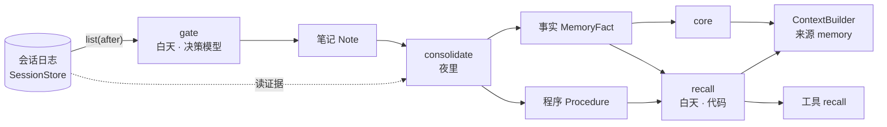

# 记忆

- 状态：已实现（0.4 计划，未发布）。这一篇写设计：为什么分这几层、五个决策各交给谁、怎么接进其余组件、预算和失败模式
- 协议：[协议层](protocol.md#记忆-memorystoredecisionmodelextractionmodelmemory)的记忆一节（`MemoryStore`、`DecisionModel`、`ExtractionModel`、门面 `Memory`、激活度）；参考实现：[架构](architecture.md#记忆)的记忆一节（`createMemory` 的门控、召回、巩固，存储、模型实例化、组装）
- 包：协议、纯函数、契约测试和剧本模型在 [`ctx-protocol`](../packages/protocol/README.md)；`createMemory` 和内存存储在 [`ctx-memory`](../packages/memory/README.md)；SQLite 存储在 [`ctx-sqlite`](../packages/sqlite/README.md)；System One 适配在 [`ctx-models`](../packages/models/README.md)；HTTP 形态 `/memory/*` 在 [`ctx-remote`](../packages/remote/README.md)
- 决策记录：[ADR 0006](adr/0006-memory.md)
- 实践：[yoyo 的记忆](https://github.com/modelctx-ai/yoyo/blob/main/docs/tech/memory.md)

会话日志记下一个 agent 经历过的一切，但它只能回答「发生过什么」。记忆回答另外三件事：主人是谁、什么仍然成立、上次这样做的教训是什么。ctx 把记忆定成第八个组件：一个独立的存储，加一组按固定节律读日志、写存储的操作。记忆**只读**会话日志，从不改它；会话日志仍是唯一的真相，记忆是从真相里提炼出来、可以重建的东西。

## 四层记忆和 ctx 组件

分法来自互补学习系统（CLS）：一个快的索引器记下所有事，一个慢的存储器在空闲时整理成知识。ctx 已经有了前者。

| 层                  | 生物学里     | 保存什么                           | ctx 里是什么                                      | 改不改     |
| ------------------- | ------------ | ---------------------------------- | ------------------------------------------------- | ---------- |
| 工作记忆            | 前额叶       | 这一次交给模型的东西               | 投影 `Projection`，每次重算                       | 不存       |
| 情节记忆 episodic   | 海马体       | 发生过的每件事，按时间             | 会话日志 `SessionStore`，只追加                   | 已有，不动 |
| 语义记忆 semantic   | 新皮层       | 事实：主语、谓语、宾语、何时起成立 | `MemoryStore` 的事实 `MemoryFact`，带有效期和来源 | 新增       |
| 程序记忆 procedural | 基底节、小脑 | 规则：遇到什么、该怎么做、证据     | `MemoryStore` 的程序 `Procedure`                  | 新增       |
| 画像 core           | —            | 仍然成立的事实压成的一段话，常驻   | `MemoryStore` 的 `core`，每夜重写，作为来源注入   | 新增       |

还有一个不是层的东西：**笔记 `Note`**。它是写入门控的结果，标记日志里哪一段值得夜里处理。笔记指向日志里的 `seq` 区间，不复制内容。

## 五个决策

记忆系统的难点不在存储，在五个决策。每个决策对应一个操作，操作分快慢两类：快的在白天、每轮都做、不改写记忆；慢的在夜里、离线、是唯一改写记忆的地方。

| 决策           | 操作              | 什么时候     | 谁来算                                     | 生物学里的对应     |
| -------------- | ----------------- | ------------ | ------------------------------------------ | ------------------ |
| 什么值得记     | `gate`            | 白天，每轮后 | 决策模型（System One），或启发式           | 杏仁核给事件打标签 |
| 什么时候想起   | `recall`          | 白天，组装前 | 代码：相似度 + 激活度                      | 线索触发回忆       |
| 怎么并入旧记忆 | `consolidate`     | 夜里         | 提取模型 → 决策模型 → 推理模型（只做反思） | 睡眠回放、系统巩固 |
| 怎么忘         | `activation`      | 夜里         | 公式，不用模型                             | 遗忘曲线           |
| 怎么纠错       | `close`、`forget` | 主人说了算   | 应用的界面                                 | 再巩固             |

两条路线各自成立：没有夜间任务，记忆就是一张手写的事实表加检索；没有门控，夜间任务就处理全部日志，只是贵。

## 接进其余组件

记忆不改别的协议。它通过已有的扩展点接进去：

| 接点    | 怎么接                                                                                                                   |
| ------- | ------------------------------------------------------------------------------------------------------------------------ |
| 上下文  | `memory.source()` 是一个 `ContextSource`，注册进 builder；`AgentSpec.context.facts.sources` 按名字选用，`placement` 自定 |
| 工具    | `Memory` 是 `Executor`，`registry.add(definition)` 绑到它；或 `registry.addTool('recall', …)`                            |
| 会话    | 只读：`gate` 用 `list({ after })`，`consolidate` 按 `SourceRef` 读原文；远端可用 `watch`                                 |
| 编排    | `gate` 在一轮结束后、`consolidate` 在夜里，都是编排器的一拍里的事；框架不替应用定时                                      |
| Harness | 不改。想在一轮里自动 `gate`，用 `Hooks` 之外的编排逻辑；harness 不知道记忆存在                                           |
| 模型    | `DecisionModel`、`ExtractionModel` 和 `LanguageModel` 并列，`ctx-models` 按配置造                                        |
| 网关    | `withContext` 的视图不含记忆；要给右键对话也带上，在 builder 的来源里加 `memory`                                         |

## 预算

一天 40 轮对话的量级：

| 路径             | 模型            | 约 token / 天          | 延迟要求       |
| ---------------- | --------------- | ---------------------- | -------------- |
| 门控             | 决策模型        | 40 × 1.5k 输入，无输出 | < 300 ms，异步 |
| 召回             | 无（或嵌入）    | 注入 ≤ 预算            | < 150 ms       |
| 夜间提取         | 提取模型        | ~6 主题 × 3k 输入      | 无             |
| 夜间并入         | 决策模型        | ~20 × 1k 输入          | 无             |
| 反思、core、升级 | `LanguageModel` | ~12k                   | 无             |

在线路径对一轮的延迟是零：门控异步，召回是本地查询。推理模型只在夜里用。

## 失败模式

| 会出什么事                | 怎么防                                                                  |
| ------------------------- | ----------------------------------------------------------------------- |
| 记了不存在的事实          | `sources` 必填；提取字段的 `pNull` 阈值；主人可 `forget`                |
| 旧事实盖掉新事实          | 不 UPDATE，只 `close` + `add`；`search` 缺省只看 `open`                 |
| 记忆无限膨胀              | 门控、衰减归档、`core` 预算；`open` 事实数由应用监控（参考实现不告警）  |
| 记忆里藏着指令            | 来源渲染时用 `<memory>` 包裹并声明是数据；`tool` 角色的条目不进事实文字 |
| 错误经验被固化            | `confirmations ≥ 2` 才生效；程序带 `evidence`；可 `retire`              |
| System One 输出合法但不对 | `confidence`、`pNull` 定自动化阈值，低于就升级；每周抽样复核并入结果    |
| 夜间任务中途挂掉          | `settle` 幂等；失败不影响白天；`core` 保留历史版本可回滚                |
| 隐私                      | 记忆和日志同一个库、同一份访问控制；`forget` 真删除，下一夜重写 `core`  |

## 没有采用

知识图谱、Agent 自主改记忆、在线提取、记忆作为日志事件、并进 `LanguageModel`：各自的理由见 [ADR 0006](adr/0006-memory.md#没有采用)。
