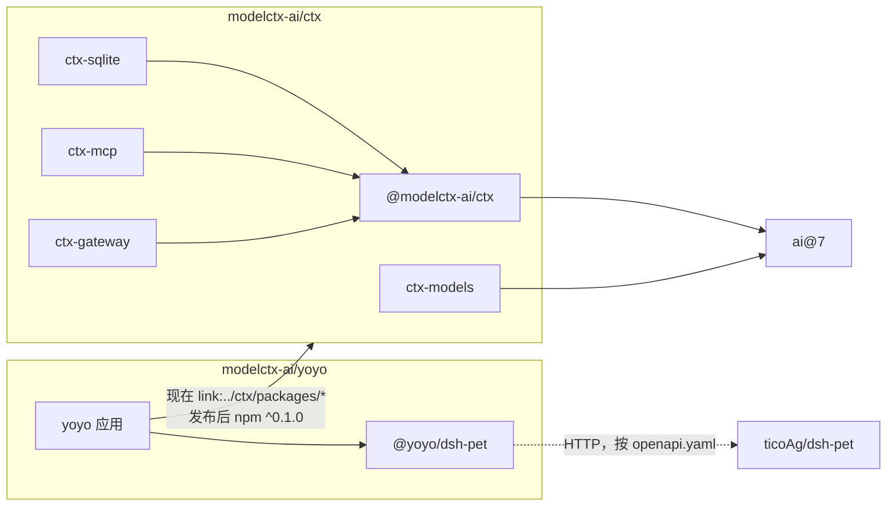
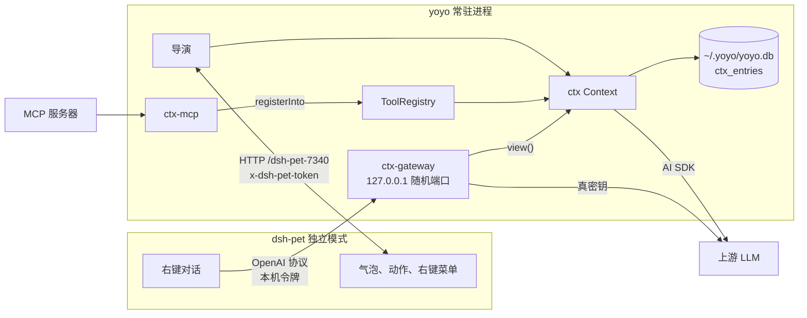

# 三个仓库

## 职责

| 仓库                                                                                | 是什么                                                           | 负责                                                                                                                    | 不碰                                 |
| ----------------------------------------------------------------------------------- | ---------------------------------------------------------------- | ----------------------------------------------------------------------------------------------------------------------- | ------------------------------------ |
| [modelctx-ai/ctx](https://github.com/modelctx-ai/ctx)（本仓库）                     | 上下文管理的核心框架和服务组件                                   | 上下文日志和存储、投影、上下文来源、工具注册、MCP 接入、按配置建模型、OpenAI 兼容网关                                   | 桌宠、人设、语音，任何具体应用的东西 |
| [modelctx-ai/yoyo](https://github.com/modelctx-ai/yoyo)                             | 个人桌宠的“导演”：a personal ai, powered by ctx-engine & dsh-pet | 人设、台词和语气、语音（Fish Audio 合成、whisper.cpp 听写）、闹钟、天气、表情包、联系人、粘贴板；决定说什么、什么时候说 | 画面和动画；上下文机制本身           |
| [ticoAg/dsh-pet](https://github.com/ticoAg/dsh-pet)（fork 自 PC2005-cloud/dsh-pet） | 桌宠本体：DSH 插件，也能以 Electron 独立模式运行                 | 显示气泡、播放动作、右键菜单、自己的对话框和对话记忆                                                                    | 我们不改它，只用它的公开契约         |

## 产物

| 仓库    | 产物                                                                                                              | 去向                                                                                                                                                         | 现状                                                                                               |
| ------- | ----------------------------------------------------------------------------------------------------------------- | ------------------------------------------------------------------------------------------------------------------------------------------------------------ | -------------------------------------------------------------------------------------------------- |
| ctx     | 5 个 npm 包：`@modelctx-ai/ctx`、`ctx-sqlite`、`ctx-models`、`ctx-mcp`、`ctx-gateway`                             | npmjs 的 `@modelctx-ai` 作用域；和同组织的 `@modelctx-ai/via` 一样，由 GitHub Actions 经 OIDC trusted publishing 发布（见 [ADR 0002](adr/0002-packages.md)） | 0.1.0，未发布                                                                                      |
| yoyo    | 应用本身：`bin/yoyo.js` 命令行、`src/main.ts` 常驻进程；内部包 `@yoyo/dsh-pet`（dsh-pet HTTP 接口的类型化客户端） | 不发布，从仓库直接运行 `.ts`（Node ≥22.18，不构建）                                                                                                          | TypeScript pnpm workspace，重构见 [modelctx-ai/yoyo#1](https://github.com/modelctx-ai/yoyo/pull/1) |
| dsh-pet | DSH 插件包 `dsh-pet`、独立模式命令 `dsh-pet-standalone`                                                           | 上游维护                                                                                                                                                     | 只读                                                                                               |

## 契约

| 边界           | 契约                                                                                                                                                                                 |
| -------------- | ------------------------------------------------------------------------------------------------------------------------------------------------------------------------------------ |
| yoyo → ctx     | 5 个包的公开 API（`dist/*.d.ts`），版本范围 `^0.1.0`                                                                                                                                 |
| yoyo → dsh-pet | `openapi.yaml` 描述的 HTTP 接口，前缀 `/dsh-pet-7340`：`/state`（长轮询）、`/lock` 和 `/lock/release`、`/broadcast`、`/anim`、`/chat`（对话记忆）、`/menu/item` 和 `/menu/events` 等 |
| yoyo → dsh-pet | 独立模式的运行状态文件 `~/.dsh/dsh-pet/standalone-runtime.json`：端口和本机令牌，写接口带请求头 `x-dsh-pet-token`                                                                    |
| yoyo → dsh-pet | `POST /standalone-ai/settings`：把桌宠右键对话的模型地址指向 yoyo 里的 ctx-gateway，密钥填一次性的本机令牌                                                                           |
| dsh-pet → yoyo | OpenAI Chat Completions：`POST /v1/chat/completions`，SSE 流式                                                                                                                       |
| yoyo → LLM     | 导演经 ctx 和 AI SDK 调模型；网关原样转发到 OpenAI 兼容的上游                                                                                                                        |

## 依赖和使用



箭头指向被依赖的一方；虚线是运行时的 HTTP 调用，没有代码依赖。

| 阶段   | yoyo 怎么拿到 ctx                                                                                                                                                        |
| ------ | ------------------------------------------------------------------------------------------------------------------------------------------------------------------------ |
| 现在   | ctx 克隆在 yoyo 旁边，先在 ctx 里 `pnpm install && pnpm build`；yoyo 的 `pnpm-workspace.yaml` 用 `overrides` 把 5 个包指到 `link:../ctx/packages/<name>`，读的是 `dist/` |
| 发布后 | 删掉 `overrides`，`package.json` 里的 `^0.1.0` 从 npm 解析                                                                                                               |

## 运行时拓扑



右键对话这条路：

1. yoyo 启动对话渠道：ctx-gateway 监听本机随机端口，上游是配置里的 `llm.baseUrl`，改写用 `withContext(context)`；生成一次性的本机令牌。
2. yoyo 调 `POST /standalone-ai/settings`，把桌宠对话的地址设成网关、密钥设成本机令牌。真密钥只留在 yoyo 进程里。
3. 用户在右键对话里说一句，桌宠带着它自己截断过的历史请求网关；网关保留桌宠的系统提示，把历史换成 ctx 的完整上下文，带上这一句，转发给上游，SSE 原样转回。
4. 桌宠把问答写进自己的对话记忆。yoyo 每拍读一次 `GET /chat`，按幂等键 `pet:<ts>:<role>:<text>` 并进 ctx，重复的跳过。

上游不是 OpenAI 兼容（`llm.provider` 不是 `openai-compatible`）时不开对话渠道，只记一行日志。

## yoyo 怎么用 ctx

| 方面     | 做法                                                                                                                      |
| -------- | ------------------------------------------------------------------------------------------------------------------------- |
| 存储     | `createSqliteStore({ database, prefix: 'ctx_' })`，和 yoyo 自己的表一起放在 `~/.yoyo/yoyo.db`                             |
| 线程     | `pet:<petId>`                                                                                                             |
| 投影     | `whisper` 事件 `fold`，渲染成一条助手消息「碎碎念：\n…」；用户话和回复原样保存，不截断；没配 `context.maxTokens` 就不裁剪 |
| 来源     | 当前任务、粘贴板                                                                                                          |
| 生成     | 碎碎念和回复都用 `record: false`：语音合成、投喂给桌宠之后，导演再把说出口的那句写进上下文                                |
| 桌宠对话 | 每拍按幂等键导入 `GET /chat` 的对话记忆                                                                                   |
| 工具     | yoyo 的本地工具，加上 `mcpServers` 配置里的 MCP 服务器（ctx-mcp）                                                         |
| 压缩     | 配了 `context.compactAt` 时，每 10 分钟最多压缩一次                                                                       |
| 模型     | ctx-models 的 `createModel()`，协议名和 dsh-pet 独立模式一致：`openai-compatible`、`anthropic`                            |

## yoyo 的分层

右边的层依赖左边的层，不许反过来：`kernel` ← `ports` ← `features` / `brain` / `adapters` ← `runtime` ← `cli` / `app/container` ← 入口。

| 层       | 目录                              | 内容                                                            |
| -------- | --------------------------------- | --------------------------------------------------------------- |
| kernel   | `src/kernel`                      | 纯领域：语气、时间、节奏、台词                                  |
| ports    | `src/ports`                       | 接口：`PetHost`、`Synthesizer`、`Transcriber`、`Repos` 等       |
| features | `src/features`                    | 预制台词、天气、日程、表情包、联系人、粘贴板、听写规则          |
| brain    | `src/brain`                       | ctx 接线：上下文、来源、提示词、生成、模型、工具、MCP、对话渠道 |
| adapters | `src/adapters/*`、`src/storage`   | dsh-pet、控制台、语音、平台、搜索、存储                         |
| runtime  | `src/runtime`                     | 导演、常驻循环、收件箱                                          |
| cli、app | `src/cli`、`src/app/container.ts` | 命令表、组装根                                                  |
| 入口     | `bin/yoyo.js`、`src/main.ts`      | 命令行、常驻进程                                                |

`features` 和 `brain` 只依赖端口，不依赖 `adapters`；`adapters` 不依赖 `features`、`brain`、`runtime`；`packages/dsh-pet` 不依赖 yoyo 的任何东西。

## 本地联调

```
<workspace>/
├── ctx/        modelctx-ai/ctx
├── yoyo/       modelctx-ai/yoyo
└── dsh-pet/    ticoAg/dsh-pet
```

```sh
(cd ctx && pnpm install && pnpm build)
(cd yoyo && pnpm install)        # overrides 链接 ../ctx/packages/*

# 另开一个终端：dsh-pet 独立模式（先按它的 README 装好依赖）
cd dsh-pet/dsh-pet && npm run build && npm run standalone

# 回到第一个终端：先按 yoyo 的 README 准备 config.json
cd yoyo && pnpm start
```

改了 ctx 以后在 ctx 里重新 `pnpm build`，yoyo 下次启动就用上。
