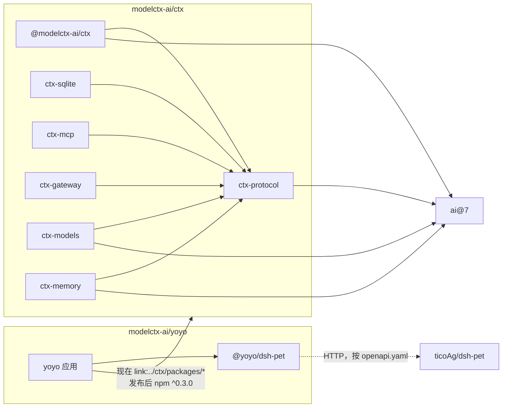
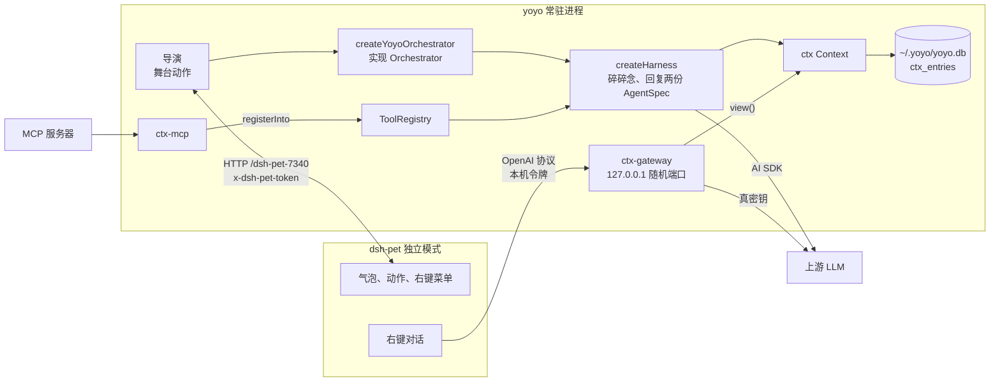

# 实践：yoyo 和三个仓库

ctx 是框架，yoyo 是用它做出来的第一个程序：一个常驻的桌宠导演。yoyo 的存在是为了检验协议够不够用、参考实现好不好组合；ctx 里不出现任何桌宠的东西。

这一篇只写三个仓库之间的事：各管什么、产物、边界上的契约、依赖和运行时拓扑、本地联调。yoyo 内部怎么分层、八个 ctx 组件在 yoyo 里各是什么、yoyo 怎么用 ctx，都写在 yoyo 仓库的[架构](https://github.com/modelctx-ai/yoyo/blob/main/docs/tech/architecture.md)（「分层」「和 ctx 组件的对应」「怎么用 ctx」三节）和[记忆](https://github.com/modelctx-ai/yoyo/blob/main/docs/tech/memory.md)里，这里不另抄一份。

## 职责

| 仓库                                                                                | 是什么                                                    | 负责                                                                                                                                                                                                | 不碰                                                                       |
| ----------------------------------------------------------------------------------- | --------------------------------------------------------- | --------------------------------------------------------------------------------------------------------------------------------------------------------------------------------------------------- | -------------------------------------------------------------------------- |
| [modelctx-ai/ctx](https://github.com/modelctx-ai/ctx)（本仓库）                     | 面向 agent 原生程序的上下文与运行框架：协议和参考实现     | 会话日志和存储、上下文组装、工具目录、执行环境、harness、编排、MCP 接入、按配置建模型、远程传输、OpenAI 兼容网关；记忆的协议、操作（门控、召回、巩固、遗忘）、System One 模型的协议和按配置实例化   | 桌宠、人设、语音，任何具体应用的东西；记什么主题、什么值得记、什么时候整理 |
| [modelctx-ai/yoyo](https://github.com/modelctx-ai/yoyo)                             | 个人桌宠的“导演”：a personal ai, powered by ctx & dsh-pet | 人设、台词和语气、语音（Fish Audio 合成、whisper.cpp 听写）、闹钟、天气、表情包、联系人、粘贴板；决定说什么、什么时候说；记忆的主题表、哪些条目进门控、画像的预算、夜里什么时候整理、主人怎么看和删 | 画面和动画；上下文机制本身；记忆的存储和判断机制                           |
| [ticoAg/dsh-pet](https://github.com/ticoAg/dsh-pet)（fork 自 PC2005-cloud/dsh-pet） | 桌宠本体：DSH 插件，也能以 Electron 独立模式运行          | 显示气泡、播放动作、右键菜单、自己的对话框和对话记忆                                                                                                                                                | 我们不改它，只用它的公开契约                                               |

## 产物

| 仓库    | 产物                                                                                                                                          | 去向                                                                                                                                                         | 现状                                                                                                                                                                                   |
| ------- | --------------------------------------------------------------------------------------------------------------------------------------------- | ------------------------------------------------------------------------------------------------------------------------------------------------------------ | -------------------------------------------------------------------------------------------------------------------------------------------------------------------------------------- |
| ctx     | 9 个 npm 包：`@modelctx-ai/ctx`、`ctx-protocol`、`ctx-sqlite`、`ctx-models`、`ctx-memory`、`ctx-mcp`、`ctx-gateway`、`ctx-exec`、`ctx-remote` | npmjs 的 `@modelctx-ai` 作用域；和同组织的 `@modelctx-ai/via` 一样，由 GitHub Actions 经 OIDC trusted publishing 发布（见 [ADR 0002](adr/0002-packages.md)） | 0.3.0，未发布                                                                                                                                                                          |
| yoyo    | 应用本身：`bin/yoyo.js` 命令行、`src/main.ts` 常驻进程；内部包 `@yoyo/dsh-pet`（dsh-pet HTTP 接口的类型化客户端）                             | 不发布，从仓库直接运行 `.ts`（Node ≥22.18，不构建）                                                                                                          | TypeScript pnpm workspace，重构见 [modelctx-ai/yoyo#1](https://github.com/modelctx-ai/yoyo/pull/1)，跟到 ctx 0.3 见 [modelctx-ai/yoyo#11](https://github.com/modelctx-ai/yoyo/pull/11) |
| dsh-pet | DSH 插件包 `dsh-pet`、独立模式命令 `dsh-pet-standalone`                                                                                       | 上游维护                                                                                                                                                     | 只读                                                                                                                                                                                   |

## 契约

| 边界           | 契约                                                                                                                                                                                        |
| -------------- | ------------------------------------------------------------------------------------------------------------------------------------------------------------------------------------------- |
| yoyo → ctx     | 7 个包的公开 API（`dist/*.d.ts`）：`@modelctx-ai/ctx`、`ctx-protocol`、`ctx-sqlite`、`ctx-mcp`、`ctx-gateway`、`ctx-models`、`ctx-memory`，版本范围 `^0.3.0`；`ctx-exec`、`ctx-remote` 不用 |
| yoyo → ctx     | `~/.yoyo/yoyo.db` 里 `ctx_` 前缀的表（`ctx-sqlite` 会话存储，结构版本 3）和 `memory_` 前缀的表（记忆存储，结构版本 1）；常驻进程和命令行共用这个库，要用同一个 ctx 版本，不支持滚动升级     |
| yoyo → dsh-pet | `openapi.yaml` 描述的 HTTP 接口，前缀 `/dsh-pet-7340`：`/state`（长轮询）、`/lock` 和 `/lock/release`、`/broadcast`、`/anim`、`/chat`（对话记忆）、`/menu/item` 和 `/menu/events` 等        |
| yoyo → dsh-pet | 独立模式的运行状态文件 `~/.dsh/dsh-pet/standalone-runtime.json`：端口和本机令牌，写接口带请求头 `x-dsh-pet-token`                                                                           |
| yoyo → dsh-pet | `POST /standalone-ai/settings`：把桌宠右键对话的模型地址指向 yoyo 里的 ctx-gateway，密钥填一次性的本机令牌                                                                                  |
| dsh-pet → yoyo | OpenAI Chat Completions：`POST /v1/chat/completions`，SSE 流式                                                                                                                              |
| yoyo → LLM     | 导演经 ctx 和 AI SDK 调模型；网关原样转发到 OpenAI 兼容的上游                                                                                                                               |

## 依赖和使用



箭头指向被依赖的一方；虚线是运行时的 HTTP 调用，没有代码依赖。实现包之间不互相依赖，都只依赖协议包（ctx-models、ctx-memory 另把 `ai` 当 peer）；`ctx-exec`、`ctx-remote` yoyo 不用，图里没画。

| 阶段   | yoyo 怎么拿到 ctx                                                                                                                                                              |
| ------ | ------------------------------------------------------------------------------------------------------------------------------------------------------------------------------ |
| 现在   | ctx 克隆在 yoyo 旁边，先在 ctx 里 `pnpm install && pnpm build`；yoyo 的 `pnpm-workspace.yaml` 用 `overrides` 把用到的 7 个包指到 `link:../ctx/packages/<name>`，读的是 `dist/` |
| 发布后 | 删掉 `overrides`，`package.json` 里的 `^0.3.0` 从 npm 解析                                                                                                                     |

## 运行时拓扑



右键对话这条路：

1. yoyo 启动对话渠道：ctx-gateway 监听本机随机端口，上游是配置里的 `llm.baseUrl`，改写用 `withContext(context)`；生成一次性的本机令牌。
2. yoyo 调 `POST /standalone-ai/settings`，把桌宠对话的地址设成网关、密钥设成本机令牌。真密钥只留在 yoyo 进程里。
3. 用户在右键对话里说一句，桌宠带着它自己截断过的历史请求网关；网关保留桌宠的系统提示，把历史换成 ctx 的完整上下文，带上这一句，转发给上游，SSE 原样转回。
4. 桌宠把问答写进自己的对话记忆。yoyo 每拍读一次 `GET /chat`，按幂等键 `pet:<ts>:<role>:<text>` 并进 ctx，重复的跳过。

上游不是 OpenAI 兼容（`llm.provider` 不是 `openai-compatible`）时不开对话渠道，只记一行日志。

## 本地联调

```
<workspace>/
├── ctx/        modelctx-ai/ctx
├── yoyo/       modelctx-ai/yoyo
└── dsh-pet/    ticoAg/dsh-pet
```

```sh
(cd ctx && pnpm install && pnpm build)
(cd yoyo && pnpm install)        # overrides 链接 ../ctx/packages/*

# 另开一个终端：dsh-pet 独立模式（先按它的 README 装好依赖）
cd dsh-pet/dsh-pet && npm run build && npm run standalone

# 回到第一个终端：先按 yoyo 的 README 准备 config.json
cd yoyo && pnpm start
```

改了 ctx 以后在 ctx 里重新 `pnpm build`，yoyo 下次启动就用上。
